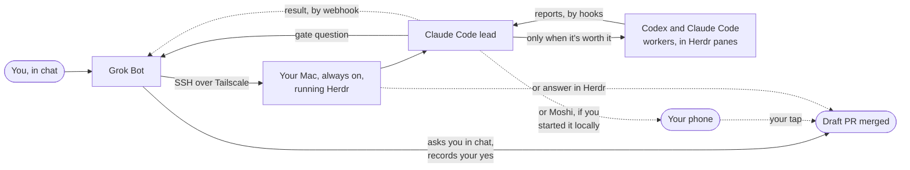

<h1 align="center">stampede</h1>

**You text a task to your Grok Bot. It reaches your Mac over Tailscale, where a Claude Code lead does the job in [Herdr](https://herdr.dev) and adds Codex or Cursor panes only when parallel work helps. Nothing is merged, pushed, sent or spent until you say yes.**

Grok Bot is the setup we recommend, but you don't need it: stampede also runs when you start it straight from Claude, Codex or any agent ([Without a bot](#without-a-bot)). Either way you can watch every agent in Herdr, and every question comes back to you.

**Let a Grok Bot set it up.** [Stompy](https://x.ai/bot/_mNMq-0M5aA02AQMNOHTy) is a Grok Bot that sets up stampede between your Grok Bot and your Mac, end to end, and keeps it healthy.

<p align="center">
  <a href="https://github.com/vib-z/stampede/actions/workflows/ci.yml"></a>
  <a href="CHANGELOG.md"></a>
  <a href="LICENSE"></a>
  <a href="https://github.com/vib-z/stampede/stargazers"></a>
  <a href="https://herdr.dev"></a>
  
</p>

<p align="center">
  
</p>

<p align="center"><sub>An animated mock-up of one job, 27 Oct 2026.</sub></p>

<p align="center">
  <a href="#install">Install</a> ·
  <a href="#updating">Updating</a> ·
  <a href="#how-it-works">How it works</a> ·
  <a href="#use-one-job-start-to-finish">Walkthrough</a> ·
  <a href="#front-doors">Front doors</a> ·
  <a href="#safety">Safety</a> ·
  <a href="#reference">Reference</a> ·
  <a href="#docs">Docs</a> ·
  <a href="CHANGELOG.md">Changelog</a>
</p>

<p align="center">New releases: on <a href="https://github.com/vib-z/stampede">GitHub</a>, <b>Watch</b>, then <b>Custom</b>, then <b>Releases</b>.<br>
  The site: <a href="https://vib-z.github.io/stampede/">vib-z.github.io/stampede</a></p>

---

## How it flows

Started from Grok Bot, the setup we recommend:



## Without a bot

stampede works fully on its own with Herdr, Claude Code and this repo: start a job straight from Claude, Codex, Cursor or any agent, or from a Claude pane in Herdr ([Front doors](#front-doors)). Gate questions then reach your phone through Moshi, if you use it, or you answer in Herdr.

Either way:
- **One ask, one lead.** A Claude Code lead plans the job and does it.
- **Workers only when it's worth it.** The lead opens a Codex or Claude Code worker in its own Herdr pane for parallel work, another model or a reviewer, and works alone otherwise.
- **Hooks, not polling.** Workers report to the lead through hooks, and you can watch every pane in Herdr.
- **Your yes on every merge, push, send, spend or close.** The gate question goes back to whoever started the job, and a yes typed in Herdr always works. The lead keeps working while it waits.

## Quick start

On a Mac with [Herdr](https://herdr.dev/docs/install/) 0.9.4 or later, Claude Code signed in, Python 3.9 or later, git, jq and curl:

```bash
git clone https://github.com/vib-z/stampede.git ~/stampede
~/stampede/install.sh
export PATH="$HOME/.local/bin:$PATH"   # add this line to your shell profile too
herdr-doctor                           # exit 0, with Herdr running
```

**Your first ask.** Once per Mac, run the [unattended setup](skills/herdr-fleet/references/unattended-setup.md), so the lead can start workers with no visit to their panes. Run `herdr-trust ~/code/my-app` once for your repo, open it in Herdr, start Claude in a pane, and type:

> With stampede: add a /health endpoint with a test, have a reviewer on another model check it, then open a draft PR.

**Then from your phone (recommended).** Set up Grok Bot's SSH, Tailscale and webhook once ([remote/grokbot/](remote/grokbot/README.md)), and send the same ask in chat.

**Limits.**
- macOS only. No Linux run has been tried.
- The lead is Claude (any Claude model, set by `FLEET_LEAD_MODEL`). Workers can be Claude, Codex or Cursor.
- Version 0.1.x, and early: commands and files may still change.
- For big jobs. A small job runs as one agent session in a single tagged Herdr pane ([FAQ](#troubleshoot)).

The full install, with every prerequisite: [Install](#install). A whole job, command by command: [the walkthrough](#use-one-job-start-to-finish).

## What is stampede?

stampede is multi-agent orchestration for Claude Code and Codex in Herdr: four skills and one command, installed by script or as a Herdr plugin. You ask once, in plain words: in a Claude pane in Herdr, from Claude or Codex desktop or Cursor, or, as we recommend, from your phone through Grok Bot. stampede starts **one lead agent** for the job. The lead writes a short plan and starts working at once. It brings in Codex workers, or Claude Code or Cursor ones, each in its own Herdr pane, only when that agent earns its place: work that runs in parallel, a different model, one reviewer, or the same task many times over. Workers report through hooks, so nobody polls. Gate questions come back to wherever you asked, and nothing that matters happens without your own yes.

**Why.** Running many agents by hand means stops between steps, too many small agents, rounds that wait on each other, and a lead that spends its day writing briefs. Real jobs showed all four ([docs/RUNS.md](docs/RUNS.md)). stampede is the lean answer: plan and go, work alone by default, wake on hooks, and ask you only what is yours to decide.

**Who it is for.** Anyone who runs Claude Code, Codex or Cursor and wants a whole job done from one ask, watched in Herdr and answered from a phone.

**What it is.** Four skills and one command:

| part | what it does |
|---|---|
| [`stampede`](skills/stampede/SKILL.md) (skill) | the front door: say "use stampede" in any project chat and it writes the ask, opens a Herdr workspace for the project and starts the lead |
| [`herdr-fleet`](skills/herdr-fleet/SKILL.md) | the playbook the lead follows: plan, panes, hooks, review, gates, report, reopen |
| [`grokbot-herdr`](skills/grokbot-herdr/SKILL.md) | the front door for a bot that reaches your machine over SSH |
| [`share-plan`](skills/share-plan/SKILL.md) | shows you the plan before any agent starts, only when you ask |
| [`stampede`](scripts/stampede) (command) | the command: `new`, `start`, `tell`, `ask`, `cancel`, `approve` |

## Works with

**Agents.** The lead runs on Claude Code. Workers run on Claude Code, Codex or Cursor, each started by `stampede start --kind claude|codex|cursor` with its own hooks and auto mode.

<table>
  <tr>
    <td align="center" width="150">
      <br>
      <b>Claude Code</b><br><sub>the lead, and workers</sub>
    </td>
    <td align="center" width="150">
      <picture>
        <source media="(prefers-color-scheme: dark)" srcset="docs/images/logos/codex-dark.svg">
        
      </picture><br>
      <b>Codex</b><br><sub>workers and reviewers</sub>
    </td>
    <td align="center" width="150">
      <picture>
        <source media="(prefers-color-scheme: dark)" srcset="docs/images/logos/cursor-dark.svg">
        
      </picture><br>
      <b>Cursor</b><br><sub>workers</sub>
    </td>
  </tr>
</table>

**Tools.**

<table>
  <tr>
    <td align="center" width="150">
      <picture>
        <source media="(prefers-color-scheme: dark)" srcset="docs/images/logos/herdr-dark.svg">
        
      </picture><br>
      <b>Herdr</b><br><sub>the panes you watch</sub>
    </td>
    <td align="center" width="150">
      <br>
      <b>Moshi</b><br><sub>questions on your phone</sub>
    </td>
    <td align="center" width="150">
      <picture>
        <source media="(prefers-color-scheme: dark)" srcset="docs/images/logos/grokbot-dark.svg">
        
      </picture><br>
      <b>Grok Bot</b><br><sub>the preferred bot</sub>
    </td>
    <td align="center" width="150">
      <picture>
        <source media="(prefers-color-scheme: dark)" srcset="docs/images/logos/tailscale-dark.svg">
        
      </picture><br>
      <b>Tailscale</b><br><sub>a bot's private link</sub>
    </td>
  </tr>
</table>

Herdr itself detects many more agent CLIs (its `herdr agent start --help` lists 24, from Gemini and Kimi to OpenCode and Copilot). That is Herdr's support, not stampede's yet: `stampede start` refuses any other kind, and starting workers on them is [planned](#status-and-roadmap). The marks belong to their owners and imply no endorsement ([sources](docs/images/logos/SOURCES.md)).

## Works well with

**[pstack](https://github.com/michael-denyer/pstack-claude), optional.** For coding jobs, the lead picks up pstack if you have it: data shape first, a contract commit, proof on the real surface. The lead is a normal Claude Code session, so an installed pstack loads on its own, and stampede's rules keep pstack's fan-out as Herdr panes you can watch. Not required: without it nothing changes. The rules: [references/pstack.md](skills/herdr-fleet/references/pstack.md).

## See it


<sub>Real, drawn: the <code>build</code> tab of the fleet that built stampede's first version, drawn from each pane's own screen text (<code>herdr agent read</code>), personal paths replaced with <code>~</code>, 18 Oct 2026. A lean job opens fewer panes; each looks the same.</sub>

## How it works

The flow is the [diagram at the top](#how-it-flows), step by step, for any front door:

1. **You ask once**, in plain words, in a [front door](#front-doors). It writes the ask to a file, runs `stampede new --file <ask.md>`, tells you the lead's name, and steps back.
2. **One lead plans and goes.** `lead-<slug>` starts on Claude (Opus 5.5 at `xhigh` effort by default) in auto mode, in a `lead` tab. It writes `plan.md` (the tasks, who does each, questions with a safe default, and the gates) and starts work.
3. **A pane only when it's worth it:** parallel pieces of about 30 minutes or more (at most 4), another model or tool, one reviewer on another model, or the same task many times (6 at once). Each worker gets its own Herdr pane.
4. **Hooks, not polling.** A worker's report, turn end, question or exit lands as a line in `<job>/inbox.log` (`REPORT`, `TURN`, `QUESTION`, `GONE`, and `UNDELIVERED` for a question or gate its bot has not heard), and Claude's file hook wakes the lead.
5. **Review only what ships**, on another model, at most two rounds.
6. **Questions and gates go back to whoever started the job**: a bot gets a `question` or `gate` event, asks you in chat and passes your answer back (a gate's yes recorded with `approve-gate`); a job you started locally asks on your phone through Moshi. A yes typed in the lead's pane always works. The lead keeps working while it waits, and an agent's own say-so never counts.
7. **The lead reports back once.** When the job is done or stopped for good it runs `stampede finish <job> "<summary>"`. That is the one done event a bot outside Herdr gets for the job. While the job is open, plain turn ends in its workspace stay on the machine. Blocked, permission prompts, StopFailure, a stale or dead pane, questions and gates still go out. Then the lead asks whether to close.
8. **Workers exit when their work is merged** or accepted. Nothing closes without your yes, and `reopen.sh` brings a closed job back.

**Stateful lead, stateless workers.** The lead holds your ask, the plan, the decisions and the judgement. A worker gets one brief and nothing else, so that brief carries the state: Goal, Why, Inputs, Constraints, Done when, Report back and If blocked, on the [hand-off template](skills/herdr-fleet/references/brief.md). A thin brief is the usual cause of weak worker output. `stampede start` refuses a worker brief with a missing or empty section before starting anything. Pick a strong planner for the lead and a fast, capable executor for workers; both are [settings](#configure), not code.

**What lives where.** Your Mac, always on, runs Herdr, the lead and the workers. A bot such as Grok Bot runs on its own computer and reaches the Mac over SSH and Tailscale. Or the whole thing runs on one remote computer. Either way, the lead and its workers share one machine; workers on a second machine are [planned](#status-and-roadmap).

<details>
<summary><b>The job folder</b></summary>

`stampede new` makes `~/code/herdr-jobs/jobs/<date>-<bot or local>-<slug>/` (`FLEET_JOBS_ROOT` moves the root), never inside your repo, so nothing lands in git; the repo stays the agents' working folder, and every agent gets `--add-dir <job>` to write there:

```text
ask.md        your ask, word for word
workdir       the repo the agents work in
lead          the lead's name
plan.md       the lead's plan
briefs/       the generated lead brief, then worker briefs on the hand-off template
hooks/        each agent's hook settings and wake state
inbox.log     REPORT, TURN, QUESTION, GONE and UNDELIVERED lines that wake the lead
inbox/        messages to each agent, one file per agent
questions/    a worker's questions, as files for the lead
asks/         questions out to your phone, while they wait
owner         the bot that started the job, when one did: its gates go back to it
workspace     the Herdr workspace id; while the job is open, ~/.config/herdr-events/jobs/<id> names this job
finished      the one-line summary written by stampede finish
gates/        each gate asked (action, PR, commit) and your recorded yes
agents.tsv    who was started, and how: the reopen record
approved      the plan's fingerprint, for a --review job
front-door    present when a chat outside Herdr relays for you (new --front-door)
outbox/       what the lead posts for that chat to relay: NNN.md and NNN/ files
outbox.log    one line per post, read by stampede wait
REOPEN.md, reopen.sh   written by herdr-reopen-snapshot before a close
```
</details>

## Install

**Prerequisites** (tested on macOS 27.2, 21 Oct 2026):

| tool | version tested | needed for |
|---|---|---|
| [Herdr](https://herdr.dev/docs/install/) | 0.9.4 (the plugin needs 0.9.4 or later) | the panes |
| [Claude Code](https://code.claude.com/docs/en/setup) | 2.1.306 | the lead, and workers |
| [Codex CLI](https://developers.openai.com/codex/cli) | 0.163.0 | workers, optional |
| [Cursor Agent](https://cursor.com/docs/cli/installation) | 2026.10.19 | workers, optional |
| Python 3, git, jq, curl | Python 3.9 (the tests need 3.11), git 2.56, jq 1.7 | the scripts |
| [Moshi](https://getmoshi.app/docs/herdr) `moshi-hook` | 0.4.33 | questions on your phone, optional |
| [Tailscale](https://tailscale.com/kb/1017/install) | 1.104.1 | a bot on another computer, optional |

**Step by step**, on a Mac with Herdr, Claude Code (signed in), Python 3 and git:

```bash
git clone https://github.com/vib-z/stampede.git ~/stampede
cd ~/stampede
./install.sh --dry-run               # prints each link it would make, changes nothing
./install.sh                         # links the skills and the commands
export PATH="$HOME/.local/bin:$PATH" # add this line to your shell profile too
stampede --version                   # 0.1.5
herdr-trust ~/code/my-app            # once per repo, before agents start there
```

**Or as a Herdr plugin**, where Herdr keeps the checkout and runs the same `install.sh`, plus the event hook:

```bash
herdr plugin install vib-z/stampede  # shows a preview and asks y/N; add --yes over SSH or from a bot
export PATH="$HOME/.local/bin:$PATH" # add this line to your shell profile too
herdr-doctor                         # Herdr hides the installer's output; exit 0 on a clean install, with Herdr running
herdr-trust ~/code/my-app            # once per repo, before agents start there
```

Then open your repo in Herdr, start Claude in a pane, and ask: *"With stampede: ..."*. The [walkthrough](#use-one-job-start-to-finish) shows a whole job.

`install.sh` links the four skills into `~/.claude/skills/` and `~/.codex/skills/` (each only when `~/.claude` or `~/.codex` exists), and links `stampede`, `fleet-job` and the `herdr-*` helpers into `~/.local/bin`. It is safe to re-run (`ok` for a link already in place) and never replaces anything already there (`skip ... left as is`), except, in a Herdr plugin install, its own link to the same file in an older checkout of that same install, which it moves to the new one (`relinked`). A clone relinks nothing. `herdr-trust` marks a repo trusted for Claude, and for Codex when `~/.codex` exists, so agents start without the folder-trust dialog; it refuses a repo outside `FLEET_TRUST_ROOT` (default `~/code`), so keep your repos there or set the key.

**Then, once:** the settings that let agents start and run without a visit to their pane, which you run yourself: [unattended-setup.md](skills/herdr-fleet/references/unattended-setup.md). A remote bot also needs the event relay. Both: [docs/SETUP.md](docs/SETUP.md). To uninstall: [docs/SETUP.md, Uninstall](docs/SETUP.md#uninstall).

**Linux:** the lead, `stampede` and `herdr-trust` use only Python and git, but the event relay scripts use macOS tools (`launchd`, BSD `stat`, `md5`), and no Linux run has been tried.

## Updating

Once a day stampede tells you when a newer release is out; it never updates anything by itself. Then you update:

| installed with | update with |
|---|---|
| a clone and `./install.sh` | `stampede update` |
| `herdr plugin install vib-z/stampede` | `herdr plugin update stampede` (add `--yes` from a bot, a script or SSH) |

**The daily check.** At most once a day, `stampede --version`, `stampede update --check` and `herdr-doctor` ask GitHub for the latest release: one request without a token, given 3 s in all (DNS, connect and the reply), the answer cached for 24 h in `${XDG_CACHE_HOME:-~/.cache}/stampede/`. When a newer release is out they print one line:

```text
$ stampede --version
0.1.0
stampede 0.2.0 is out, this is 0.1.0: run stampede update
```

In a plugin install the line ends `run herdr plugin update stampede --yes`. `stampede --version` puts that line on stderr, after the version, and still exits 0; `herdr-doctor` prints it as a `warn` line, never a `PROBLEM`. Offline, rate-limited, a malformed reply or any other failure prints nothing and is cached too, so the next try is a day later. Turn the check off with `export STAMPEDE_NO_UPDATE_CHECK=1` in your shell profile or `~/.config/stampede/config` ([Configure](#configure)). To hear of a release on GitHub instead: on the repo page, **Watch**, then **Custom**, then **Releases**. How a release is cut: [RELEASING.md](RELEASING.md).

**`stampede update`** is the guided updater: it updates only a clean checkout on `main`, and never overwrites a file of yours. It runs `git fetch`, fast-forwards with `git merge --ff-only`, reruns `./install.sh` (which links any new skill or command), and ends with `stampede 0.1.0 -> 0.2.0`. It refuses with the reason, and changes no file, when the checkout has local changes or untracked files, is on another branch, or holds an ignored file at a path the update adds, which git would overwrite (`refused: the update adds local-settings.txt, already in <checkout> (ignored by git, so it would be overwritten): move it away, then rerun`). In a Herdr plugin install it changes nothing and prints `herdr plugin update stampede --yes` to run instead, though Herdr's checkout holds a `.git`.

**A plugin update moves the links.** Herdr gives each plugin install or update a new checkout folder and deletes the old one the next time its server starts. The installer it runs moves each stampede link that points at the same file in an older checkout of that same install to the new one, and leaves any other link alone (another plugin's, a backup's, one of yours); `herdr-doctor` reports a `PROBLEM` if `stampede` or a skill still resolves outside the checkout Herdr reports.

**From 0.1.0, once.** 0.1.0 has no `stampede update` (`invalid choice: 'update'`). Move the old clone aside, clone again to the same path and rerun the installer; the links keep their paths, so they work at once:

```bash
mv ~/stampede ~/stampede-0.1.0
git clone https://github.com/vib-z/stampede.git ~/stampede
~/stampede/install.sh
```

Keep anything of yours from `~/stampede-0.1.0`, then delete it. From then on, `stampede update`. A plugin install pinned with `--ref v0.1.0` stays pinned under `herdr plugin update`: `herdr plugin install vib-z/stampede --yes` drops the pin, and its installer moves the links.

## Use: one job, start to finish

In a Herdr pane in your repo, ask your Claude chat: *"With stampede: make hello.txt with hi, then have a reviewer on another model confirm it."* The chat (a front door) writes the ask and starts the lead:

```console
$ printf 'Make hello.txt with hi.\nThen have a reviewer on another model confirm it.\n' > ask.md
$ stampede new --file ask.md
recorded lead-make-hello-txt-with-hi (claude) in ~/code/herdr-jobs/jobs/2026-10-29-local-make-hello-txt-with-hi/agents.tsv
DELIVERED lead-make-hello-txt-with-hi (inbox file)
lead-make-hello-txt-with-hi ~/code/herdr-jobs/jobs/2026-10-29-local-make-hello-txt-with-hi
```

Inside Herdr, `--workspace` defaults to the current workspace and the lead gets a new `lead` tab; `--pane <id>` puts it in an empty pane instead, and `--name <slug>` names the job. A front door outside Herdr (a bot, a desktop app) has no current workspace, so it passes `--workspace` or `--pane`: it creates a workspace for the job (`herdr workspace create`) and passes its root pane, as in [skills/stampede](skills/stampede/SKILL.md). The chat tells you `lead-make-hello-txt-with-hi` and stops.

**Plan in chat, then fork it into the lead.** A Claude chat where you and Claude already worked out the plan, in Herdr or the Claude desktop app, adds `--fork "$CLAUDE_CODE_SESSION_ID"`: the lead starts as a fork of that chat (`claude --resume <id> --fork-session`), so it keeps the whole conversation and writes the agreed plan into `plan.md` instead of planning again. Your chat stays as it was. Put the agreed plan in the ask file too: it stays the source of truth, since a chat's saved transcript can miss some of its messages. The reopen record leaves the fork out, so `reopen.sh` resumes the lead's own session. Guide: [remote/claude-code.md](remote/claude-code.md#plan-here-then-fork-the-lead).

The lead reads `ask.md`, writes `plan.md` and goes on at once. Here it writes `briefs/review-hello.md` on the [hand-off template](skills/herdr-fleet/references/brief.md), then starts one reviewer on another model:

```console
$ J=~/code/herdr-jobs/jobs/2026-10-29-local-make-hello-txt-with-hi
$ stampede start $J review-hello --kind claude --pane <pane id> \
    --brief $J/briefs/review-hello.md \
    --model <another model> --effort max --report reports/review-hello.md
recorded review-hello (claude) in ~/code/herdr-jobs/jobs/2026-10-29-local-make-hello-txt-with-hi/agents.tsv
DELIVERED review-hello (inbox file)
```

When the reviewer writes `reports/review-hello.md` with `Status: PASS` in its first 10 lines and ends its turn, its hook adds `REPORT reports/review-hello.md` to `inbox.log`, which wakes the lead. A question for you, with the lead still working:

```console
$ stampede ask $J "Keep the file in the repo root?" \
    --option Yes --option No
ASKED 1fecfa0be4dc (the answer goes to the lead inbox; cancel with: fleet-job cancel <job> 1fecfa0be4dc)
```

Your tap comes back as `ANSWER ...` in the lead's inbox. A gate (say, merging the draft PR) goes back to whoever started the job ([Safety](#safety)); you started this one in Herdr, so it is the lead's own question card or `stampede ask --gate`, on your phone. Then the lead writes a short report and asks whether to close the workspace; `<job>/reopen.sh` brings it back later.

### Share the plan first

Say "share the plan first" and the front door adds `--review`. The lead then writes `plan.md` and ends its turn, and no pane can open until you approve that exact plan:

```console
$ stampede new --file ask.md --name hello-review --review
recorded lead-hello-review (claude) in ~/code/herdr-jobs/jobs/2026-10-29-local-hello-review/agents.tsv
DELIVERED lead-hello-review (inbox file)
lead-hello-review ~/code/herdr-jobs/jobs/2026-10-29-local-hello-review
$ J=~/code/herdr-jobs/jobs/2026-10-29-local-hello-review
$ stampede start $J review-hello --kind codex \
    --pane <pane id> --brief <brief>
fleet-job start: the owner asked to see this plan: run fleet-job approve after their yes, and again after any change to the plan
$ stampede approve $J --by "owner in chat"
DELIVERED lead-hello-review (inbox file)
$ cat $J/approved
Approved: 2026-10-21 21:35 by owner in chat, plan 6ef5e2effdb06d6adf70e17da8726c05dd2d057a4a7ba23c4fbe3836eed14ffa
```

The `start` refusal exits 2. The approval holds a fingerprint of `plan.md`; any later change locks `start` again until a new approve. A change you ask for goes to the lead with `stampede tell <job> lead "<your words>"`. The steps: [share-plan](skills/share-plan/SKILL.md).

### A front door outside Herdr (the Claude desktop app)

When you talk to a chat outside Herdr, nobody watches the lead's pane, and a card or file the lead shows there reaches no one. The front door then starts the job with `--front-door`: the lead posts everything that is for you (the plan, questions, gates, files, its report) to `<job>/outbox/`, a hook turns its own question cards and SendUserFile into posts, and the front door waits on the outbox in the background and relays each item. Here a review job, with the chat as front door:

```console
$ stampede new --file ask.md --pane <pane id> --name seller-copy --front-door --review
lead-seller-copy ~/code/herdr-jobs/jobs/2026-10-29-local-seller-copy
$ J=~/code/herdr-jobs/jobs/2026-10-29-local-seller-copy
$ stampede approve $J --by "owner in desktop chat: 'ok - lets go'"
fleet-job approve: the owner has not been shown this plan.md: the lead posts it (fleet-job post <job> "PLAN READY" --file plan.md), the front door sends it to the owner, and only their yes to it is approved
$ stampede post $J "PLAN READY: one Sonnet build, one review" --file $J/plan.md      # the lead
POSTED 001 for the front door to relay (~/code/herdr-jobs/jobs/2026-10-29-local-seller-copy/outbox/001.md)
$ stampede wait $J                                                                   # the front door, in the background
# 001 post

PLAN READY: one Sonnet build, one review

Files:
- ~/code/herdr-jobs/jobs/2026-10-29-local-seller-copy/outbox/001/plan.md
$ stampede approve $J --by "owner in desktop chat: 'approve as written'"
DELIVERED lead-seller-copy (inbox file)
$ stampede ask $J --gate --sha <commit> --pr 12 "mark PR #12 ready for review"        # the lead
GATE 83307febaa1a posted to the front door as outbox 002; act after fleet-job gate-ok ... prints APPROVED, or on the owner's yes typed in your pane
$ stampede approve-gate $J 83307febaa1a --sha <commit> --by "owner in desktop chat: 'mark it ready'"
APPROVED 83307febaa1a at <commit>
```

The front door shows you the plan file itself, and a yes to its own summary is never an approval. A gate's item carries the exact `approve-gate` line, which the front door runs with your words quoted. If the lead is held at a card anyway, `stampede wait` and `stampede tell` say `BLOCKED_ON_CARD` instead of pretending the message was read. The lead's `finish` posts a `done` item, and `stampede wait` says `LEAD_GONE` when Herdr no longer has the lead, so the front door is never left waiting on a job that ended. The front door's loop: [skills/stampede](skills/stampede/SKILL.md#relay-a---front-door-job); the lead's side: [front-door.md](skills/herdr-fleet/references/front-door.md).

## Front doors

Every front door writes the ask and runs `stampede new`; none plans or runs the job itself.

| front door | how you ask | where answers arrive | guide |
|---|---|---|---|
| a chat in Herdr | type the ask in a Claude pane | the lead's pane, plus a Moshi card | [walkthrough](#use-one-job-start-to-finish) |
| Claude desktop or the Claude app | Remote Control into a session on the machine | the lead's row in the Claude app, plus Moshi | [remote/claude-code.md](remote/claude-code.md) |
| Codex desktop or the ChatGPT app | Codex on the connected machine | Moshi | [remote/codex.md](remote/codex.md) |
| Cursor | a Cursor chat on the machine runs the same two commands | Moshi | [remote/other.md](remote/other.md) |
| **Grok Bot** (preferred bot) | the bot reaches your Mac over SSH and Tailscale | the Grok chat, woken by a webhook | [remote/grokbot/](remote/grokbot/README.md), [grokbot-herdr](skills/grokbot-herdr/SKILL.md) |
| any other bot | the same as Grok Bot | its webhook | [remote/other.md](remote/other.md) |
| a whole remote computer | Herdr, the CLIs and stampede on one box | any of the above | [remote/any-machine/](remote/any-machine/README.md) |

Moshi, the phone side of every front door: [remote/moshi.md](remote/moshi.md).

## Safety

- **Your own yes, every time:** a merge to main, a push to main or another shared branch, a deploy, publishing, sending email or messages, any spend, and closing panes, tabs or a workspace. Pushing the job's own work branch and opening a draft PR need no ask.
- **Gates go back to whoever started the job.** `stampede new` records the bot that started it (`HERDR_EVENTS_OWNER`, else the workspace's owner tag) in `<job>/owner`. The lead asks each gate with `stampede ask <job> --gate --sha <commit> [--pr <n>] "<the exact action>"`:
  - **started by a bot:** a `gate` event goes to that bot ([remote/events.md](remote/events.md)). The bot asks you in chat and, on your yes, runs `stampede approve-gate <job> <gate> --sha <commit> --by "owner in <bot> chat"` over SSH, which records it in `<job>/gates/`.
  - **started locally:** your phone, through `FLEET_ASK_CMD` (Moshi), records your tap the same way; or the lead's own question card.
  - **started by a front door** (`--front-door`): a post in `<job>/outbox/`. The front door shows you the exact action and, on your yes in its chat, runs `stampede approve-gate ... --by "owner in <chat>: '<your words>'"`. An explicit order you already gave there for that exact action counts, quoted; anything vaguer goes back to you.
  - **either way,** a yes typed in the lead's Herdr pane works.
- **The lead acts on your yes typed in its pane for that exact action, or on a recorded yes for one gate at one commit:** `stampede gate-ok <job> <gate> --sha <the commit it acts on>` prints `APPROVED` only when the record names that gate and that commit. A merge also passes `--match-head-commit` on that commit, so a push after your yes means asking again. `approve-gate` refuses inside Herdr, for a job started locally (not by a bot or a front door) and for another commit: an agent's own say-so never counts, and nor does a plan, a brief or a yes passed on in a message.
- **Auto mode, never no-checks mode, by default:** Claude `--permission-mode auto`, Codex `--approve-for-me`, Cursor `--auto-review`. `stampede start --yolo-in <worktree>` runs a worker in its CLI's no-checks mode only when its pane's shell sits in its own linked git worktree, and never the lead.
- **Plan approval** (only when you asked to see the plan) lets the lead work inside the job's own folder and branch; it is not a gate and covers no merge or spend.
- **Nothing closes by itself.** The last step is always the question whether to close; no answer is a no.
- **Never touched:** panes, tabs and workspaces the lead did not create; the pane you have focused; credentials and `.env` files.

## Configure

Every key is an environment variable with a default; nothing needs setting. To change one, copy [config.example](config.example) to `~/.config/stampede/config`, edit it, and source it from your shell profile (`. ~/.config/stampede/config`). The Herdr plugin event reads the same file.

<details>
<summary><b>Every key, with its default</b></summary>

| key | default | what it does |
|---|---|---|
| `FLEET_LEAD_MODEL` | Claude Opus 5.5 (its id is in config.example) | the lead's Claude model; worker models and effort are chosen per start with `--model` and `--effort`, so lead and workers swap independently |
| `FLEET_LEAD_EFFORT` | `xhigh` | the lead's effort |
| `FLEET_ASK_CMD` | `moshi-hook ask --require-remote --source herdr-fleet --timeout 24h` | what `stampede ask` runs, for a question or a gate, in a job started locally (a bot-started job asks its bot); the options and question are appended |
| `FLEET_JOBS_ROOT` | `~/code/herdr-jobs` | job folders go in `<root>/jobs/`, never in a repo |
| `FLEET_TRUST_ROOT` | `~/code` | `herdr-trust` trusts repos only under it; `herdr-doctor` checks worktrees there |
| `FLEET_WATCH_INTERVAL` | `30` | seconds between `fleet-watch.sh` passes (a bot outside Herdr) |
| `FLEET_WATCH_PASSES` | `0` | stop the watch after this many passes; 0 runs until stopped |
| `FLEET_WATCH_NOTIFY` | `1` | `0` turns off the watch's phone push |
| `HERDR_EVENTS_MACHINE` | `hostname -s` | the machine label sent with every event |
| `HERDR_EVENTS_HOME` | `~/.herdr-events` | the event queue and dead letters |
| `HERDR_EVENTS_ROUTES_DIR` | `~/.config/herdr-events/routes` | one file per route, `URL=` and `KEY=` |
| `HERDR_EVENTS_FLUSH_LOG` | `~/.herdr-events/flush.log` | the flusher's log |
| `HERDR_EVENTS_OWNER` | unset | set per command by a bot, never in the config file: at `stampede new`, the bot that started the job (else the workspace's owner tag), so its gates go back to it |
| `STAMPEDE_NO_UPDATE_CHECK` | `0` | `1` turns off the daily check for a newer release ([Updating](#updating)) |
| `STAMPEDE_UPDATE_URL` | `https://api.github.com/repos/vib-z/stampede/releases/latest` | where the check reads the latest release; the tests point it at a local file |
</details>

## Troubleshoot

| what you see | fix |
|---|---|
| `fleet-job start: the owner asked to see this plan` | a `--review` job: approve the plan as it stands with `stampede approve <job> --by <who>` |
| `fleet-job approve: the owner has not been shown this plan` | a `--front-door` job: the lead posts `plan.md` (`stampede post <job> "PLAN READY" --file <job>/plan.md`), the front door sends that file to you, and only your yes to it is approved; post again after any change |
| `fleet-job approve: the front door has not received this plan.md yet` | the lead posted the plan, but the front door has not run `stampede wait` since: run it, send the owner the file it names, and approve only their yes to that file |
| `BLOCKED_ON_CARD <agent>` from `stampede tell` or `stampede wait` | the agent waits at a question card in its pane and reads nothing else until it is answered; your message is queued. Answer the card in its pane, or have the front door type your answer there. In a `--front-door` job the lead's own cards become posts, so this is rare |
| no `.herdr-<slug>` folder in the repo any more | job folders now live in `~/code/herdr-jobs/jobs/` (`FLEET_JOBS_ROOT`); `stampede new` prints the path. An old in-repo `.herdr-*` job still works with every command |
| `fleet-job start: brief ... is missing: ...` or `brief ... does not exist` | write the brief on the [hand-off template](skills/herdr-fleet/references/brief.md), fill every missing or empty section, then start again |
| `fleet-job start: fleet-job starts claude, codex or cursor; ...` | stampede starts only those three kinds; start another agent by hand and record it with `herdr-reopen-snapshot` |
| `BLOCKED <agent>: clear the startup dialog` | read the screen (`herdr agent read <agent> --source visible --lines 30`), clear the dialog, then send the printed `fleet-job tell` line |
| `refused: ... is outside ~/code` from `herdr-trust` | the repo is outside `FLEET_TRUST_ROOT`; move it or change the key |
| `fleet-job start: pane ...'s shell is in ..., not ...` | `--yolo-in` needs the pane's shell in that worktree; use auto mode or `cd` the pane first |
| `FileExistsError` from `stampede new` | a job of that name exists; pass `--name <new slug>` |
| `fleet-job new: new needs --workspace or --pane, or run it inside Herdr` | run outside Herdr with no target: pass `--workspace <id>` or `--pane <id>` ([skills/stampede](skills/stampede/SKILL.md)) |
| `PROBLEM` from `herdr-doctor` | the line names the broken part and its fix. Plain `herdr-doctor` checks the core install only; the event relay's checks run when the relay is installed, or with `--relay` |
| `PROBLEM herdr server not running` from `herdr-doctor` | start Herdr (run `herdr` in a terminal), then run `herdr-doctor` again |
| the lead's pane shows Claude's sign-in or first-run screen, though `stampede new` printed `DELIVERED` | sign in to Claude Code once in a plain terminal (`claude`) before your first ask. Then finish the screen in the lead's pane and send `stampede tell <job> lead "Read <job>/briefs/<lead>.md"` |
| a bot gets no events | `herdr-doctor --relay` names the broken part; see [remote/events.md](remote/events.md) |
| `fleet-job ask: the relay did not queue this for <bot>` | a job that bot started asks it by its own route only, never the default route: add `~/.config/herdr-events/routes/<bot>` with a `URL=` (the same webhook as `default` is fine) and check the queue folder with `herdr-doctor --relay` ([remote/events.md](remote/events.md)); meanwhile answer in the lead's pane |
| `UNDELIVERED gate <id> for <bot> held: route <bot> has no URL` in `inbox.log` | the gate or question is queued, but its bot's route lost its URL: put the `URL=` back in `~/.config/herdr-events/routes/<bot>` and the flusher sends it within 2 minutes. After 24 h it moves to `dead/` (a second `UNDELIVERED` line says so): ask again, or ask the owner in the lead's pane |
| `fleet-job gate-ok: gate ... was approved for <sha>, not <sha>` | a push came after the yes: ask the gate again at the new commit |
| `fleet-job approve-gate: approve-gate runs only outside Herdr` | it is the starting bot's command, over SSH; inside Herdr, type yes in the lead's pane instead |
| relay `PROBLEM` lines on a Mac without a bot | a routes folder, a relay launch agent or a relay hook is left over, so the relay counts as installed: finish its setup ([remote/events.md](remote/events.md)) or remove what you no longer use |
| `PROBLEM ... not in the plugin checkout ...` from `herdr-doctor`, or `stampede: command not found` after a Herdr restart | the links point at an old plugin checkout, which Herdr deletes at its next start: rerun the current checkout's installer, which moves them ([docs/SETUP.md, Update](docs/SETUP.md#update)) |
| `stampede` still works after `herdr plugin uninstall stampede` | Herdr keeps its checkout until its server next starts and never removes the links: [docs/SETUP.md, Uninstall](docs/SETUP.md#uninstall) |
| `warn no ~/code (FLEET_TRUST_ROOT)` from `herdr-doctor` | `herdr-trust` trusts repos only under that folder: create it, or set `FLEET_TRUST_ROOT` to where your repos are |
| `refused: ... has local changes or untracked files`, `... is on <branch>, not main` or `... the update adds <path>, already in ...` from `stampede update` | commit, stash or move the files it names, or `git switch main`, then rerun; it never overwrites a file of yours |
| no update line, though a release is out | the check runs at most once a day and is silent offline: delete `~/.cache/stampede/latest-release` to check now, and see that `STAMPEDE_NO_UPDATE_CHECK` is not `1` |

Every known failure with its fix: [failure-modes.md](skills/herdr-fleet/references/failure-modes.md). Startup dialogs: [unattended-setup.md](skills/herdr-fleet/references/unattended-setup.md). Setup problems: [docs/SETUP.md](docs/SETUP.md#setup-problems).

**FAQ**
- *Do I need stampede for this?* Only for a big job: hours long, more than one agent family, anything that leaves the machine (merge, push, send, spend, publish, deploy), or work that must survive a restart. A small job needs no stampede job: run it as one agent session with its built-in subagents, still inside Herdr in a single tagged pane of its own, so its finish arrives as an event. That is also the answer to "why not subagents": for small jobs, use them. The rule: [Size the job first](skills/herdr-fleet/SKILL.md#size-the-job-first-small-or-big).
- *Why two names?* `stampede` is the public name of `fleet-job`, its first name; both run the same command.
- *Can Codex or Cursor lead?* Not yet; the lead is Claude ([roadmap](#status-and-roadmap)).
- *Can workers run on Gemini, Kimi or the other agents Herdr knows?* Not through `stampede start` yet ([roadmap](#status-and-roadmap)).

## Reference

<details>
<summary><b><code>stampede</code> commands and exit codes</b></summary>

`stampede` is the same command as `fleet-job` ([fleet_job.py](skills/herdr-fleet/scripts/fleet_job.py)). `stampede --version` (or `-V`) prints the version from [VERSION](VERSION), then, on stderr, the update line when a newer release is out ([Updating](#updating)). `update` is in [stampede_update.py](scripts/stampede_update.py).

| command | flags | does |
|---|---|---|
| `new --file <ask.md>` | `--workspace <id>` (default `$HERDR_WORKSPACE_ID`), `--pane <id>`, `--name <slug>`, `--review`, `--fork <session id>` (the lead starts as a fork of that Claude chat; a value that is not a UUID exits 2), `--front-door` (a chat outside Herdr relays for the owner: the lead posts to `<job>/outbox/`; refused in a workspace a bot owns) | makes the job folder, starts the lead with its hooks, marks the workspace so plain turn ends stay on the machine, prints `<lead> <job dir>` |
| `finish <job> <summary>` | | one `done` event (`source` stampede, with the summary). A job a bot started uses the same strict route as a question; a local job uses the ordinary relay. Then removes the job marker. A second run does not send again |
| `start <job> <agent> --kind claude\|codex\|cursor --pane <id> --brief <file>` | `--model`, `--effort`, `--report <path>` (repeatable), `--yolo-in <worktree>` | refuses a missing brief or a missing or empty section (exit 2); otherwise starts a worker with hooks and auto mode, records it and sends its brief pointer |
| `tell <job> <agent> <text>` | `lead` names the lead | a Claude agent's inbox file (`DELIVERED`, or `BLOCKED_ON_CARD` and exit 3 when it waits at a question card and will read nothing until that is answered); another CLI through `herdr-send` |
| `post <job> <text>` | `--file <path>` (repeatable) | the lead's post for a front door: `<job>/outbox/NNN.md`, its files copied into `outbox/NNN/`, a line in `outbox.log`; prints `POSTED NNN` |
| `wait <job>` | `--timeout <s>` (default 3600) | the front door's wait, run in the background: prints every post it has not shown yet, `BLOCKED_ON_CARD` with the lead's screen, or `LEAD_GONE` when Herdr has no such agent any more, then exits 0; exit 3 when nothing came |
| `ask <job> <question>` | `--option <a>` (repeatable) | asks you in the background: a `question` event to the bot that started the job, a post for a front door, else your phone; prints `ASKED <id>` |
| `ask <job> --gate --sha <commit> <action>` | `--pr <n>`; no `--option`: a gate is yes or no | a gate: a `gate` event to the bot that started the job, a post for a front door, else your phone; prints `GATE <id>` |
| `approve-gate <job> <gate> --sha <commit> --by <who>` | | the starting bot or front door records your yes in chat, run outside Herdr; refuses inside Herdr, a local job's gate or another commit |
| `gate-ok <job> <gate> --sha <commit>` | | the lead's check before it acts: prints `APPROVED ...` only for your recorded yes at that commit |
| `cancel <job> <id>` | | stops an asked question and its phone card (a question sent to a bot has no card: refused) |
| `approve <job> --by <who>` | | records the plan's fingerprint and wakes the lead; in a front-door job only from outside Herdr, and only a plan (`plan.md`, `fleet-plan.md`) the lead posted exactly as it stands and `stampede wait` has already handed to the front door |
| `update` | | in a clean git checkout on `main`: `git fetch`, `git merge --ff-only`, then `./install.sh`; refuses local changes, untracked files, another branch, or an ignored file at a path the update adds; in a Herdr plugin install prints `herdr plugin update stampede --yes` |
| `update --check` | | one line: a newer release (exit 1) or the latest release (exit 0); nothing when offline, failed or turned off (exit 0) |
| `hook <action> <job> --agent <name>` | actions: `watch-paths`, `wake`, `claude-stop`, `ask-lead`, `send-file`, `codex-notify`, `cursor-stop`, `session-end` | run by the agents' hooks, never by hand |

**Exit codes:** 0 done; 2 a usage error or a refusal (an agent not in the job, a kind other than claude, codex or cursor, a start before approval, yolo outside a worktree, a gate with no recorded yes or another commit, no route for the bot that started the job, `approve-gate` inside Herdr, `cancel` of a question that is no phone card), with the reason on stderr; 1 Herdr or the file system failed, with a Python traceback. `tell` exits 3 for `BLOCKED_ON_CARD` (the message is queued) and `wait` exits 3 when nothing came. The `wake` hook exits 2 on purpose: that wakes Claude. `update` exits 0 updated (or already the latest), 1 refused or failed with the reason, 2 a usage error; `update --check` exits 1 only when a newer release is out.
</details>

<details>
<summary><b>Helper scripts</b></summary>

In [skills/grokbot-herdr/scripts/](skills/grokbot-herdr/scripts/):

| script | does | exit |
|---|---|---|
| `herdr-trust <dir>` | pre-trusts a repo for Claude and Codex | 0, or 2 refused |
| `herdr-send <agent> <text>` | prompts an agent and confirms it started: `SUBMITTED` or `FAILED`; refuses a pane you have focused before any key | 0, 1 failed, 2 usage |
| `herdr-reopen-snapshot <ws> <job dir>` | reads the live workspace (read only) and writes `REOPEN.md` and `reopen.sh` in the job folder: the tabs holding the job's agents (from `agents.tsv`), never another's agent | 0, or 1 with the reason |
| `<job>/reopen.sh` | recreates the workspace and resumes each agent's session; `--fresh` new sessions, `--prompt` re-sends the briefs, `--into <ws>` adds to an open workspace | 0, 2 a workspace with that label is open, 3 a pane's folder is gone, 4 a tab did not open, 64 usage |
| `herdr-doctor [--relay]` | read-only health check: `ok`, `warn`, `PROBLEM` lines; `-h` prints usage. The core install by default; the event relay too when it is installed, or with `--relay`. For a GitHub-managed plugin, `stampede` or a skill outside the checkout Herdr reports is a `PROBLEM`. A newer stampede release, or no `FLEET_TRUST_ROOT` folder, is a `warn` | 0 ok, 1 a PROBLEM, 2 usage |
| `herdr-events-owner <ws> [<bot>\|--clear]` | tags a workspace with the bot its events go to | 0, or 2 refused |
| `herdr-event-post`, `herdr-event-flush`, `herdr-event-watchdog`, `herdr-event-claude-hook`, `herdr-event-codex-notify` | the event relay to a bot: [remote/events.md](remote/events.md). While a job marker is present, a plain turn end in that workspace exits 0 without sending | 0; `herdr-event-post --strict` (a job's questions, gates, and finish when a bot started the job): 3 no route of its own, 4 not queued |
</details>

<details>
<summary><b>Repo layout</b></summary>

```text
README.md  CHANGELOG.md  CONTRIBUTING.md  RELEASING.md  SECURITY.md  LICENSE  VERSION
AGENTS.md  CLAUDE.md  SKILL.md  config.example  install.sh  herdr-plugin.toml
.github/                issue and pull request templates, workflows/ci.yml (macOS CI)
skills/herdr-fleet/     the job: SKILL.md, references/, scripts/fleet-job, fleet_job.py, fleet-watch.sh
skills/grokbot-herdr/   the bot front door: SKILL.md, scripts/ (herdr-send, herdr-trust, herdr-doctor, the relay)
skills/share-plan/      the plan review, on request
skills/stampede/        the front door: "use stampede" in any chat starts a lead
scripts/stampede        the command (also linked as fleet-job); answers --version and update
scripts/stampede_update.py   the daily release check and stampede update
scripts/herdr-plugin-event   the Herdr plugin's event hook
remote/                 front-door guides
docs/                   SETUP.md, RUNS.md, superpowers/specs/ (the design), images/ (screenshots, logos/)
assets/                 the poster, the teaser and the demo GIF
site/                   the hero site: index.html, assets/
site/brand/             the identity assets and the brand guide
tests/                  python3 -m unittest discover tests
```
</details>

## Docs

| doc | for |
|---|---|
| [docs/SETUP.md](docs/SETUP.md) | the full setup: installer, unattended agents, the event relay, uninstall |
| [SKILL.md](SKILL.md) | the entry point an agent reads to run a job |
| [skills/herdr-fleet](skills/herdr-fleet/SKILL.md) | the lead's playbook, with [failure modes](skills/herdr-fleet/references/failure-modes.md) |
| [remote/](remote/README.md) | one guide per front door, Moshi and the event relay |
| [docs/RUNS.md](docs/RUNS.md) | real runs, with timelines and what changed because of them |
| [the lean design](docs/superpowers/specs/2026-10-21-stampede-lean-design.md) | why stampede is shaped this way |
| [site/](site/README.md) | the hero site, and its [brand kit](site/brand/README.md) |
| [CHANGELOG.md](CHANGELOG.md) | what each version shipped |
| [RELEASING.md](RELEASING.md) | how a maintainer cuts a release: VERSION, the changelog, the tag, the GitHub Release |
| [CONTRIBUTING.md](CONTRIBUTING.md), [SECURITY.md](SECURITY.md) | how to help, and how to report a security problem privately |

## Contribute

How to open an issue or a pull request: [CONTRIBUTING.md](CONTRIBUTING.md). The rules every change follows: [AGENTS.md](AGENTS.md).

- **Tests:** `python3 -m unittest discover tests` (Python 3.11 or later; all with fakes, nothing touches a live Herdr). [CI](.github/workflows/ci.yml) runs them on macOS on every push and pull request, then a real install and `herdr-doctor` against Homebrew Herdr.
- **The four skills are copies** of the maintainer's own skills, scrubbed of anything personal. A pull request that changes `skills/` is welcome; the maintainer carries it to the source first, then copies it back here.
- **A front door:** a guide in `remote/` that writes the ask and runs `stampede new`, linked from [Front doors](#front-doors).
- **An agent CLI:** its auto and no-checks flags in `AUTO` and `YOLO`, and its hooks in `cli_args`, in [fleet_job.py](skills/herdr-fleet/scripts/fleet_job.py), with a test in `tests/test_fleet_job.py`.

## Status and roadmap

**0.1.0, 22 Oct 2026. Works and tested:** the job folder, the lead's start with its hooks, starting workers on Claude, Codex or Cursor, the review lock and approval, background questions and cancel, the wake on every rewritten report, the yolo guard, the install, `--version` and the plugin event, all with fakes. Every command in this README was run against a scratch job.

**0.1.1, 23 Oct 2026. Updating:** `stampede update` and `stampede update --check`, the daily release check in `--version` and `herdr-doctor`, and a test that keeps `herdr-plugin.toml` at VERSION. Tested with a local reply file, a fake rate-limited server and scratch git repos, and run once against the live GitHub API.

**0.1.1, 23 Oct 2026. A clean first install:** plain `herdr-doctor` checks the core install, and the event relay only when it is installed or with `--relay`; the README opens with a short path; CI on macOS runs the tests, a real install and `herdr-doctor` against Homebrew Herdr on every push and pull request.

**0.1.2, 23 Oct 2026. Gates go back to whoever started the job:** a bot-started job's questions and gates go to that bot as events through `herdr-event-post --strict`, the bot records your yes with `approve-gate`, and the lead acts only once `gate-ok` matches it to the gate and the commit; a job started locally asks on your phone as before, and a yes typed in Herdr always works. Tested with fakes: a scratch relay route, scratch job folders, the refusal inside Herdr and for another commit, and a held or expired gate told to its lead. Small jobs stay in Herdr, in one tagged pane.

**0.1.2, 23 Oct 2026. Plugin installs:** from a sandboxed test of the whole plugin lifecycle. A plugin update or reinstall moves stampede's own links (the same file, in an older checkout of the same install) to Herdr's new checkout, so nothing dangles after Herdr deletes the old one; `herdr-doctor` reports links outside the plugin's checkout, and warns when `FLEET_TRUST_ROOT` is missing; `stampede update` and the daily check name `herdr plugin update stampede --yes` in a plugin install; the README shows the plugin install, and SETUP.md the full uninstall, comparing link targets as plain text. Tested with fake managed checkouts, another plugin named `stampede-helper-abc`, a backup tree, glob characters in a path, both uninstall recipes run from SETUP.md in bash and zsh, a fake `herdr` and scratch git repos; the `herdr plugin` commands themselves were run only in that sandbox test.

**0.1.3, 25 Oct 2026. Complete worker briefs:** `stampede start` refuses a brief that is missing a section of the hand-off template or leaves one empty, and each role's model is set on its own (`FLEET_LEAD_MODEL` for the lead, `--model` per worker). Tested with fake Herdr.

**0.1.4, 28 Oct 2026. Optional pstack, a README that opens with a demo, and a clean install rehearsal:** a lead started inside Herdr with the same Claude flags `stampede new` uses loaded pstack 0.9.102 (its skills and its session start note were present) and ran that change under [references/pstack.md](skills/herdr-fleet/references/pstack.md), with its todo list as `todo.md` and no hidden subagents. Both install routes were run from a throwaway home with its own Herdr server and no stampede: `herdr-doctor` exited 0 and `stampede --version` printed the version. The quick start ran up to the lead's first turn (that home had no signed-in Claude): the gate and the plan lock held, and the reopen script was written.

**Site and brand, 22 Oct 2026:** the hero (PR #16), the brand kit (PR #20) and the landing page around the film (PR #3) are done. The site is live at https://vib-z.github.io/stampede/ and mirrored on Vercel at https://stampede-xi.vercel.app/.

**Live, 21 Oct 2026:** the engine started a hooked Claude lead, which was woken by its inbox file; a Codex reviewer's turn reached it through Codex's notify hook; a Cursor worker committed under auto-review and its stop hook reached the lead; a question went to the owner's phone without blocking the lead and was cancelled cleanly. Real jobs, with timelines: [docs/RUNS.md](docs/RUNS.md).

**0.1.5, 29 Oct 2026. Quieter events while a job is open, and a lead forked from the planning chat:** `stampede new` writes `~/.config/herdr-events/jobs/<workspace>`. Plain turn ends in that workspace stay on the machine, and `stampede finish` sends one done and removes the marker. Blocked and permission prompts for one pane are one message for 120 seconds. A Codex turn with no Herdr pane is not sent. Tested with the relay sample payloads and fake Herdr: a mid-job worker Stop was dropped, finish posted once, blocked from two sources posted once, a done in a workspace with no job still posted, a Codex turn with no pane was dropped, and StopFailure still posted. A chat in the desktop app was forked into a lead in a fresh Herdr workspace on a scratch repo: the lead started with the conversation, started a reviewer on another model, and got its pass through the hook. A fresh install linked the new `stampede` skill, and a chat told "use stampede" loaded it first.

**Next:**
- One live job from Grok Bot.
- Starting workers on the other agents Herdr detects, not only Claude, Codex and Cursor.
- Workers on a second machine over Tailscale.
- Codex or Cursor as the lead.
- ChatGPT Dots as a front door, once it can be woken by a webhook.
- Report to Herdr that Codex's "Implement this plan?" and Cursor's "Ready to build?" dialogs read as `idle` and `done`, not `blocked` (needs the owner's yes).
- A Linux run.

## Credits and license

Built on [Herdr](https://herdr.dev) and its agent automation, with [Moshi](https://getmoshi.app/docs/herdr) for the phone. A stream of many small, independent coding tasks fits [herdr-projects](https://github.com/eliasstravik/herdr-projects) better. Product marks: [docs/images/logos/SOURCES.md](docs/images/logos/SOURCES.md). The brand kit, in [site/brand](site/brand/README.md) with its [visual guide](site/brand/guide.html), holds the Open gate logo, the Star link, the painterly grounds and the brand guide.

[MIT](LICENSE), copyright 2026 stampede contributors. The code licence does not grant rights to the stampede name or marks. See [site/brand/CREDITS.md](site/brand/CREDITS.md).
