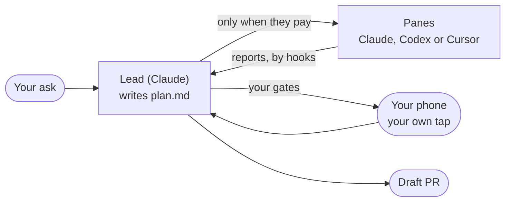

<h1 align="center">stampede</h1>

<p align="center">
  <b>One ask. One lead. Only the agents that pay.</b><br>
  stampede is three skills and one command for Claude Code. A lead agent plans your job, does the work, and opens a <a href="https://herdr.dev">Herdr</a> pane for another agent only when that pane pays for itself.<br>
  Every merge, push, send, spend and close waits for your own tap.
</p>

<p align="center">
  <a href="https://github.com/vib-z/stampede/actions/workflows/ci.yml"></a>
  <a href="CHANGELOG.md"></a>
  <a href="LICENSE"></a>
  <a href="https://github.com/vib-z/stampede/stargazers"></a>
  <a href="https://herdr.dev"></a>
  
</p>

<p align="center">
  <a href="#install">Install</a> ·
  <a href="#updating">Updating</a> ·
  <a href="#how-it-works">How it works</a> ·
  <a href="#use-one-job-start-to-finish">Walkthrough</a> ·
  <a href="#front-doors">Front doors</a> ·
  <a href="#safety">Safety</a> ·
  <a href="#reference">Reference</a> ·
  <a href="#docs">Docs</a> ·
  <a href="CHANGELOG.md">Changelog</a>
</p>

<p align="center">New releases: on <a href="https://github.com/vib-z/stampede">GitHub</a>, <b>Watch</b>, then <b>Custom</b>, then <b>Releases</b>.<br>
  The site: <a href="https://vib-z.github.io/stampede/">vib-z.github.io/stampede</a></p>

---

## Quick start

On a Mac with [Herdr](https://herdr.dev/docs/install/) 0.9.4 or later, Claude Code signed in, Python 3.9 or later, git, jq and curl:

```bash
git clone https://github.com/vib-z/stampede.git ~/stampede
~/stampede/install.sh
export PATH="$HOME/.local/bin:$PATH"   # add this line to your shell profile too
```

**Your first ask.** Run `herdr-trust ~/code/my-app` once for your repo, open it in Herdr, start Claude in a pane, and type:

> With stampede: add a /health endpoint with a test, have a reviewer on another model check it, then open a draft PR.



**Limits.**
- macOS only. No Linux run has been tried.
- The lead is Claude. Workers can be Claude, Codex or Cursor.
- Version 0.1.x, and early: commands and files may still change.
- For big jobs. A small job needs one plain Claude session ([FAQ](#troubleshoot)).

The full install, with every prerequisite: [Install](#install). A whole job, command by command: [the walkthrough](#use-one-job-start-to-finish).

## What is stampede?

You ask once, in plain words: in a Herdr chat, Claude or Codex desktop, Cursor, or a bot such as Grok Bot. stampede starts **one lead agent** for the job. The lead writes a short plan and starts working at once. It brings in another agent, in its own Herdr pane, only when that agent earns its place: work that runs in parallel, a different model, one reviewer, or the same task many times over. Workers report through hooks, so nobody polls. Your questions and gates reach your phone, and nothing that matters happens without your own tap.

**Why.** Running many agents by hand means stops between steps, too many small agents, rounds that wait on each other, and a lead that spends its day writing briefs. Real jobs showed all four ([docs/RUNS.md](docs/RUNS.md)). stampede is the lean answer: plan and go, work alone by default, wake on hooks, and ask you only what is yours to decide.

**Who it is for.** Anyone who runs Claude Code, Codex or Cursor and wants a whole job done from one ask, watched in Herdr and answered from a phone.

**What it is.** Three skills and one command:

| part | what it does |
|---|---|
| [`herdr-fleet`](skills/herdr-fleet/SKILL.md) | the playbook the lead follows: plan, panes, hooks, review, gates, report, reopen |
| [`grokbot-herdr`](skills/grokbot-herdr/SKILL.md) | the front door for a bot that reaches your machine over SSH |
| [`share-plan`](skills/share-plan/SKILL.md) | shows you the plan before any agent starts, only when you ask |
| [`stampede`](scripts/stampede) | the command: `new`, `start`, `tell`, `ask`, `cancel`, `approve` |

## Works with

**Agents.** The lead runs on Claude Code. Workers run on Claude Code, Codex or Cursor, each started by `stampede start --kind claude|codex|cursor` with its own hooks and auto mode.

<table>
  <tr>
    <td align="center" width="150">
      <br>
      <b>Claude Code</b><br><sub>the lead, and workers</sub>
    </td>
    <td align="center" width="150">
      <picture>
        <source media="(prefers-color-scheme: dark)" srcset="docs/images/logos/codex-dark.svg">
        
      </picture><br>
      <b>Codex</b><br><sub>workers and reviewers</sub>
    </td>
    <td align="center" width="150">
      <picture>
        <source media="(prefers-color-scheme: dark)" srcset="docs/images/logos/cursor-dark.svg">
        
      </picture><br>
      <b>Cursor</b><br><sub>workers</sub>
    </td>
  </tr>
</table>

**Tools.**

<table>
  <tr>
    <td align="center" width="150">
      <picture>
        <source media="(prefers-color-scheme: dark)" srcset="docs/images/logos/herdr-dark.svg">
        
      </picture><br>
      <b>Herdr</b><br><sub>the panes you watch</sub>
    </td>
    <td align="center" width="150">
      <br>
      <b>Moshi</b><br><sub>questions on your phone</sub>
    </td>
    <td align="center" width="150">
      <picture>
        <source media="(prefers-color-scheme: dark)" srcset="docs/images/logos/grokbot-dark.svg">
        
      </picture><br>
      <b>Grok Bot</b><br><sub>the preferred bot</sub>
    </td>
    <td align="center" width="150">
      <picture>
        <source media="(prefers-color-scheme: dark)" srcset="docs/images/logos/tailscale-dark.svg">
        
      </picture><br>
      <b>Tailscale</b><br><sub>a bot's private link</sub>
    </td>
  </tr>
</table>

Herdr itself detects many more agent CLIs (its `herdr agent start --help` lists 24, from Gemini and Kimi to OpenCode and Copilot). That is Herdr's support, not stampede's yet: `stampede start` refuses any other kind, and starting workers on them is [planned](#status-and-roadmap). The marks belong to their owners and imply no endorsement ([sources](docs/images/logos/SOURCES.md)).

## See it


<sub>Real, drawn: the <code>build</code> tab of the fleet that built stampede's first version, drawn from each pane's own screen text (<code>herdr agent read</code>), personal paths replaced with <code>~</code>, 18 Oct 2026. A lean job opens fewer panes; each looks the same.</sub>

<p align="center">
  
</p>

<sub>The teaser, from the launch film, 17 Oct 2026.</sub>

## How it works

The flow is the diagram in [Quick start](#quick-start), step by step:

1. **You ask once**, in plain words, in a [front door](#front-doors). It writes the ask to a file, runs `stampede new --file <ask.md>`, tells you the lead's name, and steps back.
2. **One lead plans and goes.** `lead-<slug>` starts on Claude (Opus 5.5 at `xhigh` effort by default) in auto mode, in a `lead` tab. It writes `plan.md` (the tasks, who does each, questions with a safe default, and the gates) and starts work.
3. **A pane only when it pays:** parallel pieces of about 30 minutes or more (at most 4), another model or tool, one reviewer on another model, or the same task many times (6 at once). Each worker gets its own Herdr pane.
4. **Hooks, not polling.** A worker's report, turn end, question or exit lands as a line in `<job>/inbox.log` (`REPORT`, `TURN`, `QUESTION`, `GONE`), and Claude's file hook wakes the lead.
5. **Review only what ships**, on another model, at most two rounds.
6. **Questions and gates reach your phone** through Moshi, and the lead keeps working while it waits. Every gate is your own tap; a yes relayed by another agent never counts.
7. **The lead reports back once**, then asks whether to close.
8. **Workers exit when their work is merged** or accepted. Nothing closes without your yes, and `reopen.sh` brings a closed job back.

**What lives where.** Your Mac, always on, runs Herdr, the lead and the workers. A bot such as Grok Bot runs on its own computer and reaches the Mac over SSH and Tailscale. Or the whole thing runs on one remote computer. Either way, the lead and its workers share one machine; workers on a second machine are [planned](#status-and-roadmap).

<details>
<summary><b>The job folder</b></summary>

`stampede new` makes `<repo>/.herdr-<slug>/`, kept out of git through `.git/info/exclude`:

```text
ask.md        your ask, word for word
lead          the lead's name
plan.md       the lead's plan
briefs/       one brief per agent, the lead's first
hooks/        each agent's hook settings and wake state
inbox.log     REPORT, TURN, QUESTION and GONE lines that wake the lead
inbox/        messages to each agent, one file per agent
questions/    a worker's questions, as files for the lead
asks/         questions out to your phone, while they wait
agents.tsv    who was started, and how: the reopen record
approved      the plan's fingerprint, for a --review job
REOPEN.md, reopen.sh   written by herdr-reopen-snapshot before a close
```
</details>

## Install

**Prerequisites** (tested on macOS 27.2, 21 Oct 2026):

| tool | version tested | needed for |
|---|---|---|
| [Herdr](https://herdr.dev/docs/install/) | 0.9.4 (the plugin needs 0.9.4 or later) | the panes |
| [Claude Code](https://code.claude.com/docs/en/setup) | 2.1.306 | the lead, and workers |
| [Codex CLI](https://developers.openai.com/codex/cli) | 0.163.0 | workers, optional |
| [Cursor Agent](https://cursor.com/docs/cli/installation) | 2026.10.19 | workers, optional |
| Python 3, git, jq, curl | Python 3.9 (the tests need 3.11), git 2.56, jq 1.7 | the scripts |
| [Moshi](https://getmoshi.app/docs/herdr) `moshi-hook` | 0.4.33 | questions on your phone, optional |
| [Tailscale](https://tailscale.com/kb/1017/install) | 1.104.1 | a bot on another computer, optional |

**Step by step**, on a Mac with Herdr, Claude Code (signed in), Python 3 and git:

```bash
git clone https://github.com/vib-z/stampede.git ~/stampede
cd ~/stampede
./install.sh --dry-run               # prints each link it would make, changes nothing
./install.sh                         # links the skills and the commands
export PATH="$HOME/.local/bin:$PATH" # add this line to your shell profile too
stampede --version                   # 0.1.0
herdr-trust ~/code/my-app            # once per repo, before agents start there
```

Then open your repo in Herdr, start Claude in a pane, and ask: *"With stampede: ..."*. The [walkthrough](#use-one-job-start-to-finish) shows a whole job.

`install.sh` links the three skills into `~/.claude/skills/` and `~/.codex/skills/` (each only when `~/.claude` or `~/.codex` exists), and links `stampede`, `fleet-job` and the `herdr-*` helpers into `~/.local/bin`. It is safe to re-run (`ok` for a link already in place) and never replaces anything already there (`skip ... left as is`). `herdr-trust` marks a repo trusted for Claude and Codex so agents start without the folder-trust dialog; it refuses a repo outside `FLEET_TRUST_ROOT` (default `~/code`), so keep your repos there or set the key.

**Then, once:** the settings that let agents start and run without a visit to their pane, which you run yourself: [unattended-setup.md](skills/herdr-fleet/references/unattended-setup.md). A remote bot also needs the event relay. Both, plus uninstalling: [docs/SETUP.md](docs/SETUP.md).

**Linux:** the lead, `stampede` and `herdr-trust` use only Python and git, but the event relay scripts use macOS tools (`launchd`, BSD `stat`, `md5`), and no Linux run has been tried.

## Updating

| installed with | update with |
|---|---|
| a clone and `./install.sh` | `stampede update` |
| `herdr plugin install vib-z/stampede` | `herdr plugin update` |

`stampede update` is the guided updater: it updates only a clean checkout on `main`, and never overwrites a file of yours. It runs `git fetch`, fast-forwards with `git merge --ff-only`, reruns `./install.sh` (which links any new skill or command), and ends with `stampede 0.1.0 -> 0.2.0`. It refuses with the reason, and changes no file, when the checkout has local changes or untracked files, is on another branch, or holds an ignored file at a path the update adds, which git would overwrite (`refused: the update adds local-settings.txt, already in <checkout> (ignored by git, so it would be overwritten): move it away, then rerun`). Outside a git checkout, as in a plugin install, it prints `herdr plugin update` to run instead.

**The daily check.** It only tells you a release is out; it never updates anything. At most once a day, `stampede --version`, `stampede update --check` and `herdr-doctor` ask GitHub for the latest release: one request without a token, given 3 s in all (DNS, connect and the reply), the answer cached for 24 h in `${XDG_CACHE_HOME:-~/.cache}/stampede/`. When a newer release is out they print one line:

```text
$ stampede --version
0.1.0
stampede 0.2.0 is out, this is 0.1.0: run stampede update
```

`stampede --version` puts that line on stderr, after the version, and still exits 0; `herdr-doctor` prints it as a `warn` line, never a `PROBLEM`. Offline, rate-limited, a malformed reply or any other failure prints nothing and is cached too, so the next try is a day later. Turn the check off with `export STAMPEDE_NO_UPDATE_CHECK=1` in your shell profile or `~/.config/stampede/config` ([Configure](#configure)). To hear of a release on GitHub instead: on the repo page, **Watch**, then **Custom**, then **Releases**. How a release is cut: [RELEASING.md](RELEASING.md).

## Use: one job, start to finish

In a Herdr pane in your repo, ask your Claude chat: *"With stampede: make hello.txt with hi, then have a reviewer on another model confirm it."* The chat (a front door) writes the ask and starts the lead:

```console
$ printf 'Make hello.txt with hi.\nThen have a reviewer on another model confirm it.\n' > ask.md
$ stampede new --file ask.md
recorded lead-make-hello-txt-with-hi (claude) in <repo>/.herdr-make-hello-txt-with-hi/agents.tsv
DELIVERED lead-make-hello-txt-with-hi (inbox file)
lead-make-hello-txt-with-hi <repo>/.herdr-make-hello-txt-with-hi
```

Inside Herdr, `--workspace` defaults to the current workspace and the lead gets a new `lead` tab; `--pane <id>` puts it in an empty pane instead, and `--name <slug>` names the job. A front door outside Herdr (a bot, a desktop app) has no current workspace, so it passes `--workspace` or `--pane`: it creates a workspace for the job (`herdr workspace create`) and passes its root pane, as in [SKILL.md](SKILL.md#front-door). The chat tells you `lead-make-hello-txt-with-hi` and stops.

The lead reads `ask.md`, writes `plan.md` and goes on at once. Here it starts one reviewer on another model:

```console
$ stampede start .herdr-make-hello-txt-with-hi review-hello --kind claude --pane <pane id> \
    --brief .herdr-make-hello-txt-with-hi/briefs/review-hello.md \
    --model <another model> --effort max --report reports/review-hello.md
recorded review-hello (claude) in .herdr-make-hello-txt-with-hi/agents.tsv
DELIVERED review-hello (inbox file)
```

When the reviewer writes `reports/review-hello.md` with `Status: PASS` in its first 10 lines and ends its turn, its hook adds `REPORT reports/review-hello.md` to `inbox.log`, which wakes the lead. A question for you, with the lead still working:

```console
$ stampede ask .herdr-make-hello-txt-with-hi "Keep the file in the repo root?" \
    --option Yes --option No
ASKED 1fecfa0be4dc (the answer goes to the lead inbox; cancel with: fleet-job cancel <job> 1fecfa0be4dc)
```

Your tap comes back as `ANSWER ...` in the lead's inbox. A gate (say, merging the draft PR) is the lead's own question card, which Moshi puts on your phone. Then the lead writes a short report and asks whether to close the workspace; `<job>/reopen.sh` brings it back later.

### Share the plan first

Say "share the plan first" and the front door adds `--review`. The lead then writes `plan.md` and ends its turn, and no pane can open until you approve that exact plan:

```console
$ stampede new --file ask.md --name hello-review --review
recorded lead-hello-review (claude) in <repo>/.herdr-hello-review/agents.tsv
DELIVERED lead-hello-review (inbox file)
lead-hello-review <repo>/.herdr-hello-review
$ stampede start .herdr-hello-review review-hello --kind codex \
    --pane <pane id> --brief <brief>
fleet-job start: the owner asked to see this plan: run fleet-job approve after their yes, and again after any change to the plan
$ stampede approve .herdr-hello-review --by "owner in chat"
DELIVERED lead-hello-review (inbox file)
$ cat .herdr-hello-review/approved
Approved: 2026-10-21 21:35 by owner in chat, plan 6ef5e2effdb06d6adf70e17da8726c05dd2d057a4a7ba23c4fbe3836eed14ffa
```

The `start` refusal exits 2. The approval holds a fingerprint of `plan.md`; any later change locks `start` again until a new approve. A change you ask for goes to the lead with `stampede tell <job> lead "<your words>"`. The steps: [share-plan](skills/share-plan/SKILL.md).

## Front doors

Every front door writes the ask and runs `stampede new`; none plans or runs the job itself.

| front door | how you ask | where answers arrive | guide |
|---|---|---|---|
| a chat in Herdr | type the ask in a Claude pane | the lead's pane, plus a Moshi card | [walkthrough](#use-one-job-start-to-finish) |
| Claude desktop or the Claude app | Remote Control into a session on the machine | the lead's row in the Claude app, plus Moshi | [remote/claude-code.md](remote/claude-code.md) |
| Codex desktop or the ChatGPT app | Codex on the connected machine | Moshi | [remote/codex.md](remote/codex.md) |
| Cursor | a Cursor chat on the machine runs the same two commands | Moshi | [remote/other.md](remote/other.md) |
| **Grok Bot** (preferred bot) | the bot reaches your Mac over SSH and Tailscale | the Grok chat, woken by a webhook | [remote/grokbot/](remote/grokbot/README.md), [grokbot-herdr](skills/grokbot-herdr/SKILL.md) |
| any other bot | the same as Grok Bot | its webhook | [remote/other.md](remote/other.md) |
| a whole remote computer | Herdr, the CLIs and stampede on one box | any of the above | [remote/any-machine/](remote/any-machine/README.md) |

Moshi, the phone side of every front door: [remote/moshi.md](remote/moshi.md).

## Safety

- **Your own tap, every time:** a merge to main, a push to main or another shared branch, a deploy, publishing, sending email or messages, any spend, and closing panes, tabs or a workspace. A plan, a brief or a relayed yes is never approval. Pushing the job's own work branch and opening a draft PR need no ask.
- **Auto mode, never no-checks mode, by default:** Claude `--permission-mode auto`, Codex `--approve-for-me`, Cursor `--auto-review`. `stampede start --yolo-in <worktree>` runs a worker in its CLI's no-checks mode only when its pane's shell sits in its own linked git worktree, and never the lead.
- **Plan approval** (only when you asked to see the plan) lets the lead work inside the job's own folder and branch; it is not a gate and covers no merge or spend.
- **Nothing closes by itself.** The last step is always the question whether to close; no answer is a no.
- **Never touched:** panes, tabs and workspaces the lead did not create; the pane you have focused; credentials and `.env` files.

## Configure

Every key is an environment variable with a default; nothing needs setting. To change one, copy [config.example](config.example) to `~/.config/stampede/config`, edit it, and source it from your shell profile (`. ~/.config/stampede/config`). The Herdr plugin event reads the same file.

<details>
<summary><b>Every key, with its default</b></summary>

| key | default | what it does |
|---|---|---|
| `FLEET_LEAD_MODEL` | Claude Opus 5.5 (its id is in config.example) | the lead's Claude model |
| `FLEET_LEAD_EFFORT` | `xhigh` | the lead's effort |
| `FLEET_ASK_CMD` | `moshi-hook ask --require-remote --source herdr-fleet --timeout 24h` | what `stampede ask` runs; the options and question are appended |
| `FLEET_TRUST_ROOT` | `~/code` | `herdr-trust` trusts repos only under it; `herdr-doctor` checks worktrees there |
| `FLEET_WATCH_INTERVAL` | `30` | seconds between `fleet-watch.sh` passes (a bot outside Herdr) |
| `FLEET_WATCH_PASSES` | `0` | stop the watch after this many passes; 0 runs until stopped |
| `FLEET_WATCH_NOTIFY` | `1` | `0` turns off the watch's phone push |
| `HERDR_EVENTS_MACHINE` | `hostname -s` | the machine label sent with every event |
| `HERDR_EVENTS_HOME` | `~/.herdr-events` | the event queue and dead letters |
| `HERDR_EVENTS_ROUTES_DIR` | `~/.config/herdr-events/routes` | one file per route, `URL=` and `KEY=` |
| `HERDR_EVENTS_FLUSH_LOG` | `~/.herdr-events/flush.log` | the flusher's log |
| `STAMPEDE_NO_UPDATE_CHECK` | `0` | `1` turns off the daily check for a newer release ([Updating](#updating)) |
| `STAMPEDE_UPDATE_URL` | `https://api.github.com/repos/vib-z/stampede/releases/latest` | where the check reads the latest release; the tests point it at a local file |
</details>

## Troubleshoot

| what you see | fix |
|---|---|
| `fleet-job start: the owner asked to see this plan` | a `--review` job: approve the plan as it stands with `stampede approve <job> --by <who>` |
| `fleet-job start: fleet-job starts claude, codex or cursor; ...` | stampede starts only those three kinds; start another agent by hand and record it with `herdr-reopen-snapshot` |
| `BLOCKED <agent>: clear the startup dialog` | read the screen (`herdr agent read <agent> --source visible --lines 30`), clear the dialog, then send the printed `fleet-job tell` line |
| `refused: ... is outside ~/code` from `herdr-trust` | the repo is outside `FLEET_TRUST_ROOT`; move it or change the key |
| `fleet-job start: pane ...'s shell is in ..., not ...` | `--yolo-in` needs the pane's shell in that worktree; use auto mode or `cd` the pane first |
| `FileExistsError` from `stampede new` | a job of that name exists; pass `--name <new slug>` |
| `fleet-job new: new needs --workspace or --pane, or run it inside Herdr` | run outside Herdr with no target: pass `--workspace <id>` or `--pane <id>` ([SKILL.md](SKILL.md#front-door)) |
| `PROBLEM` from `herdr-doctor` | the line names the broken part and its fix. Plain `herdr-doctor` checks the core install only; the event relay's checks run when the relay is installed, or with `--relay` |
| a bot gets no events | `herdr-doctor --relay` names the broken part; see [remote/events.md](remote/events.md) |
| relay `PROBLEM` lines on a Mac without a bot | a routes folder, a relay launch agent or a relay hook is left over, so the relay counts as installed: finish its setup ([remote/events.md](remote/events.md)) or remove what you no longer use |
| skill or command links still point at an old plugin checkout | a new `herdr plugin install` does not move links that already exist; see [docs/SETUP.md](docs/SETUP.md#update) |
| `refused: ... has local changes or untracked files`, `... is on <branch>, not main` or `... the update adds <path>, already in ...` from `stampede update` | commit, stash or move the files it names, or `git switch main`, then rerun; it never overwrites a file of yours |
| no update line, though a release is out | the check runs at most once a day and is silent offline: delete `~/.cache/stampede/latest-release` to check now, and see that `STAMPEDE_NO_UPDATE_CHECK` is not `1` |

Every known failure with its fix: [failure-modes.md](skills/herdr-fleet/references/failure-modes.md). Startup dialogs: [unattended-setup.md](skills/herdr-fleet/references/unattended-setup.md). Setup problems: [docs/SETUP.md](docs/SETUP.md#setup-problems).

**FAQ**
- *Do I need stampede for this?* Only for a big job: hours long, more than one agent family, anything that leaves the machine (merge, push, send, spend, publish, deploy), or work that must survive a restart. A small job needs no stampede: run it in one plain Claude session with its built-in subagents. That is also the answer to "why not subagents": for small jobs, use them. The rule: [Size the job first](skills/herdr-fleet/SKILL.md#size-the-job-first-small-or-big).
- *Why two names?* `stampede` is the public name of `fleet-job`, its first name; both run the same command.
- *Can Codex or Cursor lead?* Not yet; the lead is Claude ([roadmap](#status-and-roadmap)).
- *Can workers run on Gemini, Kimi or the other agents Herdr knows?* Not through `stampede start` yet ([roadmap](#status-and-roadmap)).

## Reference

<details>
<summary><b><code>stampede</code> commands and exit codes</b></summary>

`stampede` is the same command as `fleet-job` ([fleet_job.py](skills/herdr-fleet/scripts/fleet_job.py)). `stampede --version` (or `-V`) prints the version from [VERSION](VERSION), then, on stderr, the update line when a newer release is out ([Updating](#updating)). `update` is in [stampede_update.py](scripts/stampede_update.py).

| command | flags | does |
|---|---|---|
| `new --file <ask.md>` | `--workspace <id>` (default `$HERDR_WORKSPACE_ID`), `--pane <id>`, `--name <slug>`, `--review` | makes the job folder, starts the lead with its hooks, prints `<lead> <job dir>` |
| `start <job> <agent> --kind claude\|codex\|cursor --pane <id> --brief <file>` | `--model`, `--effort`, `--report <path>` (repeatable), `--yolo-in <worktree>` | starts a worker in a pane with hooks and auto mode, records it, sends its brief pointer |
| `tell <job> <agent> <text>` | `lead` names the lead | a Claude agent's inbox file; another CLI through `herdr-send` |
| `ask <job> <question>` | `--option <a>` (repeatable) | asks you in the background; prints `ASKED <id>` |
| `cancel <job> <id>` | | stops an asked question and its phone card |
| `approve <job> --by <who>` | | records the plan's fingerprint and wakes the lead |
| `update` | | in a clean git checkout on `main`: `git fetch`, `git merge --ff-only`, then `./install.sh`; refuses local changes, untracked files, another branch, or an ignored file at a path the update adds; outside a git checkout prints `herdr plugin update` |
| `update --check` | | one line: a newer release (exit 1) or the latest release (exit 0); nothing when offline, failed or turned off (exit 0) |
| `hook <action> <job> --agent <name>` | actions: `watch-paths`, `wake`, `claude-stop`, `ask-lead`, `codex-notify`, `cursor-stop`, `session-end` | run by the agents' hooks, never by hand |

**Exit codes:** 0 done; 2 a usage error or a refusal (an agent not in the job, a kind other than claude, codex or cursor, a start before approval, yolo outside a worktree), with the reason on stderr; 1 Herdr or the file system failed, with a Python traceback. The `wake` hook exits 2 on purpose: that wakes Claude. `update` exits 0 updated (or already the latest), 1 refused or failed with the reason, 2 a usage error; `update --check` exits 1 only when a newer release is out.
</details>

<details>
<summary><b>Helper scripts</b></summary>

In [skills/grokbot-herdr/scripts/](skills/grokbot-herdr/scripts/):

| script | does | exit |
|---|---|---|
| `herdr-trust <dir>` | pre-trusts a repo for Claude and Codex | 0, or 2 refused |
| `herdr-send <agent> <text>` | prompts an agent and confirms it started: `SUBMITTED` or `FAILED`; refuses a pane you have focused before any key | 0, 1 failed, 2 usage |
| `herdr-reopen-snapshot <ws> <job dir>` | reads the live workspace (read only) and writes `REOPEN.md` and `reopen.sh` in the job folder: the tabs holding the job's agents (from `agents.tsv`), never another's agent | 0, or 1 with the reason |
| `<job>/reopen.sh` | recreates the workspace and resumes each agent's session; `--fresh` new sessions, `--prompt` re-sends the briefs, `--into <ws>` adds to an open workspace | 0, 2 a workspace with that label is open, 3 a pane's folder is gone, 4 a tab did not open, 64 usage |
| `herdr-doctor [--relay]` | read-only health check: `ok`, `warn`, `PROBLEM` lines; `-h` prints usage. The core install by default; the event relay too when it is installed, or with `--relay`. A newer stampede release is a `warn` | 0 ok, 1 a PROBLEM, 2 usage |
| `herdr-events-owner <ws> [<bot>\|--clear]` | tags a workspace with the bot its events go to | 0, or 2 refused |
| `herdr-event-post`, `herdr-event-flush`, `herdr-event-watchdog`, `herdr-event-claude-hook`, `herdr-event-codex-notify` | the event relay to a bot: [remote/events.md](remote/events.md) | 0 |
</details>

<details>
<summary><b>Repo layout</b></summary>

```text
README.md  CHANGELOG.md  CONTRIBUTING.md  RELEASING.md  SECURITY.md  LICENSE  VERSION
AGENTS.md  CLAUDE.md  SKILL.md  config.example  install.sh  herdr-plugin.toml
.github/                issue and pull request templates, workflows/ci.yml (macOS CI)
skills/herdr-fleet/     the job: SKILL.md, references/, scripts/fleet-job, fleet_job.py, fleet-watch.sh
skills/grokbot-herdr/   the bot front door: SKILL.md, scripts/ (herdr-send, herdr-trust, herdr-doctor, the relay)
skills/share-plan/      the plan review, on request
scripts/stampede        the command (also linked as fleet-job); answers --version and update
scripts/stampede_update.py   the daily release check and stampede update
scripts/herdr-plugin-event   the Herdr plugin's event hook
remote/                 front-door guides
docs/                   SETUP.md, RUNS.md, superpowers/specs/ (the design), images/ (screenshots, logos/)
assets/                 the poster and the teaser
site/                   the hero site: index.html, assets/
site/brand/             the identity assets and the brand guide
tests/                  python3 -m unittest discover tests
```
</details>

## Docs

| doc | for |
|---|---|
| [docs/SETUP.md](docs/SETUP.md) | the full setup: installer, unattended agents, the event relay, uninstall |
| [SKILL.md](SKILL.md) | the entry point an agent reads to run a job |
| [skills/herdr-fleet](skills/herdr-fleet/SKILL.md) | the lead's playbook, with [failure modes](skills/herdr-fleet/references/failure-modes.md) |
| [remote/](remote/README.md) | one guide per front door, Moshi and the event relay |
| [docs/RUNS.md](docs/RUNS.md) | real runs, with timelines and what changed because of them |
| [the lean design](docs/superpowers/specs/2026-10-21-stampede-lean-design.md) | why stampede is shaped this way |
| [site/](site/README.md) | the hero site, and its [brand kit](site/brand/README.md) |
| [CHANGELOG.md](CHANGELOG.md) | what each version shipped |
| [RELEASING.md](RELEASING.md) | how a maintainer cuts a release: VERSION, the changelog, the tag, the GitHub Release |
| [CONTRIBUTING.md](CONTRIBUTING.md), [SECURITY.md](SECURITY.md) | how to help, and how to report a security problem privately |

## Contribute

How to open an issue or a pull request: [CONTRIBUTING.md](CONTRIBUTING.md). The rules every change follows: [AGENTS.md](AGENTS.md).

- **Tests:** `python3 -m unittest discover tests` (Python 3.11 or later; all with fakes, nothing touches a live Herdr). [CI](.github/workflows/ci.yml) runs them on macOS on every push and pull request, then a real install and `herdr-doctor` against Homebrew Herdr.
- **The three skills are copies** of the maintainer's own skills, scrubbed of anything personal. A pull request that changes `skills/` is welcome; the maintainer carries it to the source first, then copies it back here.
- **A front door:** a guide in `remote/` that writes the ask and runs `stampede new`, linked from [Front doors](#front-doors).
- **An agent CLI:** its auto and no-checks flags in `AUTO` and `YOLO`, and its hooks in `cli_args`, in [fleet_job.py](skills/herdr-fleet/scripts/fleet_job.py), with a test in `tests/test_fleet_job.py`.

## Status and roadmap

**0.1.0, 22 Oct 2026. Works and tested:** the job folder, the lead's start with its hooks, starting workers on Claude, Codex or Cursor, the review lock and approval, background questions and cancel, the wake on every rewritten report, the yolo guard, the install, `--version` and the plugin event, all with fakes. Every command in this README was run against a scratch job.

**Unreleased, 22 Oct 2026. Updating:** `stampede update` and `stampede update --check`, the daily release check in `--version` and `herdr-doctor`, and a test that keeps `herdr-plugin.toml` at VERSION. Tested with a local reply file, a fake rate-limited server and scratch git repos, and run once against the live GitHub API.

**Unreleased, 23 Oct 2026. A clean first install:** plain `herdr-doctor` checks the core install, and the event relay only when it is installed or with `--relay`; the README opens with a short path; CI on macOS runs the tests, a real install and `herdr-doctor` against Homebrew Herdr on every push and pull request.

**Site and brand, 22 Oct 2026:** the hero (PR #16), the brand kit (PR #20) and the landing page around the film (PR #3) are done. The site is live at https://vib-z.github.io/stampede/ and mirrored on Vercel at https://stampede-xi.vercel.app/.

**Live, 21 Oct 2026:** the engine started a hooked Claude lead, which was woken by its inbox file; a Codex reviewer's turn reached it through Codex's notify hook; a Cursor worker committed under auto-review and its stop hook reached the lead; a question went to the owner's phone without blocking the lead and was cancelled cleanly. Real jobs, with timelines: [docs/RUNS.md](docs/RUNS.md).

**Next:**
- One live job from Grok Bot.
- Starting workers on the other agents Herdr detects, not only Claude, Codex and Cursor.
- Workers on a second machine over Tailscale.
- Codex or Cursor as the lead.
- ChatGPT Dots as a front door, once it can be woken by a webhook.
- Report to Herdr that Codex's "Implement this plan?" and Cursor's "Ready to build?" dialogs read as `idle` and `done`, not `blocked` (needs the owner's yes).
- A Linux run.

## Credits and license

Built on [Herdr](https://herdr.dev) and its agent automation, with [Moshi](https://getmoshi.app/docs/herdr) for the phone. A stream of many small, independent coding tasks fits [herdr-projects](https://github.com/eliasstravik/herdr-projects) better. Product marks: [docs/images/logos/SOURCES.md](docs/images/logos/SOURCES.md). The brand kit, in [site/brand](site/brand/README.md) with its [visual guide](site/brand/guide.html), holds the Open gate logo, the Star link, the painterly grounds and the brand guide.

[MIT](LICENSE), copyright 2026 stampede contributors. The code licence does not grant rights to the stampede name or marks. See [site/brand/CREDITS.md](site/brand/CREDITS.md).
