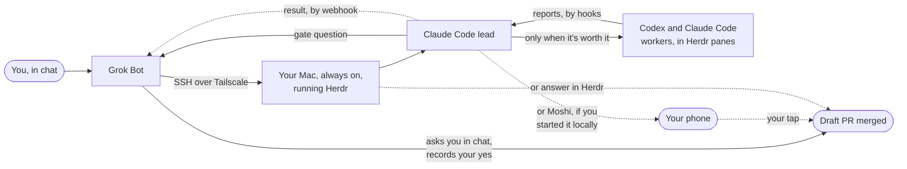

<h1 align="center">stampede</h1>

**You text a task to your Grok Bot. It reaches your Mac over Tailscale, where a Claude Code lead does the job in [Herdr](https://herdr.dev) and adds Codex or Cursor panes only when parallel work helps. Nothing is merged, pushed, sent or spent until you say yes.**

Grok Bot is the setup we recommend, but you don't need it: stampede also runs when you start it straight from Claude, Codex or any agent ([Without a bot](#without-a-bot)). Either way you can watch every agent in Herdr, and every question comes back to you.

**Let a Grok Bot set it up.** [Stompy](https://x.ai/bot/_mNMq-0M5aA02AQMNOHTy) is a Grok Bot that sets up stampede between your Grok Bot and your Mac, end to end, and keeps it healthy.

<p align="center">
  <a href="https://github.com/vib-z/stampede/actions/workflows/ci.yml"></a>
  <a href="CHANGELOG.md"></a>
  <a href="LICENSE"></a>
  <a href="https://github.com/vib-z/stampede/stargazers"></a>
  <a href="https://herdr.dev"></a>
  
</p>

<p align="center">
  
</p>

<p align="center"><sub>An animated mock-up of one job, 27 Oct 2026.</sub></p>

<p align="center">
  <a href="#install">Install</a> ·
  <a href="#updating">Updating</a> ·
  <a href="#how-it-works">How it works</a> ·
  <a href="#use-one-job-start-to-finish">Walkthrough</a> ·
  <a href="#front-doors">Front doors</a> ·
  <a href="#safety">Safety</a> ·
  <a href="#reference">Reference</a> ·
  <a href="#docs">Docs</a> ·
  <a href="CHANGELOG.md">Changelog</a>
</p>

<p align="center">New releases: on <a href="https://github.com/vib-z/stampede">GitHub</a>, <b>Watch</b>, then <b>Custom</b>, then <b>Releases</b>.<br>
  The site: <a href="https://vib-z.github.io/stampede/">vib-z.github.io/stampede</a></p>

---

## How it flows

Started from Grok Bot, the setup we recommend:



## Without a bot

stampede works fully on its own with Herdr, Claude Code and this repo: start a job straight from Claude, Codex, Cursor or any agent, or from a Claude pane in Herdr ([Front doors](#front-doors)). Gate questions then reach your phone through Moshi, if you use it, or you answer in Herdr.

Either way:
- **One ask, one lead.** A Claude Code lead plans the job and does it.
- **Workers only when it's worth it.** The lead opens a Codex or Claude Code worker in its own Herdr pane for parallel work, another model or a reviewer, and works alone otherwise.
- **Hooks, not polling.** Workers report to the lead through hooks, and you can watch every pane in Herdr.
- **Your yes on every merge, push, send, spend or close.** The gate question goes back to whoever started the job, and a yes typed in a Claude lead's Herdr pane works too, except for a merge or a push to the default branch (for a Codex lead and on Herdr Core only the recorded yes counts). The lead keeps working while it waits.

## Quick start

**An agent told to run a job with stampede:** start at [USING.md](USING.md), one short page.

On a Mac or a Linux machine with [Herdr](https://herdr.dev/docs/install/) 0.9.4 or later, Claude Code signed in, Python 3.9 or later, git, jq and curl:

```bash
git clone https://github.com/vib-z/stampede.git ~/stampede
~/stampede/install.sh
export PATH="$HOME/.local/bin:$PATH"   # add this line to your shell profile too
stampede doctor                        # exit 0, with Herdr running: each check with its fix
```

**Your first ask.** Once per Mac, run the [unattended setup](skills/herdr-fleet/references/unattended-setup.md), so the lead can start workers with no visit to their panes. Run `herdr-trust ~/code/my-app` once for your repo, open it in Herdr, start Claude in a pane, and type:

> With stampede: add a /health endpoint with a test, have a reviewer on another model check it, then open a draft PR.

**Then from your phone (recommended).** Set up Grok Bot's SSH, Tailscale and webhook once ([remote/grokbot/](remote/grokbot/README.md)), and send the same ask in chat.

**On Herdr Core instead of the Herdr TUI.** With [Herdr Core](https://herdr.dev/core/) (`hc` 0.1.13 or later) installed and running, run `herdr-doctor` (it checks whichever of the Herdr TUI and Herdr Core is installed), then ask *"With stampede: ..."* from anywhere outside a Herdr pane. The front door runs `stampede new --file ask.md`, which runs the job on Herdr Core there by itself (the setting `backend`, default `auto`; `--core` forces it): the lead is a root Core terminal and each helper its Core child ([Herdr Core](#herdr-core)).

**Limits.**
- macOS and Linux. On macOS you load the event relay's two launchd jobs yourself; on Linux `install.sh` starts the same timers (systemd user units, or one flock-guarded loop when `systemctl --user` does not answer). On Linux a whole job ran live on the Herdr TUI and on Herdr Core (Ubuntu 24.04 arm64, stand-in agents; [docs/LINUX.md](docs/LINUX.md) says exactly what was real); a signed-in agent, the systemd timers, Moshi paired and a bot over SSH have not been run there yet.
- The lead is Claude by default (any Claude model, set by `FLEET_LEAD_MODEL`), or Codex with `stampede new --lead codex`, on the Herdr TUI or on Herdr Core. Workers can be Claude, Codex or Cursor (on Herdr Core, Claude, Codex or any program as the lead's Core children; Cursor, Hermes or Kimi handed to Herdr TUI panes only on the earlier `--core --relay` path).
- Version 0.1.x, and early: commands and files may still change.
- For big jobs. A small job runs as one agent session in a single tagged Herdr pane ([FAQ](#troubleshoot)).

The full install, with every prerequisite: [Install](#install). A whole job, command by command: [the walkthrough](#use-one-job-start-to-finish).

## What is stampede?

stampede is multi-agent orchestration for Claude Code and Codex in Herdr: four skills and one command, installed by script or as a Herdr plugin. You ask once, in plain words: in a Claude pane in Herdr, from Claude or Codex desktop or Cursor, or, as we recommend, from your phone through Grok Bot. stampede starts **one lead agent** for the job. The lead writes a short plan and starts working at once. It brings in Codex workers, or Claude Code or Cursor ones, each in its own Herdr pane, only when that agent earns its place: work that runs in parallel, a different model, one reviewer, or the same task many times over. Workers report through hooks, so nobody polls. Gate questions come back to wherever you asked, and nothing that matters happens without your own yes.

**Why.** Running many agents by hand means stops between steps, too many small agents, rounds that wait on each other, and a lead that spends its day writing briefs. Real jobs showed all four ([docs/RUNS.md](docs/RUNS.md)). stampede is the lean answer: plan and go, work alone by default, wake on hooks, and ask you only what is yours to decide.

**Who it is for.** Anyone who runs Claude Code, Codex or Cursor and wants a whole job done from one ask, watched in Herdr and answered from a phone.

**What it is.** Four skills and one command:

| part | what it does |
|---|---|
| [`stampede`](skills/stampede/SKILL.md) (skill) | the front door: say "use stampede" in any project chat and it writes the ask, opens a Herdr workspace for the project and starts the lead |
| [`herdr-fleet`](skills/herdr-fleet/SKILL.md) | the playbook the lead follows: plan, panes, hooks, review, gates, report, reopen |
| [`grokbot-herdr`](skills/grokbot-herdr/SKILL.md) | the front door for a bot that reaches your machine over SSH |
| [`share-plan`](skills/share-plan/SKILL.md) | shows you the plan before any agent starts, only when you ask |
| [`stampede`](scripts/stampede) (command) | the command: `new`, `start`, `tell`, `ask`, `cancel`, `approve` |

## Works with

**Agents.** The lead runs on Claude Code, or on Codex when you pick it (`stampede new --lead codex`, on the Herdr TUI or on Herdr Core). Workers run on Claude Code, Codex or Cursor, each started by `stampede start --kind claude|codex|cursor` with its own hooks and auto mode. A [Herdr Core](#herdr-core) job runs any other CLI as a program, and the earlier `--core --relay` path hands Hermes and Kimi workers to Herdr TUI panes.

<table>
  <tr>
    <td align="center" width="150">
      <br>
      <b>Claude Code</b><br><sub>the lead, and workers</sub>
    </td>
    <td align="center" width="150">
      <picture>
        <source media="(prefers-color-scheme: dark)" srcset="docs/images/logos/codex-dark.svg">
        
      </picture><br>
      <b>Codex</b><br><sub>the lead if you pick it, workers and reviewers</sub>
    </td>
    <td align="center" width="150">
      <picture>
        <source media="(prefers-color-scheme: dark)" srcset="docs/images/logos/cursor-dark.svg">
        
      </picture><br>
      <b>Cursor</b><br><sub>workers</sub>
    </td>
  </tr>
</table>

**Tools.**

<table>
  <tr>
    <td align="center" width="150">
      <picture>
        <source media="(prefers-color-scheme: dark)" srcset="docs/images/logos/herdr-dark.svg">
        
      </picture><br>
      <b>Herdr</b><br><sub>the panes you watch</sub>
    </td>
    <td align="center" width="150">
      <br>
      <b>Moshi</b><br><sub>questions on your phone</sub>
    </td>
    <td align="center" width="150">
      <picture>
        <source media="(prefers-color-scheme: dark)" srcset="docs/images/logos/grokbot-dark.svg">
        
      </picture><br>
      <b>Grok Bot</b><br><sub>the preferred bot</sub>
    </td>
    <td align="center" width="150">
      <picture>
        <source media="(prefers-color-scheme: dark)" srcset="docs/images/logos/tailscale-dark.svg">
        
      </picture><br>
      <b>Tailscale</b><br><sub>a bot's private link</sub>
    </td>
  </tr>
</table>

**Herdr Core** (`hc` 0.1.13 or later), Herdr's terminal runtime, can run a whole job in place of the Herdr TUI: [Herdr Core](#herdr-core).

Herdr itself detects many more agent CLIs (its `herdr agent start --help` lists 24, from Gemini and Kimi to OpenCode and Copilot). Beyond Claude, Codex, Cursor, and Hermes and Kimi on the `--core --relay` path (a Core job can run any CLI as a plain program), that is Herdr's support, not stampede's yet: `stampede start` refuses any other kind, and starting workers on them is [planned](#status-and-roadmap). The marks belong to their owners and imply no endorsement ([sources](docs/images/logos/SOURCES.md)).

## Works well with

**[pstack](https://github.com/michael-denyer/pstack-claude), optional.** For coding jobs, the lead picks up pstack if you have it: data shape first, a contract commit, proof on the real surface. The lead is a normal Claude Code session, so an installed pstack loads on its own, and stampede's rules keep pstack's fan-out as Herdr panes you can watch. Not required: without it nothing changes. The rules: [references/pstack.md](skills/herdr-fleet/references/pstack.md).

## See it


<sub>Real, drawn: the <code>build</code> tab of the fleet that built stampede's first version, drawn from each pane's own screen text (<code>herdr agent read</code>), personal paths replaced with <code>~</code>, 18 Oct 2026. A lean job opens fewer panes; each looks the same.</sub>

## How it works

The flow is the [diagram at the top](#how-it-flows), step by step, for any front door:

1. **You ask once**, in plain words, in a [front door](#front-doors). It writes the ask to a file, runs `stampede new --file <ask.md>`, tells you the lead's name, and steps back.
2. **One lead plans and goes.** `lead-<slug>` starts on Claude (Opus 5.5 at `xhigh` effort by default), or on Codex (GPT-6 Astra at `ultra`) with `--lead codex`, in auto mode, in a `lead` tab. It writes `plan.md` (the tasks, who does each, questions with a safe default, and the gates) and starts work.
3. **A pane only when it's worth it:** parallel pieces of about 30 minutes or more (at most 4), another model or tool, one reviewer on another model, or the same task many times (6 at once). Each worker gets its own Herdr pane.
4. **Hooks, not polling.** A worker's report, turn end, question or exit lands as a line in `<job>/inbox.log` (`REPORT`, `TURN`, `QUESTION`, `GONE`, and `UNDELIVERED` for a question, gate or post its bot has not heard), and Claude's file hook wakes the lead. A Codex lead has no file hook: stampede types each new line into its pane, marked `[fleet-job inbox for <lead>, not typed by the owner]`, once it is idle and unfocused.
5. **Review only what ships**, on another model, at most two rounds.
6. **Questions and gates go back to whoever started the job**: a bot gets a `question` or `gate` event, asks you in chat and passes your answer back (a gate's yes recorded with `approve-gate`); a job you started locally asks on your phone through Moshi. On the TUI, a yes typed in a Claude lead's pane works, except for a merge or a push to the default branch, which take the recorded yes; for a Codex lead, and on Core, only a recorded yes counts. The lead keeps working while it waits, and an agent's own say-so never counts.
7. **The lead reports back once.** When the job is done or stopped for good it runs `stampede finish <job> "<summary>"`. That is the one done event a bot outside Herdr gets for the job. While the job is open, plain turn ends in its workspace stay on the machine. Blocked, permission prompts, StopFailure, a stale or dead pane, questions, gates and the lead's posts still go out: in a job a bot started, each `stampede post` reaches that bot as a `post` event, which it shows you. Then the lead asks whether to close.
8. **Workers exit when their work is merged** or accepted. Nothing closes without your yes, and `reopen.sh` brings a closed job back.

**Stateful lead, stateless workers.** The lead holds your ask, the plan, the decisions and the judgement. A worker gets one brief and nothing else, so that brief carries the state: Goal, Why, Inputs, Constraints, Done when, Report back and If blocked, on the [hand-off template](skills/herdr-fleet/references/brief.md). A thin brief is the usual cause of weak worker output. `stampede start` refuses a worker brief with a missing or empty section before starting anything. Pick a strong planner for the lead and a fast, capable executor for workers; both are [settings](#configure), not code.

**What lives where.** Your Mac, always on, runs Herdr, the lead and the workers. A bot such as Grok Bot runs on its own computer and reaches the Mac over SSH and Tailscale. Or the whole thing runs on one remote computer. Either way, the lead and its workers share one machine; workers on a second machine are [planned](#status-and-roadmap).

**On Herdr Core** the flow keeps its steps, but Core holds the tree: the lead is a root terminal, each helper its Core child (any depth, at most 12 working at once), and the lead is woken by Core's notes about its children and by messages sent with `hc send`, never by hooks or inbox files. Questions, gates, posts and finish reach the owner as above; a blocked, failed, dead or stalled lead reaches the owner from the machine's watchdog within about 5 minutes ([Herdr Core](#herdr-core)).

<details>
<summary><b>The job folder</b></summary>

`stampede new` makes `~/code/herdr-jobs/jobs/<date>-<bot or local>-<slug>/` (the setting `jobs_root`, or `FLEET_JOBS_ROOT`, moves the root), never inside your repo, so nothing lands in git, on the Herdr TUI and on Herdr Core alike (a job an older stampede made in `<repo>/.herdr-<slug>` keeps working); the repo stays the agents' working folder, and every agent gets `--add-dir <job>` to write there:

```text
ask.md        your ask, word for word
settings.json the settings stampede new resolved (not the user-only ones), and the layer that set each; every later
              command of the job reads it (stampede config show --job <job>)
workdir       the repo the agents work in
lead          the lead's name
plan.md       the lead's plan
briefs/       the generated lead brief, then worker briefs on the hand-off template
hooks/        each agent's hook settings and wake state; deliver.log for a Codex lead (not on Core)
inbox.log     REPORT, TURN, QUESTION, GONE and UNDELIVERED lines that wake the lead (not on Core)
inbox/        messages to each agent, one file per agent (not on Core)
questions/    a worker's questions, as files for the lead
asks/         questions out to your phone, while they wait
owner         the bot that started the job, when one did: its gates go back to it
workspace     the Herdr workspace id, or a Herdr Core job's key hc-<12 hex>; while the job is open,
              ~/.config/herdr-events/jobs/<id> names this job
backend       native for a Herdr Core job, core for one on --relay (no file: the Herdr TUI)
endpoint      the Herdr Core a Core job was made on (HC_SESSION, HC_SOCKET);
              every later command uses it
space         a Core job's space name (the lead's stampede.space label)
max-helpers   a Core job's cap, only when the owner set one
closed        a Core job closed whole by stampede close; stampede reopen removes it
tree.json     a Core job's reopen record: every node, its parent, kind, session, brief,
              and how to start it again
queue/        a Core job's helper starts waiting under the cap; dropped/ those whose parent ended
core.json, locks/, relay-state.json, start-failed, reopen-pending
              the --relay path's record (core-relay.md)
finished      the one-line summary written by stampede finish
gates/        each gate asked (action, PR, commit) and your recorded yes
gates.log     one line per gate switched off for the job, and each merge or push made without one
merges.log    one line per stampede merge: PR, reviewed commit, merge commit, review report, gate
agents.tsv    who was started, and how: the reopen record (not on Core)
approved      the plan's fingerprint, for a --review job
front-door    present when a chat outside Herdr relays for you (new --front-door)
outbox/       what the lead posts for that chat to relay: NNN.md and NNN/ files
outbox.log    one line per post, read by stampede wait
REOPEN.md, reopen.sh   written by herdr-reopen-snapshot before a close (a Core job: at every start
              and by stampede snapshot)
```
</details>

## Install

**Prerequisites** (tested on macOS 27.2, 21 Oct 2026, with Herdr 0.9.5, Herdr Core 0.1.19 and moshi-hook 0.4.50 on 8 Nov 2026 on macOS 27.2 and Ubuntu 24.04 arm64, and with Herdr 0.9.5 and Herdr Core 0.1.20 on 11 Nov 2026 on macOS 27.2; Linux in detail: [docs/LINUX.md](docs/LINUX.md)):

| tool | version tested | needed for |
|---|---|---|
| [Herdr](https://herdr.dev/docs/install/) | 0.9.5 (0.9.4 or later: the plugin and `herdr-doctor` check it) | the panes |
| [Herdr Core](https://herdr.dev/core/) `hc` | 0.1.20 (0.1.13 or later; below 0.1.20 `herdr-doctor` warns); the Core-native path ran on 0.1.21 | a job on Herdr Core, optional |
| [Claude Code](https://code.claude.com/docs/en/setup) | 2.1.306 (2.1.295 or later on Herdr Core, for its status) | the lead, and workers |
| [Codex CLI](https://developers.openai.com/codex/cli) | 0.163.0 (0.165.0 checked for `--no-daemon` on Herdr Core, 0.167.1 for a Codex lead's empty prompt) | workers, optional |
| [Cursor Agent](https://cursor.com/docs/cli/installation) | 2026.10.19 | workers, optional |
| [Hermes Agent](https://github.com/NousResearch/hermes-agent) | 0.22.5 (flags checked with `--help`) | handed workers of a Herdr Core job, optional |
| [Kimi Code](https://moonshotai.github.io/kimi-code/) | 2.2.0 (flags checked with `--help`) | handed workers of a Herdr Core job, optional |
| Python 3, git, jq, curl; on Linux also `flock` (util-linux) and `ps` (procps) | Python 3.9 (the tests need 3.11), git 2.56, jq 1.7 | the scripts |
| [Moshi](https://getmoshi.app/docs/herdr) `moshi-hook` | 0.4.50 (`ask`, `notify` and `job` flags checked with `--help`; on Linux, unpaired) | questions on your phone, optional |
| [Tailscale](https://tailscale.com/kb/1017/install) | 1.104.1 | a bot on another computer, optional |

**Step by step**, on a Mac or a Linux machine with Herdr, Claude Code (signed in), Python 3 and git:

```bash
git clone https://github.com/vib-z/stampede.git ~/stampede
cd ~/stampede
./install.sh --dry-run               # prints each link it would make, changes nothing
./install.sh                         # links the skills and the commands
export PATH="$HOME/.local/bin:$PATH" # add this line to your shell profile too
stampede --version                   # 0.2.0
herdr-trust ~/code/my-app            # once per repo, before agents start there
```

**Or as a Herdr plugin**, where Herdr keeps the checkout and runs the same `install.sh`, plus the event hook:

```bash
herdr plugin install vib-z/stampede  # shows a preview and asks y/N; add --yes over SSH or from a bot
export PATH="$HOME/.local/bin:$PATH" # add this line to your shell profile too
stampede doctor                      # Herdr hides the installer's output; exit 0 on a clean install, with Herdr running
herdr-trust ~/code/my-app            # once per repo, before agents start there
```

Then open your repo in Herdr, start Claude in a pane, and ask: *"With stampede: ..."*. The [walkthrough](#use-one-job-start-to-finish) shows a whole job.

`install.sh` links the four skills into `~/.claude/skills/` and `~/.codex/skills/` (each only when `~/.claude` or `~/.codex` exists), and links `stampede`, `fleet-job` and the `herdr-*` helpers into `~/.local/bin`. It is safe to re-run (`ok` for a link already in place) and never replaces anything already there (`skip ... left as is`), except, in a Herdr plugin install, its own link to the same file in an older checkout of that same install, which it moves to the new one (`relinked`). A clone relinks nothing. On Linux it also starts the event timers: systemd user timers when `systemctl --user` answers, otherwise one flock-guarded loop. `--no-supervise` skips that, `--dry-run` only prints it, and a `HOME` that is not the login home is skipped so a throwaway home never touches a real user manager. macOS still loads its launchd jobs by hand ([watchdogs](remote/watchdogs.md)). `herdr-trust` marks a repo trusted for Claude, and for Codex when `~/.codex` exists, so agents start without the folder-trust dialog; it refuses a repo outside `FLEET_TRUST_ROOT` (default `~/code`), so keep your repos there or set the key.

**Then, once:** the settings that let agents start and run without a visit to their pane, which you run yourself: [unattended-setup.md](skills/herdr-fleet/references/unattended-setup.md). A remote bot also needs the event relay. Both: [docs/SETUP.md](docs/SETUP.md). To uninstall: [docs/SETUP.md, Uninstall](docs/SETUP.md#uninstall).

## Updating

Once a day stampede tells you when a newer release is out; it never updates anything by itself. Then you update:

| installed with | update with |
|---|---|
| a clone and `./install.sh` | `stampede update` |
| `herdr plugin install vib-z/stampede` | `herdr plugin update stampede` (add `--yes` from a bot, a script or SSH) |

**The daily check.** At most once a day, `stampede --version`, `stampede update --check` and `herdr-doctor` ask GitHub for the latest release: one request without a token, given 3 s in all (DNS, connect and the reply), the answer cached for 24 h in `${XDG_CACHE_HOME:-~/.cache}/stampede/`. When a newer release is out they print one line:

```text
$ stampede --version
0.1.0
stampede 0.2.0 is out, this is 0.1.0: run stampede update
```

In a plugin install the line ends `run herdr plugin update stampede --yes`. `stampede --version` puts that line on stderr, after the version, and still exits 0; `herdr-doctor` prints it as a `warn` line, never a `PROBLEM`. Offline, rate-limited, a malformed reply or any other failure prints nothing and is cached too, so the next try is a day later. Turn the check off with `export STAMPEDE_NO_UPDATE_CHECK=1` in your shell profile or `~/.config/stampede/config` ([Configure](#configure)). To hear of a release on GitHub instead: on the repo page, **Watch**, then **Custom**, then **Releases**. How a release is cut: [RELEASING.md](RELEASING.md).

**`stampede update`** is the guided updater: it updates only a clean checkout on `main`, and never overwrites a file of yours. It runs `git fetch`, fast-forwards with `git merge --ff-only`, reruns `./install.sh` (which links any new skill or command), and ends with `stampede 0.1.0 -> 0.2.0`. It refuses with the reason, and changes no file, when the checkout has local changes or untracked files, is on another branch, or holds an ignored file at a path the update adds, which git would overwrite (`refused: the update adds local-settings.txt, already in <checkout> (ignored by git, so it would be overwritten): move it away, then rerun`). In a Herdr plugin install it changes nothing and prints `herdr plugin update stampede --yes` to run instead, though Herdr's checkout holds a `.git`.

**A plugin update moves the links.** Herdr gives each plugin install or update a new checkout folder and deletes the old one the next time its server starts. The installer it runs moves each stampede link that points at the same file in an older checkout of that same install to the new one, and leaves any other link alone (another plugin's, a backup's, one of yours); `herdr-doctor` reports a `PROBLEM` if `stampede` or a skill still resolves outside the checkout Herdr reports.

**From 0.1.0, once.** 0.1.0 has no `stampede update` (`invalid choice: 'update'`). Move the old clone aside, clone again to the same path and rerun the installer; the links keep their paths, so they work at once:

```bash
mv ~/stampede ~/stampede-0.1.0
git clone https://github.com/vib-z/stampede.git ~/stampede
~/stampede/install.sh
```

Keep anything of yours from `~/stampede-0.1.0`, then delete it. From then on, `stampede update`. A plugin install pinned with `--ref v0.1.0` stays pinned under `herdr plugin update`: `herdr plugin install vib-z/stampede --yes` drops the pin, and its installer moves the links.

## Use: one job, start to finish

In a Herdr pane in your repo, ask your Claude chat: *"With stampede: make hello.txt with hi, then have a reviewer on another model confirm it."* The chat (a front door) writes the ask and starts the lead:

```console
$ printf 'Make hello.txt with hi.\nThen have a reviewer on another model confirm it.\n' > ask.md
$ stampede new --file ask.md
recorded lead-make-hello-txt-with-hi (claude) in ~/code/herdr-jobs/jobs/2026-10-29-local-make-hello-txt-with-hi/agents.tsv
DELIVERED lead-make-hello-txt-with-hi (inbox file)
lead-make-hello-txt-with-hi ~/code/herdr-jobs/jobs/2026-10-29-local-make-hello-txt-with-hi
```

Inside Herdr, `--workspace` defaults to the current workspace and the lead gets a new `lead` tab; `--pane <id>` puts it in an empty pane instead, and `--name <slug>` names the job. A front door outside Herdr (a bot, a desktop app) has no current workspace: with no flag the job runs on Herdr Core ([Herdr Core](#herdr-core)), and for the Herdr TUI it passes `--workspace` or `--pane`: it creates a workspace for the job (`herdr workspace create`) and passes its root pane, as in [skills/stampede](skills/stampede/SKILL.md). The chat tells you `lead-make-hello-txt-with-hi` and stops.

**Plan in chat, then fork it into the lead.** A Claude chat where you and Claude already worked out the plan, in Herdr or the Claude desktop app, adds `--fork "$CLAUDE_CODE_SESSION_ID"`: the lead starts as a fork of that chat (`claude --resume <id> --fork-session`), so it keeps the whole conversation and writes the agreed plan into `plan.md` instead of planning again. Your chat stays as it was. Put the agreed plan in the ask file too: it stays the source of truth, since a chat's saved transcript can miss some of its messages. The reopen record leaves the fork out, so `reopen.sh` resumes the lead's own session. Guide: [remote/claude-code.md](remote/claude-code.md#plan-here-then-fork-the-lead).

**Pick the lead.** The lead is Claude unless you ask for Codex: then the front door adds `--lead codex` (`FLEET_LEAD_KIND=codex` makes it your standing choice). A Codex lead runs GPT-6 Astra at `ultra` with its hooks and `--approve-for-me`; its brief pointer is typed into its pane at once:

```console
$ stampede new --file ask.md --lead codex
recorded lead-make-hello-txt-with-hi (codex) in ~/code/herdr-jobs/jobs/2026-11-03-local-make-hello-txt-with-hi/agents.tsv
SUBMITTED lead-make-hello-txt-with-hi
lead-make-hello-txt-with-hi ~/code/herdr-jobs/jobs/2026-11-03-local-make-hello-txt-with-hi
$ stampede new --file ask.md --lead codex --fork "$CLAUDE_CODE_SESSION_ID"
stampede new: --fork forks a Claude chat, so it takes a Claude lead: drop --lead codex, or start without --fork
```

A Codex lead has no file hook, so `stampede tell`, the workers' hooks and its own turn ends start a short-lived deliverer that types its new inbox lines into its pane once it is idle, unfocused and has nothing typed in its prompt. Because text is typed there, it acts on a gate only after `stampede gate-ok` prints `APPROVED`. On Herdr Core a Codex lead gets its messages through Core, by `hc send` ([Herdr Core](#herdr-core)).

The lead reads `ask.md`, writes `plan.md` and goes on at once. Here it writes `briefs/review-hello.md` on the [hand-off template](skills/herdr-fleet/references/brief.md), then starts one reviewer on another model:

```console
$ J=~/code/herdr-jobs/jobs/2026-10-29-local-make-hello-txt-with-hi
$ stampede start $J review-hello --kind claude --pane <pane id> \
    --brief $J/briefs/review-hello.md \
    --model <another model> --effort max --report reports/review-hello.md
recorded review-hello (claude) in ~/code/herdr-jobs/jobs/2026-10-29-local-make-hello-txt-with-hi/agents.tsv
DELIVERED review-hello (inbox file)
```

When the reviewer writes `reports/review-hello.md` with `Status: PASS` in its first 10 lines and ends its turn, its hook adds `REPORT reports/review-hello.md` to `inbox.log`, which wakes the lead. A question for you, with the lead still working:

```console
$ stampede ask $J "Keep the file in the repo root?" \
    --option Yes --option No
ASKED 1fecfa0be4dc (the answer goes to the lead inbox; cancel with: fleet-job cancel <job> 1fecfa0be4dc)
```

Your tap comes back as `ANSWER ...` in the lead's inbox. A gate (say, merging the draft PR) goes back to whoever started the job ([Safety](#safety)); you started this one in Herdr, so it goes to your phone. The lead merges only with `stampede merge`, which checks the review report and the PR head first and names the gate it needs:

```console
$ sha=$(gh pr view 12 --json headRefOid -q .headRefOid)
$ stampede merge $J 12 --sha $sha --review $J/reports/review-hello.md
stampede merge: the merge gate is on: ask the owner with the next line, then run this again with --gate <id>
stampede ask <job> --gate --kind merge --sha 4e1b0c2f9a7d3e5b6c8a0f1e2d3c4b5a69788766 --pr 12 'merge PR 12 at 4e1b0c2f9a7d3e5b6c8a0f1e2d3c4b5a69788766'
$ stampede ask $J --gate --kind merge --sha $sha --pr 12 "merge PR 12 at $sha"
GATE 3288fa0757e0 on the phone; act after fleet-job gate-ok <job> 3288fa0757e0 --sha <the commit you act on> prints APPROVED
$ stampede merge $J 12 --sha $sha --review $J/reports/review-hello.md --gate 3288fa0757e0     # after your tap
MERGED 12 9c2d7e1f0a4b6c8d3e5f7a9b1c2d4e6f8a0b1c3d
```

It marked the draft ready, merged with `--match-head-commit $sha`, and wrote `<job>/merges.log`: a `MERGING` line before it touched GitHub, then `MERGED`. A merge gate takes `--kind merge`, so no yes to another action opens it, and only the recorded yes counts: your tap, or a bot's `approve-gate`, never a yes typed in the lead's pane. Then the lead writes a short report and asks whether to close the workspace; `<job>/reopen.sh` brings it back later.

### Share the plan first

Say "share the plan first" and the front door adds `--review`. The lead then writes `plan.md` and ends its turn, and no pane can open until you approve that exact plan:

```console
$ stampede new --file ask.md --name hello-review --review
recorded lead-hello-review (claude) in ~/code/herdr-jobs/jobs/2026-10-29-local-hello-review/agents.tsv
DELIVERED lead-hello-review (inbox file)
lead-hello-review ~/code/herdr-jobs/jobs/2026-10-29-local-hello-review
$ J=~/code/herdr-jobs/jobs/2026-10-29-local-hello-review
$ stampede start $J review-hello --kind codex \
    --pane <pane id> --brief <brief>
stampede start: the owner asked to see this plan: run fleet-job approve after their yes, and again after any change to the plan
$ stampede approve $J --by "owner in chat"
DELIVERED lead-hello-review (inbox file)
$ cat $J/approved
Approved: 2026-10-21 21:35 by owner in chat, plan 6ef5e2effdb06d6adf70e17da8726c05dd2d057a4a7ba23c4fbe3836eed14ffa
```

The `start` refusal exits 2. The approval holds a fingerprint of `plan.md`; any later change locks `start` again until a new approve. A change you ask for goes to the lead with `stampede tell <job> lead "<your words>"`. The steps: [share-plan](skills/share-plan/SKILL.md).

### A front door outside Herdr (the Claude desktop app)

When you talk to a chat outside Herdr, nobody watches the lead's pane, and a card or file the lead shows there reaches no one. The front door then starts the job with `--front-door`: the lead posts everything that is for you (the plan, questions, gates, files, its report) to `<job>/outbox/`, a hook turns its own question cards and SendUserFile into posts, and the front door waits on the outbox in the background and relays each item. Here a review job, with the chat as front door:

```console
$ stampede new --file ask.md --pane <pane id> --name seller-copy --front-door --review
lead-seller-copy ~/code/herdr-jobs/jobs/2026-10-29-local-seller-copy
$ J=~/code/herdr-jobs/jobs/2026-10-29-local-seller-copy
$ stampede approve $J --by "owner in desktop chat: 'ok - lets go'"
stampede approve: the owner has not been shown this plan.md: the lead posts it (fleet-job post <job> "PLAN READY" --file plan.md), the front door sends it to the owner, and only their yes to it is approved
$ stampede post $J "PLAN READY: one Sonnet build, one review" --file $J/plan.md      # the lead
POSTED 001 for the front door to relay (~/code/herdr-jobs/jobs/2026-10-29-local-seller-copy/outbox/001.md)
$ stampede wait $J                                                                   # the front door, in the background
# 001 post

PLAN READY: one Sonnet build, one review

Files:
- ~/code/herdr-jobs/jobs/2026-10-29-local-seller-copy/outbox/001/plan.md
$ stampede approve $J --by "owner in desktop chat: 'approve as written'"
DELIVERED lead-seller-copy (inbox file)
$ stampede ask $J --gate --sha <commit> --pr 12 "mark PR #12 ready for review"        # the lead
GATE 83307febaa1a posted to the front door as outbox 002; act after fleet-job gate-ok ... prints APPROVED, or on the owner's yes typed in your pane
$ stampede approve-gate $J 83307febaa1a --sha <commit> --by "owner in desktop chat: 'mark it ready'"
APPROVED 83307febaa1a at <commit>
```

The front door shows you the plan file itself, and a yes to its own summary is never an approval. A gate's item carries the exact `approve-gate` line, which the front door runs with your words quoted. If the lead is held at a card anyway, `stampede wait` and `stampede tell` say `BLOCKED_ON_CARD` instead of pretending the message was read. The lead's `finish` posts a `done` item, and `stampede wait` says `LEAD_GONE` when Herdr no longer has the lead, so the front door is never left waiting on a job that ended. The front door's loop: [skills/stampede](skills/stampede/SKILL.md#steps); the lead's side: [front-door.md](skills/herdr-fleet/references/front-door.md).

**On Herdr Core** the same loop runs with `stampede new --front-door` from a chat outside Herdr (`backend` `auto` picks Herdr Core there; `--core` says so outright), against the test suite's fake `hc` here, from the repo (every command ran from outside Herdr):

```console
$ stampede new --file ask.md --name login --front-door --review
on Herdr Core (backend auto: not inside a Herdr pane)
STARTED lead-login (t1)
lead-login ~/code/herdr-jobs/jobs/2026-11-14-local-login
$ J=~/code/herdr-jobs/jobs/2026-11-14-local-login
$ stampede post $J "PLAN READY: two helpers" --file $J/plan.md                     # the lead
POSTED 001 for the front door to relay (~/code/herdr-jobs/jobs/2026-11-14-local-login/outbox/001.md)
$ stampede wait $J                                                                # the chat, in the background
# 001 post
...
$ stampede approve $J --by "owner in desktop chat: 'go'"
SUBMITTED lead-login (t1)
$ stampede ask $J --gate --kind merge --sha <commit> --pr 12 "merge PR #12"       # the lead
GATE 729a76a001bb posted to the front door as outbox 002; act after fleet-job gate-ok ~/code/herdr-jobs/jobs/2026-11-14-local-login 729a76a001bb --sha <the commit you act on> prints APPROVED
$ stampede wait $J                                                                # the chat
# 002 gate

Gate 729a76a001bb (merge): merge PR #12 (PR #12) at <commit, 12 hex>?
One exact action, yes or no. Show the owner this action as written.

Answer with: fleet-job approve-gate ~/code/herdr-jobs/jobs/2026-11-14-local-login 729a76a001bb --sha <commit> --digest 70efc3bdffe6dabc --by "owner in <chat>: <their exact words>"   (a no: fleet-job tell ~/code/herdr-jobs/jobs/2026-11-14-local-login lead 'GATE 729a76a001bb NO: <their words>')

$ stampede approve-gate $J 729a76a001bb --sha <commit> --digest 70efc3bdffe6dabc --by "owner in desktop chat: 'merge it'"   # on the owner's yes
SUBMITTED lead-login (t1)
APPROVED deca46984e27 at <commit>
$ stampede wait $J                                                                # the lead waits at a permission dialog
BLOCKED lead-login: permission. Core says it waits at a dialog in its terminal t1 (hc read t1). Its screen:
Allow this command?
...
```

`SUBMITTED` means Core typed the line into the lead's terminal: there is no inbox file. The lead has no hooks there, so its brief tells it never to use a question card or a file-send tool. [Front door](docs/CORE-NATIVE.md#front-door) has the whole contract.

## Herdr Core

[Herdr Core](https://herdr.dev/core/) (`hc` 0.1.13 or later; checked against 0.1.20) is Herdr's terminal runtime: programs in persistent terminals that report their own status (OSC 7501), with parent links, labels and an event stream, and no workspaces, tabs or panes. `stampede new` runs a job there the way Core itself works: Core holds the tree of terminals, and stampede adds only the space's name, the owner tag, the reopen record, the owner's gates, a cap on helpers and the layout labels. Which backend a job takes is the setting `backend`: `auto` (the default) runs it on the Herdr TUI inside a Herdr pane, as before, and on Herdr Core everywhere else, saying so on the first line (`on Herdr Core (backend auto: not inside a Herdr pane)`); `tui` and `core` make either the standing choice; `--core` forces Core, and `--pane` or `--workspace` the TUI. Every TUI command works as before. The shape a client reads (labels, parent links, events): [docs/CORE-NATIVE.md](docs/CORE-NATIVE.md). The lead's playbook: [references/core.md](skills/herdr-fleet/references/core.md). For Core's own basics read `hc --skill`.

**The tree and the roles.**
- **The owner** asks, answers questions and gives every gate's yes.
- **The front door** writes the ask, runs `stampede new` (outside a Herdr pane, or with `--core`), passes the owner's words to the lead with `stampede tell <job> lead "..."` and records a gate's yes with `approve-gate`. It reads the lead or a helper with `hc read <address>` and never types into one. A chat outside Herdr that is your only contact adds `--front-door` and relays the job by `stampede wait`, as on the TUI ([Front door](docs/CORE-NATIVE.md#front-door)): `wait` says `BLOCKED <lead>: <kind>` with the lead's screen where the TUI says `BLOCKED_ON_CARD`.
- **The lead** is the root: one Core terminal with no parent, one per job. The space has no terminal of its own: its name is the lead's `stampede.space` label.
- **Helpers** are the lead's real Core children, started with `stampede start`: Claude, Codex or any program. A helper may start its own helpers, at any depth. Core ends a branch when its parent ends, unless a helper was started with `--outlive-parent`. Core sets a parent once, so such a helper still names its old parent after a lead is reopened: `stampede tree` shows it at depth 1 as `outlived <its old parent>`, the cap counts it, and a whole-job `close` ends it with the rest.
- **The reviewer** is one helper on another model: a `review-<scope>` helper gets the setting `roles.review` (Codex by default). The lead's brief says when to review, from the setting `review.step`: `end` (one pass at the end, the default), `each` (one per pull request or step) or `none` (the owner switched it off).
- **Plain children** (a CI wait, a build) are started with a bare `hc run`; they are in the tree by their parent link alone.

**What lives where.** Core holds the tree and each terminal's status; read it with `stampede tree <job>`. The job folder holds the ask, the plan, the briefs, the reports, the owner's gates and `tree.json`, the reopen record. Messages go only through Core: `hc send`, Core's notes to a parent about each child (its turn ended, it is blocked, it exited), `hc wait --children`, and results in files with the path sent. A Core job has no follower terminal, no inbox files and no hooks.

Check the machine once, then start the job from the repo. `herdr-doctor` checks each backend that is installed, the Herdr TUI when `herdr` is on PATH and Herdr Core when `hc` is, and one usable backend is enough: the other one's gaps are a `warn`, and the last backend line says where a job can run. This ran on a Mac with Herdr 0.9.5 installed but no Herdr server for that home, against a running Herdr Core 0.1.20 in a scratch session named `probe1`:

```console
$ herdr-doctor
...
ok herdr on PATH
ok herdr 0.9.5
warn herdr server not running: the owner starts it (bots never do)
ok hc 0.1.20
ok Herdr Core answers (HC_SESSION probe1)
ok claude 2.1.322 reports its status (OSC 7501)
ok codex runs with --no-daemon
warn cursor-agent reports no OSC 7501 status on Herdr Core: a Core-native job runs it as a program (stampede start <job> <name> -- cursor-agent ...), a --core --relay job hands it to a Herdr TUI pane
ok backend core
...
```

With both usable the line is `ok backend tui,core`. `herdr-doctor --core` checks Herdr Core only and `--tui` the Herdr TUI only, and there each gap is a `PROBLEM`. On Herdr Core it also warns about three things Herdr Core 0.1.18 to 0.1.20 brought: an `hc` older than 0.1.20; on macOS, terminals opened before the core's current bundle was installed (reopen each once, a job's with its `reopen.sh`); and a core that was started from inside an agent or a pane, so that every new terminal inherits that environment (you run `hc server restart --fresh` from a terminal outside Herdr; programs keep running). It never starts, stops or restarts a core.

On that same machine a job started for the Herdr TUI (`--workspace`) is refused in one line that names Core (`ask.md` is the one from the walkthrough above):

```console
$ stampede new --file ask.md --workspace w9
stampede new: herdr pane list: {'code': 'server_not_running', 'message': 'no herdr server is running at <home>/.config/herdr/herdr.sock; run `herdr` to start or attach it'}; Herdr Core answers here, so this job can run on it: new --core --file <ask.md> [--cwd <repo>]
```

### One Core job, start to finish

These commands ran against the test suite's fake `hc` in a scratch home (`<repo>` stands for the repo's path, `J` for the job folder). The front door starts the job from the repo, outside any Herdr pane, so `backend` `auto` picks Herdr Core. The job folder is in the jobs root, as on the TUI, with the repo in `<job>/workdir`. The lead starts as a root terminal labelled with the space's name (`--space`, by default the job's slug):

```console
$ cd ~/code/my-app && stampede new --file ask.md --name add-health
on Herdr Core (backend auto: not inside a Herdr pane)
STARTED lead-add-health (t1)
lead-add-health ~/code/herdr-jobs/jobs/2026-11-14-local-add-health
```

The lead writes `plan.md` and starts its helpers, each as its own Core child. A helper's role, its name up to the first `-`, gives its kind, model and effort (the settings `roles.<role>`: `build-health` is a Claude builder at medium effort, `review-health` a Codex reviewer); `--kind`, `--model` and `--effort` override them. Any CLI runs as a program:

```console
$ J=~/code/herdr-jobs/jobs/2026-11-14-local-add-health
$ stampede start $J build-health --brief $J/briefs/build-health.md --report reports/build-health.md
STARTED build-health (t2) under lead-add-health
$ stampede start $J review-health --brief $J/briefs/review-health.md
STARTED review-health (t3) under lead-add-health
$ stampede start $J lint -- npm run lint
STARTED lint (t4) under lead-add-health
```

At most 12 helpers work at once in one lead's tree, at any depth (`--max-helpers <n>` at `new`, `<job>/max-helpers`, or `STAMPEDE_MAX_HELPERS`). With this job's cap set to 3, a fourth start waits in the queue, and the lead runs `stampede next` when a child's note says it is done:

```console
$ stampede start $J docs-health --brief $J/briefs/docs-health.md
QUEUED docs-health (3 running, cap 3)
$ stampede next $J
STARTED docs-health (t5) under lead-add-health
$ stampede next $J
NOTHING QUEUED
$ stampede tree $J
space add-health (hc-62876e54e3ce)
  lead-add-health (t1) lead claude idle tab main pane 1
    build-health (t2) helper claude done tab main pane 2
    review-health (t3) helper codex idle tab main pane 3
    lint (t4) helper program idle tab main pane 4
    docs-health (t5) helper claude idle tab main-2 pane 1
```

The layout is labels only. The lead is pane 1 of tab `main`, top left, and helpers fill `main`, `main-2` and so on, 4 live terminals to a tab (`STAMPEDE_TAB_PANES`), or a workstream tab named with `--tab <label>`, each at the lowest free pane. In each tab, pane 2 splits pane 1 right, pane 3 splits pane 2 down and pane 4 splits pane 1 down: a 2x2 of top left, top right, bottom right, bottom left (the labels `stampede.pane`, `stampede.split` and `stampede.beside`). The setting `helpers.layout` changes only the split labels: `grid` (this, the default), `columns` (each pane splits the one before it right) or `rows` (down). The lead and every helper also carry `herdr.space` and `herdr.tab`, so the Herdr app can show the job as one space; the app reads only those two and adds each terminal to the tab's row, so a client draws the places from the `stampede.*` labels. The app takes both as ids: it shows the space by its first terminal's folder and a tab by its place until you rename it there (naming it from stampede is planned). `stampede tree --json` gives the same to a client.

The lead waits with Core, never with sleep or a poll. With nothing else to do it ends its turn: Core types each child's news and each message into its terminal, and that wakes it. To block inside a command, `hc wait --children any --timeout <seconds>` returns on the next child's news or a message, and `--children all` once none is working; an answer whose reason is `timeout` (180 s by default) is a check-in, not news. A helper reports with `hc send <parent address> "build-health: done reports/build-health.md"`: one line and the path of its result file, which the lead then reads. Core's own notes tell the lead when a child's turn ends, when it is blocked and when it exits. The owner's words reach the lead through `tell`:

```console
$ stampede tell $J lead "The owner says: keep the route at /health"
SUBMITTED lead-add-health (t1)
```

A question for the owner, or a gate, goes out with `stampede ask`; on a Core job the answer comes back through Core, typed into the lead's terminal (the phone here):

```console
$ stampede ask $J "Keep the route at /health?" --option Yes --option No
ASKED 188e888a8640 (Core types the answer into the lead's terminal; cancel with: fleet-job cancel $J 188e888a8640)
$ stampede ask $J --gate --kind merge --sha <commit> --pr 12 "merge PR #12"
ASKED 439e979b6d65 (Core types the answer into the lead's terminal; cancel with: fleet-job cancel $J 439e979b6d65)
GATE 8b6cf83c386c on the phone; act after fleet-job gate-ok $J 8b6cf83c386c --sha <the commit you act on> prints APPROVED
```

A message from an agent arrives in a terminal as `<hc from="t7 name">...</hc>`; one from a plain program arrives as bare text. Neither is ever the owner's approval.

A CI wait or a build is a plain child of the lead, `hc run --bg --name wait-ci-<pr> -- gh pr checks <pr> --watch`: it carries no stampede label, never counts against the cap, and its exit comes to the lead as Core's note.

Gates are as everywhere on Core: only the recorded yes counts ([Safety](#safety)). When the job is done the lead runs `stampede finish $J "<summary>"`, and on the owner's yes closes it. Here the owner closes the job before it is finished, so it can be reopened to work again:

```console
$ stampede close $J review-health
CLOSED review-health (t3)
$ stampede close $J
CLOSED build-health (t2)
CLOSED lint (t4)
CLOSED docs-health (t5)
CLOSED lead-add-health (t1)
```

`close` ends a subtree leaves first, politely when an agent is idle or done (`/exit` for Claude, `/quit` for Codex, then up to 15 s to leave), else by killing its terminal, then removes it. A helper closed by name stays closed: a reopen prints `DONE <name> (closed)` and starts neither it nor anything under it. With no agent `close` ends the whole job, the lead last, and writes `<job>/closed`, so the watchdog raises no alarm; it marks no helper closed, so a later reopen brings back what ran. Closing a whole job is always the owner's call. It is refused from a terminal inside the subtree it would end.

**Reopen.** `new`, every start, `snapshot`, `reopen`, `close` and `finish` write `tree.json`, and `REOPEN.md` and `reopen.sh` from it. After a crash, a reboot or a close of a job not yet finished, `stampede reopen $J` (or `bash $J/reopen.sh`) walks the record parents first and brings back what is not live, each child under its parent's new address in its recorded tab and pane, and removes `closed` (here `review-health` stays closed, as it was closed by name; the lead's and build-health's Claude sessions ran, docs-health's never did):

```console
$ stampede reopen $J
STARTED lead-add-health (t6)
STARTED build-health (t7) under lead-add-health
DONE review-health (closed)
SKIPPED lint (a program: --rerun-programs runs it again)
STARTED docs-health (t8) under lead-add-health
$ bash $J/reopen.sh
LIVE lead-add-health (t6)
LIVE build-health (t7)
DONE review-health (closed)
SKIPPED lint (a program: --rerun-programs runs it again)
LIVE docs-health (t8)
```

A reopen never hands out work by itself. The lead comes back first (a Claude lead resumes its session when Claude's own session file shows it ran, else starts with the same id and its brief; a Codex lead starts fresh) and gets one line saying it was reopened. A Claude helper whose session ran comes back resumed and idle (labelled `stampede.resumed=1`, outside the cap) and waits for the lead's word; `--prompt` gives it its parent's new address. What would start its work again goes through the queue and the cap: a Claude helper whose session never ran (docs-health here), every helper with `--fresh`, and a program with `--rerun-programs`; what waits prints `QUEUED <name> (<n> running, cap <c>)` for `stampede next`. A Codex helper is `SKIPPED` without `--fresh`, since a native job records no Codex session. A finished job reopens for reading only: only a resumed Claude lead and resumed Claude helpers come back, nothing in its queue starts (each queued start is named `SKIPPED` and stays there), `stampede start` and `stampede next` start no helper on it, and `--fresh` or `--rerun-programs` is refused:

```console
$ stampede finish $J "added /health with a test"
FINISHED ~/code/herdr-jobs/jobs/2026-11-14-local-add-health
$ stampede reopen $J --fresh
stampede reopen: the job is finished, so it reopens for reading only: --fresh and --rerun-programs would start its work again
```

### The earlier path: `--core --relay`

`stampede new --core --relay` starts a Core job the earlier way, kept for one release: a follower terminal (`herdr-event-core`) per job, inbox files and hooks, workers with no parent, `--app-space` for the Herdr app, a Codex lead whose inbox is typed into its terminal, and `tell` that waits out a person's draft. It is the one way to hand Cursor, Hermes or Kimi workers to Herdr TUI panes (`stampede start --pane`). Its reference, with every command, output line and exit code: [references/core-relay.md](skills/herdr-fleet/references/core-relay.md).

## Front doors

Every front door writes the ask and runs `stampede new`; none plans or runs the job itself.

| front door | how you ask | where answers arrive | guide |
|---|---|---|---|
| a chat in Herdr | type the ask in a Claude pane | the lead's pane, plus a Moshi card | [walkthrough](#use-one-job-start-to-finish) |
| Claude desktop or the Claude app | Remote Control into a session on the machine | the lead's row in the Claude app, plus Moshi | [remote/claude-code.md](remote/claude-code.md) |
| Codex desktop or the ChatGPT app | Codex on the connected machine | Moshi | [remote/codex.md](remote/codex.md) |
| Cursor | a Cursor chat on the machine runs the same two commands | Moshi | [remote/other.md](remote/other.md) |
| **Grok Bot** (preferred bot) | the bot reaches your Mac over SSH and Tailscale | the Grok chat, woken by a webhook | [remote/grokbot/](remote/grokbot/README.md), [grokbot-herdr](skills/grokbot-herdr/SKILL.md) |
| any other bot | the same as Grok Bot | its webhook | [remote/other.md](remote/other.md) |
| a whole remote computer | Herdr, the CLIs and stampede on one box | any of the above | [remote/any-machine/](remote/any-machine/README.md) |

Any of them can run the job on Herdr Core instead: it passes `--core --cwd <repo>` in place of `--pane` or `--workspace` ([Herdr Core](#herdr-core)). It then hears a question, a gate, a post and done from the lead's own commands, and blocked, error, dead or stale for the lead from the machine's watchdog within about 5 minutes. A chat outside Herdr adds `--front-door` on Core too, and relays the outbox with `stampede wait` ([Front door](docs/CORE-NATIVE.md#front-door)); only `--core --relay` refuses it.

Moshi, the phone side of every front door: [remote/moshi.md](remote/moshi.md).

## Safety

- **Your own yes, every time:** a merge to main, a push to main or another shared branch, a deploy, publishing, sending email or messages, resubmitting a sitemap, any spend, and closing panes, tabs, a workspace or a Core job (`stampede close`). Pushing the job's own work branch and opening a draft PR need no ask. The one list, and what never counts as a yes: [gates.md](skills/herdr-fleet/references/gates.md).
- **Gates go back to whoever started the job.** `stampede new` records the bot that started it (`HERDR_EVENTS_OWNER`, else the workspace's owner tag) in `<job>/owner`. The lead asks each gate with `stampede ask <job> --gate [--kind merge|push_default_branch] --sha <commit> [--pr <n>] "<the exact action>"` (`--kind merge` for a merge, `--kind push_default_branch` for a push to the default branch; a gate for anything else has no kind):
  - **started by a bot:** a `gate` event goes to that bot ([remote/events.md](remote/events.md)). The bot asks you in chat and, on your yes, runs `stampede approve-gate <job> <gate> --sha <commit> --by "owner in <bot> chat"` over SSH, which records it in `<job>/gates/`.
  - **started locally:** your phone, through `FLEET_ASK_CMD` (Moshi), records your tap the same way; or the lead's own question card.
  - **started by a front door** (`--front-door`, on the Herdr TUI or on Herdr Core): a post in `<job>/outbox/`. The front door shows you the exact action and, on your yes in its chat, runs `stampede approve-gate ... --by "owner in <chat>: '<your words>'"`. An explicit order you already gave there for that exact action counts, quoted; anything vaguer goes back to you.
  - **either way, on the Herdr TUI,** a yes typed in a Claude lead's Herdr pane works.
- **The lead acts on your yes typed in its pane for that exact action (a Claude lead on the Herdr TUI only), or on a recorded yes for one gate at one commit:** `stampede gate-ok <job> <gate> --sha <the commit it acts on>` prints `APPROVED` only when the record names that gate and that commit. A merge and a push to the default branch take only the recorded yes, since the code checks them (below). `approve-gate` refuses inside Herdr, for a job started locally and for another commit: an agent's own say-so never counts, and nor does a plan, a brief or a yes passed on in a message.
- **A yes covers the gate as you were asked it.** The record holds a digest of the gate's action, PR, commit and route: a gate changed after your yes makes `gate-ok` refuse, and the bot's `approve` command carries the same digest (`--digest`), so a gate changed between the question and your yes takes none. `stampede finish` cancels every question of the job still waiting on your phone.
- **A Codex lead counts only the recorded yes.** stampede types its inbox into its pane, marked as from stampede, so text there proves nothing: it acts only after `gate-ok` prints `APPROVED`.
- **On Herdr Core only the recorded yes counts.** If someone types yes or a similar gate approval in a job pane or terminal, the lead replies: "A typed yes does not count on Core; answer in the chat or on the phone that started this job." In a job started with `stampede new --core` the lead acts only after `gate-ok` prints `APPROVED`: a yes typed into the lead, an answer to its own question card, and any message never count, because on Core another program can type into any terminal (`hc send`, `hc keys`). Your tap on a phone card (`FLEET_ASK_CMD`) and a bot's `approve-gate` are recorded and count. `approve-gate` also refuses inside a Herdr Core terminal (`HC_TERMINAL_ID`, `HC_TERMINAL_SOCKET` or `HC_SCOPE` set) and under a `herdr-core` or `hc` process, so `hc exec` cannot run it: a bot runs it over plain ssh. Core's own `blocked` state is never a gate.
- **Three gates are held by code, not only by the lead's brief:**
  - **merge:** the lead merges only with `stampede merge <job> <pr> --sha <sha> --review <report> --gate <id>`. Whatever the settings, the review report's header (a title line, then lines that start with `Status:` and `Reviewed:`, in its first 10 lines, one line each, before any code block, quote, comment or indented line) must say exactly `Status: PASS` and `Reviewed: <sha>`, and the PR must be open with that sha as its head; with `gates.merge` on, the gate must be one asked with `--kind merge` for that PR and approved at that sha. Every new head, a rebase too, needs a review report that names it. Then it marks a draft ready and runs `gh pr merge <pr> --squash --match-head-commit <sha>` (`merge.method`), so a push after the review or the yes means reviewing and asking again.
  - **push to the default branch:** `stampede new` installs a `pre-push` hook (marked `# stampede-hook`) in the repo's own hooks folder, only when there is no `pre-push` and `core.hooksPath` is unset. A repo with a hook of its own gets no push gate from a hook (`new` says so); `stampede merge` still holds the merge gate. With neither `STAMPEDE_JOB_KEY` nor `HERDR_WORKSPACE_ID` set, the hook exits 0 without running stampede, so a push from your own shell outside Herdr is never touched; otherwise `stampede prepush` decides. A job's agent (either names an open job's marker) pushing to the default branch needs a gate asked with `--kind push_default_branch` and approved at the pushed commit. The default branch is the one `stampede new` found for each remote (its HEAD), else `refs/remotes/<remote>/HEAD`, else `main` and `master`. Only `stampede prepush`'s own refusal (exit 9) stops a push: a missing, old or failing stampede lets it through with one warning line saying what to fix.
  - **close:** a whole job never closes from one of its own terminals, and `stampede close` never ends a terminal that carries another job's key: it skips that terminal, its branch and the terminals above it (`SKIPPED ...`), and exits 1.
  - These guard against a forgetful agent, not a hostile one: an agent runs as your user and could edit the record or skip a hook with `git push --no-verify`.
- **Opting out is allowed, and logged.** Every gate is on by default (`[gates]` in [Configure](#configure)). Switch one off for one job with `stampede new --no-gate merge` (repeatable, the same as `--set gates.merge=false`), or for every job in your own `config.toml`; a repo's `.stampede.toml` can never switch a gate off. `stampede new` records the job's gates and each remote's default branch outside the job folder, in `$HERDR_EVENTS_DIR/gates/<job key>.json`, and `stampede merge`, the hook, the lead's brief and `finish` read them there (a job made before has every gate on, and `config show --job` says `no record: all on`). Each gate off is a line `<UTC time> OFF <name> (<layer>)` in `<job>/gates.log`, the lead's brief names it, `stampede config show --job` shows it, and `stampede finish` prints `gates off: <names>` and sends it with the done event. Two rules have no switch: never close what the job did not create, and merge only the reviewed commit.
- **Auto mode, never no-checks mode, by default:** Claude `--permission-mode auto`, Codex `--approve-for-me`, Cursor `--auto-review`, Hermes its default (a dangerous command asks), Kimi `-y` (a risky action asks). `stampede start --yolo-in <worktree>` runs a worker in its CLI's no-checks mode only when its pane's shell sits in its own linked git worktree, and never the lead.
- **Plan approval** (only when you asked to see the plan) lets the lead work inside the job's own folder and branch; it is not a gate and covers no merge or spend.
- **Nothing closes by itself.** The last step is always the question whether to close; no answer is a no.
- **Never touched:** panes, tabs and workspaces the lead did not create; the pane you have focused; credentials and `.env` files.

## Configure

Nothing needs setting: every setting has a default. Each one is resolved from layers, and the last layer that sets it wins:

1. the defaults, in [defaults.toml](skills/herdr-fleet/scripts/stampede/defaults.toml), the list of every key;
2. yours: `~/.config/stampede/config.toml` (`$XDG_CONFIG_HOME/stampede/config.toml` when that is set);
3. the project's: `.stampede.toml` at the repo root, which a repo can commit;
4. the environment: the variable names stampede has always read, which keep working;
5. the command's own flags (`--lead`, `--lead-model`, `--lead-effort`, `--max-helpers`, and `start`'s `--kind`, `--model`, `--effort`), then `--set key=value` (repeatable, on `new` and `start`; the value is read as TOML, and a bare word is a string).

[config.example](config.example) is every key with its default: copy it to `~/.config/stampede/config.toml` and keep only what you change.

```bash
mkdir -p ~/.config/stampede && cp config.example ~/.config/stampede/config.toml
stampede config show                     # every setting and the layer that set it; exit 1 when the config has problems
stampede config show --json              # {values, sources, files, environment, problems}
stampede config show --job <job>         # what that job saved at new
stampede new --file ask.md --set helpers.max=6 --set lead.kind=codex
```

`stampede new` saves what it resolved in `<job>/settings.json`, with the layer of each value and the stampede version, and every later command of that job reads it there. A job remembers what was set when it started. Anything that was not set then follows your current config. A later command's own `--set` still wins for that command, a job made before `settings.json` existed reads the live layers, and `<job>/max-helpers` still wins for its job. The user-only keys below are never saved there: the job's agents can write its folder, so a job always reads them from your own file, environment and flags. A `settings.json` that is not a stampede settings file is one problem line, and the live layers apply.

**What a job keeps from its start.** Its gates are fixed at `stampede new`, in the owner-side record above: a later change to your config, or a `--set`, changes no running job's gates. The other user-only keys (`jobs_root`, `trust_root`, `ask.command`) follow your live config at every command.

**User only.** `jobs_root`, `trust_root`, `ask.command` and every `gates.` key run a command, widen what is trusted or lower a gate, so they are read from your file, the environment or a flag, never from a repo's `.stampede.toml`; there each is skipped with a problem line.

**Problems.** A key that is not a setting, a value of the wrong type or not one of the key's choices or a file that does not parse is skipped and named in one line by `stampede config show`. `stampede new` refuses to start a job while there is one (exit 2, each line, then `fix it or remove the key: stampede config show`); no other command fails on them.

<details>
<summary><b>Every key, with its default</b></summary>

| key | default | environment | what it does |
|---|---|---|---|
| `backend` | `auto` | | where `stampede new` runs a job given no `--core`, `--pane` or `--workspace`: `auto` (the Herdr TUI inside a Herdr pane, Herdr Core everywhere else), `tui` or `core` |
| `jobs_root` | `~/code/herdr-jobs` | `FLEET_JOBS_ROOT` | every job folder, on every backend, is `<root>/jobs/<date>-<owner or local>-<slug>`, never in a repo (user only) |
| `trust_root` | `~/code` | `FLEET_TRUST_ROOT` | a Core job's repo must sit under it (user only). `herdr-trust` and `herdr-doctor` read only `FLEET_TRUST_ROOT`: if you move the root, export that too |
| `lead.kind` | `claude` | `FLEET_LEAD_KIND` | the lead's CLI when `stampede new` has no `--lead`: `claude` or `codex`, on the Herdr TUI and on Herdr Core. `--fork` takes `claude` only |
| `lead.claude.model`, `lead.claude.effort` | Claude Opus 5.5 (its id is in config.example), `xhigh` | `FLEET_LEAD_MODEL`, `FLEET_LEAD_EFFORT` | a Claude lead's model and effort |
| `lead.codex.model`, `lead.codex.effort` | GPT-6 Astra (its id is in config.example), `ultra` | `FLEET_LEAD_MODEL`, `FLEET_LEAD_EFFORT` | a Codex lead's model and effort. `FLEET_LEAD_MODEL` and `FLEET_LEAD_EFFORT` set a pair: a `gpt-...` model sets the Codex pair, any other (or none) the Claude pair. `new --lead-model` and `--lead-effort` set the pair of the lead's own CLI |
| `roles.<role>.kind`, `.model`, `.effort` | `build`, `default`: Claude Opus 5.5 `medium`; `research`: Claude Opus 5.5 `xhigh`; `copy`: Claude Opus 5.5 `high`; `test`: Claude Sonnet 5.5 `medium`; `review`, `qa`, `design`: Codex GPT-6 Astra `ultra` (the ids are in config.example) | | what `stampede start <job> <role>-<scope>` gives a helper when it names no `--kind`, `--model` or `--effort` (the role is the name up to its first `-`; any other role takes `roles.default`). A flag always wins; a role's model and effort go only with its own kind, so `--kind codex` on a Claude role leaves the model to Codex. Add a role of your own as `[roles.<name>]`. Not for a program after `--` |
| `review.step` | `end` | | the review step the lead's brief asks for, with its reviewer from `roles.review`: `end` (one pass at the end, by another model than the builder's), `each` (one per pull request or step) or `none` (no review step: the brief says the owner switched it off). Guidance only, nothing enforces it |
| `ask.command` | `moshi-hook ask --require-remote --source herdr-fleet --timeout 24h` | `FLEET_ASK_CMD` | what `stampede ask` runs, for a question or a gate, in a job started locally (a bot-started job asks its bot); the options and question are appended (user only) |
| `brief.sections` | the seven headings of the [hand-off template](skills/herdr-fleet/references/brief.md) | | the sections every worker's brief must fill |
| `helpers.max` | `12` | `STAMPEDE_MAX_HELPERS` | a Core job: how many helpers may work at once in the lead's tree, at any depth; a start over it is queued (`--max-helpers` or `<job>/max-helpers` per job) |
| `helpers.layout` | `grid` | | a Core job: the split labels of a tab's terminals: `grid` (2 right of 1, 3 below 2, 4 below 1), `columns` (each right of the one before) or `rows` (each below the one before) |
| `helpers.tab_panes` | `4` | `STAMPEDE_TAB_PANES` | a Core job: live terminals per layout tab label (`main`, `main-2`, ...) before a helper goes to the next |
| `timeouts.wait` | `3600` | | seconds `stampede wait` waits before exit 3 (`--timeout` per call) |
| `timeouts.hc_call` | `60` | | seconds one `hc` call may take on top of what the command itself waits for |
| `timeouts.leave` | `15` | | seconds an idle agent has to leave after `/exit` or `/quit` at `stampede close` |
| `timeouts.hold_settle` | `5` | | seconds a `--relay` terminal must have been at rest before its turn count can start a hold |
| `gates.merge` | `true` | | `stampede merge` needs a gate approved at the reviewed commit; `false` merges a passing review without one, logged (user only) |
| `gates.push_default_branch` | `true` | | the `pre-push` hook stops a job's agent pushing to the default branch without a gate; `false` lets it, logged (user only) |
| `gates.deploy`, `gates.publish`, `gates.send`, `gates.spend` | `true` | | the lead asks before a deploy, publishing, sending or any spend; `false` tells it that one needs no yes (user only) |
| `gates.close` | `true` | | the lead asks before closing a helper's terminals; a whole job never closes from inside it (user only) |
| `merge.method` | `squash` | | how `stampede merge` merges: `squash`, `merge` or `rebase` |
</details>

<details>
<summary><b>Environment only, with defaults</b></summary>

Other programs read these, so they stay environment variables. Export them in your shell profile, or in the shell file `~/.config/stampede/config` sourced from it, which the Herdr plugin event also reads; a file you already source that way keeps working for every variable in it. `stampede config show` lists them with their current values. A Core job passes them, and the environment names above, to every terminal it starts.

| variable | default | what it does |
|---|---|---|
| `FLEET_WATCH_INTERVAL` | `30` | seconds between `fleet-watch.sh` passes (a bot outside Herdr) |
| `FLEET_WATCH_PASSES` | `0` | stop the watch after this many passes; 0 runs until stopped |
| `FLEET_WATCH_NOTIFY` | `1` | `0` turns off the watch's phone push. A `--core --relay` job's follower pushes stalls and ended terminals to the phone (`moshi-hook notify`) only when it is `1`; unset, it does not |
| `HERDR_EVENTS_MACHINE` | short hostname (`hostname -s`, else the name before the first dot) | the machine label sent with every event |
| `HERDR_EVENTS_HOME` | `~/.herdr-events` | the event queue and dead letters |
| `HERDR_EVENTS_ROUTES_DIR` | `$HERDR_EVENTS_DIR/routes` | one file per route, `URL=` and `KEY=` |
| `HERDR_EVENTS_STALE_MINUTES` | `30` | the watchdog's sweep of a Core job's lead, and a `--core --relay` job's follower: minutes a working terminal's screen may stay unchanged, with no status or turn change, before one `stale` (the TUI watchdog's fixed 30) |
| `HERDR_EVENTS_DIR` | `~/.config/herdr-events` | owner tags (`owners/`), job markers (`jobs/`), handed panes' marks (`handed/`), and the routes when `HERDR_EVENTS_ROUTES_DIR` is unset |
| `HERDR_EVENTS_FLUSH_LOG` | `~/.herdr-events/flush.log` | the flusher's log |
| `HERDR_EVENTS_OWNER` | unset | set per command by a bot, never in a config file: at `stampede new`, the bot that started the job (else the workspace's owner tag), so its gates go back to it |
| `HC` | `hc` | the Herdr Core binary, 0.1.13 or later |
| `HC_SESSION` | `default` | Herdr Core's own: which core; each name is a separate core with its own terminals and state. A Core job keeps the one it was made with (`<job>/endpoint`) and passes it to every terminal; a command from a shell set to another is refused |
| `HC_SOCKET` | Core's default path for the session | Herdr Core's own: that core's socket; passed on like `HC_SESSION`. Set to the default socket's own path, it is the default core |
| `STAMPEDE_APP_SPACE` | `0` | `1`: every `stampede new --core --relay` job labels its lead and workers for the Herdr app, as `--app-space` does ([core-relay.md](skills/herdr-fleet/references/core-relay.md#in-the-herdr-app)); a Core job always carries the app's labels |
| `STAMPEDE_NO_UPDATE_CHECK` | `0` | `1` turns off the daily check for a newer release ([Updating](#updating)) |
| `STAMPEDE_UPDATE_URL` | `https://api.github.com/repos/vib-z/stampede/releases/latest` | where the check reads the latest release; the tests point it at a local file |
</details>

## Troubleshoot

| what you see | fix |
|---|---|
| `refused: a workspace labelled <label> is already open` from `reopen.sh`, with `none of this job's agents runs there` | after a Herdr server restart, Herdr restores the job's workspace with plain shells: close that workspace (your yes, as for any close), then run `reopen.sh` again |
| `stampede gate-ok: gate <id> changed after the yes` | the gate's record changed after your yes (its action, PR or route), or the yes was recorded by stampede 0.1.8 or older: the lead asks the gate again |
| `stampede merge: no review report <file>` | the reviewer writes its report with `Status: PASS` and `Reviewed: <full sha>` in its first 10 lines, then run merge again |
| `stampede merge: the review report <file> says Status: FINDINGS, not PASS` | fix the findings, review again, then merge |
| `stampede merge: the review report <file> names no Reviewed: <full sha>` | the reviewer adds the line with the commit it reviewed |
| `stampede merge: the review report passes <a>, not <b>` | `--sha` must be the reviewed commit: merge that one, or review the new one |
| `stampede merge: the review report passes <a> but the PR head is <b>: review the new commit` | something was pushed after the review: review the new head, then ask the gate at it |
| `stampede merge: PR <n> is merged, not open` (or closed) | nothing to merge: check the PR number |
| `stampede merge: the merge gate is on: ask the owner with the next line ...` | run the `stampede ask ... --kind merge` line it prints, then merge with `--gate <id>` once the owner said yes |
| `stampede merge: gate <id> is not a merge gate for PR <n> (it is <kind>, PR <m>)` | the gate was asked for another action or PR, or without `--kind merge`: ask with the line it prints |
| `stampede merge: gate <id> has no recorded yes`, `... was approved for <a>, not <b>` | wait for the yes, or ask a merge gate for this PR at this commit |
| `stampede merge: the review report <file> has 2 Status: lines in its first 10 lines (...)` | the report's header must give one line each: the reviewer fixes it |
| `stampede merge: line <n> of the review report <file> (...) comes before or inside its header` | the header (a title line, then `Status:` and `Reviewed:`) goes before any code block, quote, comment or indented line: the reviewer moves it up |
| `stampede merge: the review report <file> says Reviewed: <text>: it takes one full sha and nothing else` | the reviewer writes the full 40-hex sha alone on that line |
| `stampede merge: <job>/merges.log cannot be written (...): nothing was merged` | make `merges.log` a writable file again, then merge again |
| `stampede-hook: stampede is not on PATH, so this job's push gate was not checked` (or `stampede prepush failed (exit <n>)`) | the push went through unchecked: put stampede on PATH (`./install.sh`) or run `stampede update` |
| `SKIPPED <name> (<address>): it carries another job's key ...` from `stampede close` | another job's terminal runs under this job's: close it from its own job; this one stays open around it |
| `stampede merge: gh pr merge failed: <gh's line>` (exit 1) | gh refused (auth, a protected branch, a head that moved): fix what gh names, then merge again |
| `stampede prepush: a push of <sha> to main needs the owner's yes. Ask it with the next line ...` | a job's agent pushed to the default branch: run the `stampede ask ... --kind push_default_branch` line it prints, then push again once `gate-ok` prints `APPROVED`; or push the work branch instead |
| `stampede new: the push gate is not enforced by a hook in this repo, because it has its own (...)` | the repo has its own `pre-push` or `core.hooksPath`: a push to the default branch is the lead's to ask; `stampede merge` still holds the merge gate |
| `stampede new: --no-gate <name> is no gate` | use one of the names it lists: `merge`, `push_default_branch`, `deploy`, `publish`, `send`, `spend`, `close` |
| `stampede approve-gate: approve-gate needs --digest` | a bot built the command itself: run the gate event's `approve` line as given, which carries the digest |
| `stampede approve-gate: gate <id> changed while the owner was asked` | the gate was edited after the bot asked you, so your yes was for something else: the lead asks again |
| `reopen.sh: workspace <id> is open but not tagged for <bot>` (exit 5) | `herdr-events-owner` failed, so the bot would not hear that workspace: run the command it prints, then carry on |
| `lock-not-taken` in the relay log | another relay held the de-dupe lock past 5 s, or there is no `lockf` (macOS) or `flock` (Linux, util-linux): the event still went out, de-duped without the lock |
| `PROBLEM herdr <version> is older than 0.9.4` or `herdr --version printed no version` from `herdr-doctor` | upgrade Herdr, then the owner restarts the server |
| `stampede start: the owner asked to see this plan` | a `--review` job: approve the plan as it stands with `stampede approve <job> --by <who>` |
| `stampede approve: the owner has not been shown this plan` | a `--front-door` job: the lead posts `plan.md` (`stampede post <job> "PLAN READY" --file <job>/plan.md`), the front door sends that file to you, and only your yes to it is approved; post again after any change |
| `stampede approve: the front door has not received this plan.md yet` | the lead posted the plan, but the front door has not run `stampede wait` since: run it, send the owner the file it names, and approve only their yes to that file |
| `stampede new: --front-door on Herdr Core is for a native job: drop --relay` (exit 2) | a `--core --relay` job has no front door: start it with `stampede new --core --front-door` (no `--relay`); nothing was made |
| `BLOCKED <lead>: <kind>` from `stampede wait` on a Core job | Core says the lead waits at a dialog (a permission, a trust prompt): show the owner the screen `wait` printed, and clear it only as they say, with `hc keys <address> <keys>`; run `wait` again |
| `BLOCKED_ON_CARD <agent>` from `stampede tell` or `stampede wait` | the agent waits at a question card in its pane and reads nothing else until it is answered; your message is queued. Answer the card in its pane, or have the front door type your answer there. In a `--front-door` job the lead's own cards become posts, so this is rare |
| `stampede new: --fork forks a Claude chat, so it takes a Claude lead` (exit 2) | a Codex lead never starts as a fork: drop `--lead codex` (or unset `FLEET_LEAD_KIND`), or start it without `--fork`; nothing was made |
| `stampede new: a Codex lead on Herdr Core gets its inbox typed into its terminal, and ...` (exit 2) | a Codex lead on a `--relay` job needs Core's draft hold: update to Herdr Core 0.1.20 or later (`hc update`) and keep `draft_wait` at 30 or more (a plain number in Core's `config.toml`), or use `--lead claude`; nothing was made. A deliverer that finds this later types nothing and says `NOT TYPED` in `<job>/hooks/deliver.log` |
| `HELD: a send to <lead> got no answer ...` in `<job>/hooks/deliver.log`, or a `blocked` event with `kind` `held` | a line for a Codex lead on a `--relay` job was stopped unanswered, most often because text sits typed in its prompt: send or clear that text in its terminal. Delivery goes on after the lead's next turn; if you cleared the text without sending anything, remove `<job>/hooks/deliver-held.json` once its prompt is empty |
| `stampede new: ...; Herdr Core answers here, so this job can run on it: new --core ...` | the Herdr TUI could not take the job (no server, no `herdr`, or no workspace outside Herdr) and a Herdr Core is running: start Herdr, or run the job on Core with `--core`; nothing was made |
| a Codex lead does not react to a worker's report or your `tell` | its lines are typed only while it is idle or done, unfocused, with nothing typed in its prompt: leave its pane, clear a draft, and see `<job>/hooks/deliver.log` (`GAVE UP` after 4 h, `CANNOT REACH HERDR`); `stampede _wake <job>` starts the deliverer again. With Codex 0.167.1 or later, stampede 0.1.9 and older took its empty prompt for a draft and typed nothing: update stampede to 0.2.0 or later |
| no `.herdr-<slug>` folder in the repo any more | job folders now live in `~/code/herdr-jobs/jobs/` (`jobs_root`, or `FLEET_JOBS_ROOT`) on every backend, Herdr Core included; `stampede new` prints the path. An old in-repo `.herdr-*` job still works with every command |
| `<file>: helpers.maxx is not a setting (did you mean helpers.max?); skipped`, then `stampede new: fix it or remove the key: stampede config show` (exit 2) | a config file, the environment or a `--set` holds a key stampede does not have, a value of the wrong type (`helpers.max must be int, not 'six'`), a file that is not TOML, or a user-only key in a repo's `.stampede.toml` (`... is taken only from your own ...`): fix or remove what the line names, check with `stampede config show` (exit 0 when clean), then run `new` again; nothing was made |
| `stampede start: brief ... is missing: ...` or `brief ... does not exist` | write the brief on the [hand-off template](skills/herdr-fleet/references/brief.md), fill every missing or empty section, then start again |
| `stampede start: fleet-job starts claude, codex or cursor (and hermes or kimi in a Herdr Core job); ...` | stampede starts only those kinds; start another agent by hand and record it with `herdr-reopen-snapshot` |
| `stampede start: hermes runs only as a handed agent of a Herdr Core job ...` (or kimi) | a TUI-only job refuses them: run the job with `stampede new --core --relay` and hand them to a pane with `--pane`, or run them as a program in a Core job |
| `BLOCKED <agent>: clear the startup dialog` | read the screen (`herdr agent read <agent> --source visible --lines 30`), clear the dialog, then send the printed `stampede tell` line |
| `refused: ... is outside ~/code` from `herdr-trust` | the repo is outside `FLEET_TRUST_ROOT`; move it or change the key |
| `stampede start: pane ...'s shell is in ..., not ...` | `--yolo-in` needs the pane's shell in that worktree; use auto mode or `cd` the pane first |
| `stampede new: new needs --workspace or --pane, or run it inside Herdr (the setting backend is tui); to run it here on Herdr Core, run the next line` | your config says `backend = "tui"` and you ran `new` outside Herdr with no target: pass `--workspace <id>` or `--pane <id>` ([skills/stampede](skills/stampede/SKILL.md)), run the printed line, or drop the key (the default `auto` runs the job on Herdr Core there) |
| `on Herdr Core (backend auto: not inside a Herdr pane)` then `stampede new: Herdr Core did not answer ...` (or `is not installed`, or `needs --cwd`) | `new` ran outside a Herdr pane with no flag, so it chose Herdr Core, which is not running: start it (`hc server start`), pass `--cwd <repo>` outside a git repo, or for the Herdr TUI run `new` inside a Herdr pane or pass `--workspace` or `--pane`; nothing was made |
| `stampede <command>: job folder not found: <path>`, or `not a job folder, it has no lead or ask.md file: <path>` | pass the folder `stampede new` printed (`$FLEET_JOBS_ROOT/jobs/<date>-<owner>-<name>`, or `<repo>/.herdr-<name>` for an older Core job) |
| `stampede tell: agent <name> is not in this job (it has: ...)` | use one of the names it lists, or `lead` |
| `stampede new: the ask file <path> does not exist` | write what the job is for in that file, then run `new` again |
| `POSTED <n> to the outbox only ...: no bot or front door hears it` | a local job's post is in `<job>/outbox` and nobody is told: a bot sets `HERDR_EVENTS_OWNER=<bot>` when it runs `new`, and a chat outside Herdr starts the job with `--front-door` |
| `stampede needs Python 3.9 or later (this is <version>)` | put a newer `python3` first on PATH: stampede runs the first one there |
| `PROBLEM not on PATH: ...` or `PROBLEM on PATH from another checkout: ...` from `stampede doctor` | run this checkout's `install.sh` and put `~/.local/bin` first on PATH |
| `PROBLEM` from `stampede doctor` or `herdr-doctor` | the line names the broken part and its fix. Plain `herdr-doctor` checks the stampede install and each backend that is installed (a backend's gaps are a `warn` while the other one is usable; `--tui` or `--core` checks one strictly); the event relay's checks run when the relay is installed, or with `--relay` |
| `PROBLEM herdr server not running` from `herdr-doctor` (a `warn` while Herdr Core is usable; always a `PROBLEM` with `--tui`) | start Herdr (run `herdr` in a terminal), then run `herdr-doctor` again |
| `PROBLEM` lines for stampede on PATH, linked skills or the relay's timers from `herdr-doctor --core` in a checkout that is not installed | expected until `install.sh` runs; the Core checks are the `ok hc`, `ok Herdr Core answers`, `ok claude` and `ok codex` lines |
| `PROBLEM event loop not running` or `systemd ... not enabled` from `herdr-doctor --relay` | on Linux, re-run `install.sh`. It enables the systemd user timers, or starts the flock loop when `systemctl --user` does not answer. On macOS, load the launchd jobs in [watchdogs](remote/watchdogs.md) |
| On Linux the systemd timers stop when you log out, or the flock loop is gone after a reboot | systemd runs user timers only while your user manager runs: on a machine nobody logs in to, run `loginctl enable-linger $USER` once. The flock loop does not survive a reboot: run `install.sh` again after one ([watchdogs](remote/watchdogs.md)) |
| `PROBLEM Herdr Core not running` from `herdr-doctor --core` (a `warn` from plain `herdr-doctor` while the Herdr TUI is usable) | start the core yourself (`hc server start`), then check again; the doctor and stampede never start one |
| `PROBLEM no usable backend` from `herdr-doctor` | both the Herdr TUI and Herdr Core are installed and neither can run a job: fix the lines above it for one of them |
| `warn hc <version> is older than 0.1.20` | `hc update`; then reopen each open Core job's terminals once, since terminals opened before the update keep the old behaviour: end each (`hc kill <address>`, or the agent's own `/exit`), then `bash <job>/reopen.sh` resumes them in new terminals |
| `warn <N> terminal(s) were opened before the Herdr Core bundle here was installed` (macOS) | those terminals keep their old holder (local network and microphone access, and what later updates fixed): reopen each once, a job's with its `reopen.sh` |
| `warn Herdr Core was started from inside an agent or a pane` | every new terminal inherits that environment: from a terminal outside Herdr, run `hc server restart --fresh` yourself (Herdr Core 0.1.20 on; running programs keep running) |
| `QUEUED <name> (...)` from `stampede start` on a Core job, and the helper never starts | the cap was full and nobody started the queue since: run `stampede next <job>` (the lead runs it on each child's note) |
| a helper of a Core job cannot reach its parent after a reopen | the parent has a new address: the helper reads it with `hc get $HC_TERMINAL_ID` (its `parent`) and sends there |
| a Core job's lead is dead (a `dead` event from the watchdog, or no lead in `stampede tree <job>`) | `bash <job>/reopen.sh` (or `stampede reopen <job>`) starts it again with its session resumed, then its helpers under it: resumed and idle, or through the queue as the cap allows |
| `UNKNOWN <name>: ...; run stampede next once Herdr Core answers` from `stampede next` (exit 1) | Core stopped answering after a failed start, so the request stays queued: once `hc ls` answers, run `stampede next <job>` again; it adopts a terminal that began under that name, else starts it, never twice |
| `BLOCKED <lead>: <kind>` or `NOT READY <lead>: ...` from `stampede new --core --relay` (exit 1) | the lead runs but is not ready: `hc read <address>`, clear a dialog with `hc keys <address> <keys>`, then send the printed `stampede tell` line; never run `new` again for that folder |
| `FAILED <lead> (...): nothing of <job> runs` (a `--relay` job) | the start never ran, or the follower ended at once (`start-failed` in the folder says why): fix it, then start a new job with another `--name` |
| `... runs on Herdr Core HC_SESSION=<a>, but HC_SESSION here is <b>` | the job lives on another core: unset `HC_SESSION` (or `HC_SOCKET`), or set it to the job's, and run the command again |
| `terminals of an earlier job at this path still run` from `stampede new --core --relay` | a job made at this path before (same `--name`, so the same key) still has live terminals: kill them (`hc ls --all --label stampede.job=<key>`) or pick another `--name` |
| `UNKNOWN <agent>: ... Nothing was taken back` (a `--relay` job) | Herdr Core lost an answer during the start: once it answers, run the printed `reopen.sh`, which adopts the agent or starts it, never twice |
| `stampede start: <agent> is already running at <address>` or `... is being started by another caller (pid <n>)` | a `--relay` job runs one terminal per agent: tell it instead, or wait for the other start |
| `stampede start: Cursor reports no OSC 7501 status ...` (or Hermes), or `Kimi reports its status on Herdr Core, but stampede has no turn hook ...` | a `--relay` job does not start it on Core: hand it to a Herdr TUI pane at its shell prompt with `--pane <pane id>` ([core-relay.md](skills/herdr-fleet/references/core-relay.md#hand-an-agent-to-a-tui-pane)); a Core job runs it as a program (`stampede start <job> <name> -- <cli> ...`) |
| `FAILED <agent> (Herdr Core cancelled the send ...)` or `(hc send: no answer in <N> s ...)` from `tell` on a `--relay` job | nothing is typed by a cancelled send; after a stopped one read the terminal with `hc read <address>` before any resend ([core-relay.md](skills/herdr-fleet/references/core-relay.md#talk-to-an-agent)) |
| `GONE <agent> ... (a shell is in its place at <address> ...)` in a `--relay` job's `inbox.log`, or `FAILED <agent> (its program was lost and Herdr Core put a shell in its place ...)` | a kept terminal lost its agent (the Herdr app keeps the terminals it shows): `bash <job>/reopen.sh` starts the agent again in a new terminal; end the shell yourself when you are done with it (`hc kill <address>`) |
| `stampede start: <agent> is already running in pane <pane>`, or `... not as the launch this job recorded` | that pane runs the agent: tell it instead; for a replacement the job did not start, read it with `herdr agent get <pane>`, then end it or use another name |
| `NOT RUNNING <agent> (pane <pane>): ...` from a `--relay` job's `reopen.sh` (exit 1) | a handed agent is never restarted on Core: run the printed `fleet-job start`, in that pane or another one at its shell prompt |
| `NOT BRIEFED <agent> (pane <pane>): ...` from `stampede start` or a `--relay` job's `reopen.sh` (exit 1) | it runs, but its brief pointer was never confirmed sent (a draft or an unknown empty prompt, such as Kimi's, a busy or focused agent): read its screen, and only if it has not got its brief, run the printed `fleet-job tell` |
| `stampede start: pane <pane> is handed to <agent> of <job>` | that pane belongs to another launch, of this job or another, still starting or with its agent there: pick another pane |
| `FAILED <agent> (...): Herdr did not see <kind> start in pane <pane>, but its CLI may still run there` | Herdr did not detect the CLI (Hermes 0.22.5 on Herdr 0.9.5): read the pane and end it there with `/exit`, then use a kind Herdr detects |
| `UNKNOWN <agent>: Herdr did not show it in pane <pane> ...` from `stampede start` | its launch is not settled and got no brief: once Herdr answers, `bash <job>/reopen.sh` settles it (`LIVE`, `NOT BRIEFED` or `NOT RUNNING`) |
| `RELAY DOWN <reason>` in a `--relay` job's `inbox.log` | the follower lost Herdr Core for 10 minutes and exited: once Core is up, `bash <job>/reopen.sh --lead` |
| `NOT ACKNOWLEDGED <file>` from a `--relay` job's `reopen.sh` (exit 3) | the restarted lead has not read that file yet: once it is up, run the printed `echo` line |
| the lead's pane shows Claude's sign-in or first-run screen, though `stampede new` printed `DELIVERED` | sign in to Claude Code once in a plain terminal (`claude`) before your first ask. Then finish the screen in the lead's pane and send `stampede tell <job> lead "Read <job>/briefs/<lead>.md"` |
| a bot gets no events | `herdr-doctor --relay` names the broken part; see [remote/events.md](remote/events.md) |
| `stampede ask: the relay did not queue this for <bot>` | a job that bot started asks it by its own route only, never the default route: add `~/.config/herdr-events/routes/<bot>` with a `URL=` (the same webhook as `default` is fine) and check the queue folder with `herdr-doctor --relay` ([remote/events.md](remote/events.md)); meanwhile answer in the lead's pane |
| `UNDELIVERED gate <id> for <bot> held: route <bot> has no URL` in `inbox.log` (a post: `UNDELIVERED post outbox <NNN> for <bot> held: ...`) | the gate, question or post is queued, but its bot's route lost its URL: put the `URL=` back in `~/.config/herdr-events/routes/<bot>` and the flusher sends it within 2 minutes; do not post a held post again. After 24 h it moves to `dead/` (a second `UNDELIVERED` line says so): ask or post again, or ask the owner in the lead's pane |
| `stampede gate-ok: gate ... was approved for <sha>, not <sha>` | a push came after the yes: ask the gate again at the new commit |
| `stampede approve-gate: approve-gate runs only outside Herdr` | it is the starting bot's command, over SSH; inside Herdr, type yes in a Claude lead's pane instead (a Codex lead takes only the recorded yes, and so do a merge and a push to the default branch). For a Herdr Core job the message names Herdr Core too: run it over plain ssh, never `hc exec`, since a typed yes does not count there |
| relay `PROBLEM` lines on a Mac without a bot | a routes folder, a relay launch agent or a relay hook is left over, so the relay counts as installed: finish its setup ([remote/events.md](remote/events.md)) or remove what you no longer use |
| `PROBLEM ... not in the plugin checkout ...` from `herdr-doctor`, or `stampede: command not found` after a Herdr restart | the links point at an old plugin checkout, which Herdr deletes at its next start: rerun the current checkout's installer, which moves them ([docs/SETUP.md, Update](docs/SETUP.md#update)) |
| `stampede` still works after `herdr plugin uninstall stampede` | Herdr keeps its checkout until its server next starts and never removes the links: [docs/SETUP.md, Uninstall](docs/SETUP.md#uninstall) |
| `warn no ~/code (FLEET_TRUST_ROOT)` from `herdr-doctor` | `herdr-trust` trusts repos only under that folder: create it, or set `FLEET_TRUST_ROOT` to where your repos are |
| `refused: ... has local changes or untracked files`, `... is on <branch>, not main` or `... the update adds <path>, already in ...` from `stampede update` | commit, stash or move the files it names, or `git switch main`, then rerun; it never overwrites a file of yours |
| no update line, though a release is out | the check runs at most once a day and is silent offline: delete `~/.cache/stampede/latest-release` to check now, and see that `STAMPEDE_NO_UPDATE_CHECK` is not `1` |

Every known failure with its fix: [failure-modes.md](skills/herdr-fleet/references/failure-modes.md). Startup dialogs: [unattended-setup.md](skills/herdr-fleet/references/unattended-setup.md). Setup problems: [docs/SETUP.md](docs/SETUP.md#setup-problems).

**FAQ**
- *Do I need stampede for this?* Only for a big job: hours long, more than one agent family, anything that leaves the machine (merge, push, send, spend, publish, deploy), or work that must survive a restart. A small job needs no stampede job: run it as one agent session with its built-in subagents, still inside Herdr in a single tagged pane of its own, so its finish arrives as an event. That is also the answer to "why not subagents": for small jobs, use them. The rule: [Size the job first](skills/herdr-fleet/SKILL.md#size-the-job-first-small-or-big).
- *Why two names?* `stampede` is the public name of `fleet-job`, its first name; both run the same command.
- *Can Codex or Cursor lead?* Codex can, on the Herdr TUI and on Herdr Core: `stampede new --lead codex` ([Pick the lead](#use-one-job-start-to-finish), [Herdr Core](#herdr-core)). Cursor not yet ([roadmap](#status-and-roadmap)).
- *Can workers run on Gemini, Kimi or the other agents Herdr knows?* In a Core job any CLI runs as a program (`stampede start <job> <name> -- <cli> ...`, [Herdr Core](#herdr-core)); Hermes and Kimi are handed to Herdr TUI panes in a `--core --relay` job ([core-relay.md](skills/herdr-fleet/references/core-relay.md#hand-an-agent-to-a-tui-pane)); as first-class kinds, the rest not through `stampede start` yet ([roadmap](#status-and-roadmap)).
- *Can a job run without the Herdr TUI?* Yes, on Herdr Core: `stampede new --core` ([Herdr Core](#herdr-core)).

## Reference

<details>
<summary><b><code>stampede</code> commands and exit codes</b></summary>

Every command with its flags, the status words it prints (`STARTED`, `QUEUED`, `DELIVERED`, `SUBMITTED`, `BLOCKED`, `APPROVED`, `TIMEOUT`, `LEAD_GONE` and the rest) and one table of exit codes: [docs/CLI.md](docs/CLI.md). Every command an agent runs takes `--json` and prints one JSON object instead (`ok`, `command`, `status` and the facts the line names, or `error` and `retry` for a refusal), with the same exit code: [docs/CLI-JSON.md](docs/CLI-JSON.md). The command lists itself too: `stampede --help`, and `stampede <command> --help` for each one's flags and an example. `stampede` and `fleet-job` are the same command ([fleet_job.py](skills/herdr-fleet/scripts/fleet_job.py), the entry; the [stampede package](skills/herdr-fleet/scripts/stampede/) holds the commands). `stampede merge` and the hidden `stampede prepush` (the pre-push hook's) are there too. In short: 0 done, 1 Herdr, Herdr Core or a program failed (or `doctor` found a `PROBLEM`), 2 a usage error or a refusal with its reason on one line, 3 `tell` queued behind a question card or `wait` timed out.
</details>

<details>
<summary><b>Helper scripts</b></summary>

In [skills/grokbot-herdr/scripts/](skills/grokbot-herdr/scripts/):

| script | does | exit |
|---|---|---|
| `herdr-trust <dir>` | pre-trusts a repo for Claude and Codex | 0, or 2 refused |
| `herdr-send <agent> <text>` | prompts an agent and confirms it started: `SUBMITTED` or `FAILED`; refuses a pane you have focused before any key | 0, 1 failed, 2 usage |
| `herdr-reopen-snapshot <ws> <job dir>` | reads the live workspace (read only) and writes `REOPEN.md` and `reopen.sh` in the job folder: the tabs holding the job's agents (from `agents.tsv`), never another's agent | 0, or 1 with the reason |
| `<job>/reopen.sh` | recreates the workspace and resumes each agent's session; `--fresh` new sessions, `--prompt` re-sends the briefs, `--into <ws>` adds to an open workspace | 0, 2 a workspace with that label is open, 3 a pane's folder is gone, 4 a tab did not open, 5 the new workspace could not be tagged for its bot, 64 usage |
| `herdr-reopen-snapshot <hc-key> <job dir>` | a `--relay` job's record, from `agents.tsv` and `core.json` with no `hc` call; `stampede` writes it at every `--relay` start; a Core job's is `stampede snapshot` | 0, or 1 with the reason |
| `<job>/reopen.sh` (a Core job) | the same as `stampede reopen <job>`: brings back what is not live from `tree.json`, parents first, under the cap | as `stampede reopen` |
| `<job>/reopen.sh` (a `--relay` job) | starts only what is not live, each once: for an open job its marker, owner tag and follower, then the lead (session resumed; a Codex lead by the session its own first turn end recorded, else fresh with its brief) and each worker (Claude resumed; Codex resumed by the session its notify recorded, with `--no-daemon`, else fresh); a kept terminal that is now the shell Core put in a lost agent's place counts as not running, and is left alone; `--lead` only the follower and the lead; `--prompt` sends a restarted Codex worker its brief; `--fresh` starts each on a new session with its recorded flags and brief, nothing resumed. A Claude session is resumed only when it is known to have run (for good, whatever a later attempt does), started fresh when it never ran, and otherwise left alone with an `UNKNOWN` line. A restarted lead must take `REOPENED <lead> <attempt>` through its wake hook (a Codex lead: through its deliverer) in both inbox files, retried every 5 s for 90 s; until both are acknowledged `<job>/reopen-pending` stays, and every later reopen asks again, even with the lead live | 0, 1 a restart was not `STARTED` (each is reported as `start` reports it: `BLOCKED` or `NOT READY` with its recovery, `FAILED`, `UNKNOWN`), 2 another caller is starting one of them, a folder is gone (each named, nothing started) or this shell names another core, 3 the lead did not acknowledge a file (printed, with the line to write by hand) |
| `herdr-doctor [--relay] [--tui\|--core]` | read-only health check: `ok`, `warn`, `PROBLEM` lines; `-h` prints usage. It checks each backend that is installed: the Herdr TUI when `herdr` is on PATH (0.9.4 or later by `herdr --version`, no readable version is a gap; a running server of the client's version), and Herdr Core when `hc` is (`hc` 0.1.13 or later, the selected core answering on its socket, Claude 2.1.295 or later for its OSC 7501 status or else Codex, Codex's `--no-daemon`). With both checked, one usable backend is enough: the other's gaps are a `warn`, `ok backend tui,core` (or `tui`, or `core`) names where a job can run, and `PROBLEM no usable backend` says neither can. `--tui` or `--core` checks that one only, each gap a `PROBLEM`; both flags together exit 2. On Core it also warns for an `hc` older than 0.1.20, for a core started from inside an agent or a pane (names from its environment through `hc exec`, never values), on macOS for terminals older than the core's bundle (`hc ls`, `hc get`), and that Cursor runs on the TUI only; those looks run only at a core that answers, and it never starts one. The stampede install by default; the event relay too when it is installed, or with `--relay`. For a GitHub-managed plugin, `stampede` or a skill outside the checkout Herdr reports is a `PROBLEM`. A newer stampede release, or no `FLEET_TRUST_ROOT` folder, is a `warn` | 0 ok, 1 a PROBLEM, 2 usage |
| `herdr-events-owner <ws> [<bot>\|--clear]` | tags a workspace with the bot its events go to; also a Herdr Core job's key `hc-<12 hex>`, while that job is open; `-h` prints usage | 0, or 2 refused |
| `herdr-event-sweep` | run by the machine's watchdog timer (`herdr-event-watchdog`, every 5 minutes): one look at the lead of each open Core job (a job with `finished` or `closed` is skipped), and one `source` `hc` event per episode (`blocked`, `error`, `stale` after `HERDR_EVENTS_STALE_MINUTES`, `dead`, also for a lead that started and then has no terminal left in Core at all, from the job's `tree.json`) with `pane` `hc:<key>/<address>`, `workspace` `<key>` and `agent` the lead's name ([remote/events.md](remote/events.md)). `--alive` asks the selected core's socket for `hello`, never starting a core (the doctor and the watchdog use it); `--core-version` prints the version the running core gives in that hello (what a Codex lead on Core is checked against, since an `hc` on PATH can be newer than the core that runs); `--socket` prints that socket's path; `-h` prints its usage | 0; `--alive` and `--core-version`: 0 up, 1 down; 2 usage |
| `herdr-event-core <job dir>` | the follower of a `--relay` job, started by `stampede new --core --relay` as `relay-<12 hex>`: follows the job's terminals, writes `BLOCKED`, `ERROR`, `GONE`, `WAITED`, `LOST`, `STALE` and `RELAY DOWN` lines for the lead (for a Codex lead it also starts the deliverer that types them) and posts `source` `hc` events for the bot ([remote/events.md](remote/events-core.md)); it decides on every event type Herdr Core 0.1.20 sends: a kept terminal's `lost` and `restarted` are one `GONE` naming the shell in its place, never an idle agent, and a stream that sent Core's 15 s heartbeat and then goes silent for 60 s is reopened; reads the job's handed agents from Herdr every 5 s on a thread of its own (`herdr agent list`, a pane read), applies that between Core events, a quiet stream included, and writes their `TURN` (Hermes, Kimi); `--sweep`, `--alive`, `--core-version` and `--socket` are kept for one release and hand over to `herdr-event-sweep` | 0 the job finished or never started, 1 relay down; 2 usage |
| `herdr-event-post`, `herdr-event-flush`, `herdr-event-watchdog`, `herdr-event-claude-hook`, `herdr-event-codex-notify` | the event relay to a bot: [remote/events.md](remote/events.md). While a job marker is present, a plain turn end in that workspace exits 0 without sending; while a handed pane's mark is present, every event about that pane but its follower's (`source` `hc`) exits 0 without sending, and the watchdog skips the pane | 0; `herdr-event-post --strict` (a job's questions, gates, and finish when a bot started the job): 3 no route of its own, 4 not queued, 6 a malformed `workspace` (a Core key not `hc-<12 hex>`, or any value with characters outside letters, digits, `_` and `-`; an ordinary event drops it instead and is routed as having none); an event from a Core job's follower (with `event_id`): 5 not queued, so the follower tries again; any event for a Core pane counts as sent only once queued |
</details>

<details>
<summary><b>Repo layout</b></summary>

```text
README.md  CHANGELOG.md  CONTRIBUTING.md  RELEASING.md  SECURITY.md  LICENSE  VERSION
AGENTS.md  CLAUDE.md  SKILL.md  config.example  install.sh  herdr-plugin.toml
.github/                issue and pull request templates, workflows/ci.yml (macOS and Linux CI)
skills/herdr-fleet/     the job: SKILL.md, references/ (core.md: a Core job; core-relay.md: the --relay path),
                        scripts/fleet-job, fleet_job.py (the entry), fleet-watch.sh, and scripts/stampede/,
                        the commands, one module per concern: base, job (the job folder), hcapi (Herdr Core),
                        herdrapi (Herdr), agents (per CLI), owner (questions, gates, tell, finish), hooks, tui,
                        native (a Core job), relay and handed (the --relay path), cli (the parser and help),
                        doctor and check (stampede doctor and stampede check), gates (stampede merge, the
                        pre-push hook and each job's gate record),
                        settings (the layered config) with defaults.toml (every key and its default);
                        core_native.py re-exports native for one release
skills/grokbot-herdr/   the bot front door: SKILL.md, scripts/ (herdr-send, herdr-trust, herdr-doctor,
                        the relay, herdr-event-sweep: the Core sweep and probes,
                        herdr-event-core: a --relay job's follower)
skills/share-plan/      the plan review, on request
skills/stampede/        the front door: "use stampede" in any chat starts a lead
scripts/stampede        the command (also linked as fleet-job); answers --version and update
scripts/stampede_update.py   the daily release check and stampede update
scripts/herdr-plugin-event   the Herdr plugin's event hook
remote/                 front-door guides
docs/                   SETUP.md, LINUX.md, RUNS.md, CLIENTS.md, CLI.md (every command), CLI-JSON.md (--json), CORE-NATIVE.md (a Core job's shape),
                        superpowers/specs/ (the design), images/ (screenshots, logos/)
assets/                 the poster, the teaser and the demo GIF
site/                   the hero site: index.html, assets/
site/brand/             the identity assets and the brand guide
tests/                  python3 -m unittest discover tests; fake_hc.py (a fake Herdr Core),
                        fake_herdr.py (a fake Herdr TUI, for mixed jobs), core_smoke.py (CI, a real one)
                        test_clients.py and clients_run.py: the cross-client suite (docs/CLIENTS.md)
tests/evals/            the evals: cases.json, run.py, record.py, live/, linux/, runs/ (tests/evals/README.md)
```
</details>

## Docs

| doc | for |
|---|---|
| [docs/SETUP.md](docs/SETUP.md) | the full setup: installer, unattended agents, the event relay, uninstall |
| [docs/LINUX.md](docs/LINUX.md) | stampede on Linux: what was verified and how, the install, the timers, what differs from macOS, the gaps |
| [USING.md](USING.md) | the one page an agent reads first to run a job: start it, the commands that follow, the job folder, the gates |
| [SKILL.md](SKILL.md) | the skill entry point, routing each role to its skill |
| [skills/herdr-fleet](skills/herdr-fleet/SKILL.md) | the lead's playbook, with [failure modes](skills/herdr-fleet/references/failure-modes.md) [a job on Herdr Core](skills/herdr-fleet/references/core.md) and [the earlier `--core --relay` path](skills/herdr-fleet/references/core-relay.md) |
| [docs/CLI.md](docs/CLI.md) | every command: its flags, the status words it prints, and the exit codes |
| [docs/CLI-JSON.md](docs/CLI-JSON.md) | `--json`: the one object each command prints, its status values and facts |
| [docs/CORE-NATIVE.md](docs/CORE-NATIVE.md) | the shape of a Core job: the tree, labels, messages, events, the job folder and the commands, for a client that draws one |
| [remote/](remote/README.md) | one guide per front door, Moshi and the event relay |
| [docs/RUNS.md](docs/RUNS.md) | real runs, with timelines and what changed because of them |
| [docs/CLIENTS.md](docs/CLIENTS.md) | the cross-client suite: every client stampede claims reaching the same outcomes on the Herdr TUI and on Herdr Core, the matrix, the live runbook, and which client does worse |
| [tests/evals/README.md](tests/evals/README.md) | the evals: the dataset, how a run is recorded, the baseline and after runs |
| [the lean design](docs/superpowers/specs/2026-10-21-stampede-lean-design.md) | why stampede is shaped this way |
| [site/](site/README.md) | the hero site, and its [brand kit](site/brand/README.md) |
| [CHANGELOG.md](CHANGELOG.md) | what each version shipped |
| [RELEASING.md](RELEASING.md) | how a maintainer cuts a release: VERSION, the changelog, the tag, the GitHub Release |
| [CONTRIBUTING.md](CONTRIBUTING.md), [SECURITY.md](SECURITY.md) | how to help, and how to report a security problem privately |

## Contribute

How to open an issue or a pull request: [CONTRIBUTING.md](CONTRIBUTING.md). The rules every change follows: [AGENTS.md](AGENTS.md).

- **Tests:** `stampede check` runs the fast part (shape, versions, the hc contract, layers and the pure-unit classes) in a few seconds; `stampede check --full`, or `python3 -m unittest discover tests`, runs them all (Python 3.9 or later; all with fakes, nothing touches a live Herdr or Herdr Core: a fake `herdr` through `HERDR`, and [tests/fake_hc.py](tests/fake_hc.py) through `HC`). [CI](.github/workflows/ci.yml) runs them on macOS, on Linux and on Python 3.9 on every push and pull request. The macOS job then does a real install and `herdr-doctor` against Homebrew Herdr, the relay sample payloads ([test-relay.sh](skills/grokbot-herdr/scripts/test-relay.sh)), and [tests/core_smoke.py](tests/core_smoke.py) on Herdr Core 0.1.20 (downloaded and checked against its pinned checksum) in a scratch `HC_SESSION`, never a machine's own core. The Linux job runs the same unit suite and relay samples, `install.sh` with the timers left off, and the same Core smoke run on Herdr Core 0.1.20, its Core-native part (`new --core`, a program helper, `tree`, `close`, `finish`) included. [test_native.py](tests/test_native.py) and [test_native_events.py](tests/test_native_events.py) state a Core job's contract ([docs/CORE-NATIVE.md](docs/CORE-NATIVE.md)) and the watchdog's sweep, and `python3 tests/evals/live/native_fleet.py` (about 60 s; `--only tree,fanout`, `--keep`) runs a Core job's sandbox fleet test on a real Herdr Core in a scratch session of its own, never the machine's own core, with stand-in agents; the `--relay` path's tests ([test_core.py](tests/test_core.py), [test_core_relay.py](tests/test_core_relay.py), and [test_mixed.py](tests/test_mixed.py) with [tests/fake_herdr.py](tests/fake_herdr.py) for handed agents) state its contract, and [test_core_releases.py](tests/test_core_releases.py) what Herdr Core 0.1.18 to 0.1.20 changed; a test marked as an expected failure is a part not built yet.
- **Herdr Core's API, pinned:** [tests/fixtures/hc-schema-0.1.20.json](tests/fixtures/hc-schema-0.1.20.json) is `hc schema` as that release prints it. [tests/hc_contract.py](tests/hc_contract.py) names what stampede uses of it (each `hc` command's method, parameters, error kinds and result fields, and the event types), and [tests/test_hc_contract.py](tests/test_hc_contract.py) holds the product code, the fake `hc` and the follower's decision on every event type to it. When Herdr Core moves on: save `hc schema` as a new fixture, point `SNAPSHOT` at it, and run the unit suite and the live eval V03, which compares the snapshot with `hc schema` on the machine.
- **The cross-client suite:** `python3 -m unittest tests.test_clients` (about 25 s) plays one job per client (a Herdr chat, Claude, Codex, Cursor, Hermes, a bot over SSH) and backend against the fakes and checks each outcome's command contract, O1 to O9, for each; the agents' own work is left to the live runs. A client is one row in `CLIENTS` in [tests/test_clients.py](tests/test_clients.py) plus one in [docs/CLIENTS.md](docs/CLIENTS.md), which also holds the live runbook and the clients that do worse; a worker kind is one entry in `WORKERS` there, which every client's job then starts.
- **The evals:** `python3 tests/evals/run.py --label <name>` runs every fixture case (about 90 s on macOS, 40 s on Linux) and records the run in `tests/evals/runs/`; the live runners (`python3 tests/evals/live/core_e2e.py --label <name>` on a real Herdr Core in a scratch session, `tests/evals/live/tui_scratch.sh --label <name>` on a real Herdr TUI in a scratch home, both with stand-in agents) and the Linux container are in [tests/evals/README.md](tests/evals/README.md). CI runs the fixture cases on macOS and on Linux.
- **The four skills are copies** of the maintainer's own skills, scrubbed of anything personal. A pull request that changes `skills/` is welcome; the maintainer carries it to the source first, then copies it back here.
- **A front door:** a guide in `remote/` that writes the ask and runs `stampede new`, linked from [Front doors](#front-doors).
- **An agent CLI:** its auto and no-checks flags in `AUTO` and `YOLO`, and its hooks in `cli_args`, in [agents.py](skills/herdr-fleet/scripts/stampede/agents.py), with a test in `tests/test_fleet_job.py`. In a Core job any CLI already runs as a program (`stampede start <job> <name> -- <cli>`). On the `--relay` path it must also report OSC 7501 status, have a turn hook and a known empty prompt; its Core flags go in `start_core` ([relay.py](skills/herdr-fleet/scripts/stampede/relay.py)), with a test in `tests/test_core.py`. A CLI Herdr detects but the `--relay` path does not start on Core goes in `HANDED` ([handed.py](skills/herdr-fleet/scripts/stampede/handed.py), handed to a TUI pane), and in `TURNS` in `herdr-event-core` when it has no turn hook of its own, with a test in `tests/test_mixed.py`.

## Status and roadmap

**0.1.0, 22 Oct 2026. Works and tested:** the job folder, the lead's start with its hooks, starting workers on Claude, Codex or Cursor, the review lock and approval, background questions and cancel, the wake on every rewritten report, the yolo guard, the install, `--version` and the plugin event, all with fakes. Every command in this README was run against a scratch job.

**0.1.1, 23 Oct 2026. Updating:** `stampede update` and `stampede update --check`, the daily release check in `--version` and `herdr-doctor`, and a test that keeps `herdr-plugin.toml` at VERSION. Tested with a local reply file, a fake rate-limited server and scratch git repos, and run once against the live GitHub API.

**0.1.1, 23 Oct 2026. A clean first install:** plain `herdr-doctor` checks the core install, and the event relay only when it is installed or with `--relay`; the README opens with a short path; CI on macOS runs the tests, a real install and `herdr-doctor` against Homebrew Herdr on every push and pull request.

**0.1.2, 23 Oct 2026. Gates go back to whoever started the job:** a bot-started job's questions and gates go to that bot as events through `herdr-event-post --strict`, the bot records your yes with `approve-gate`, and the lead acts only once `gate-ok` matches it to the gate and the commit; a job started locally asks on your phone as before, and a yes typed in Herdr always works. Tested with fakes: a scratch relay route, scratch job folders, the refusal inside Herdr and for another commit, and a held or expired gate told to its lead. Small jobs stay in Herdr, in one tagged pane.

**0.1.2, 23 Oct 2026. Plugin installs:** from a sandboxed test of the whole plugin lifecycle. A plugin update or reinstall moves stampede's own links (the same file, in an older checkout of the same install) to Herdr's new checkout, so nothing dangles after Herdr deletes the old one; `herdr-doctor` reports links outside the plugin's checkout, and warns when `FLEET_TRUST_ROOT` is missing; `stampede update` and the daily check name `herdr plugin update stampede --yes` in a plugin install; the README shows the plugin install, and SETUP.md the full uninstall, comparing link targets as plain text. Tested with fake managed checkouts, another plugin named `stampede-helper-abc`, a backup tree, glob characters in a path, both uninstall recipes run from SETUP.md in bash and zsh, a fake `herdr` and scratch git repos; the `herdr plugin` commands themselves were run only in that sandbox test.

**0.1.3, 25 Oct 2026. Complete worker briefs:** `stampede start` refuses a brief that is missing a section of the hand-off template or leaves one empty, and each role's model is set on its own (`FLEET_LEAD_MODEL` for the lead, `--model` per worker). Tested with fake Herdr.

**0.1.4, 28 Oct 2026. Optional pstack, a README that opens with a demo, and a clean install rehearsal:** a lead started inside Herdr with the same Claude flags `stampede new` uses loaded pstack 0.9.102 (its skills and its session start note were present) and ran that change under [references/pstack.md](skills/herdr-fleet/references/pstack.md), with its todo list as `todo.md` and no hidden subagents. Both install routes were run from a throwaway home with its own Herdr server and no stampede: `herdr-doctor` exited 0 and `stampede --version` printed the version. The quick start ran up to the lead's first turn (that home had no signed-in Claude): the gate and the plan lock held, and the reopen script was written.

**Site and brand, 22 Oct 2026:** the hero (PR #16), the brand kit (PR #20) and the landing page around the film (PR #3) are done. The site is live at https://vib-z.github.io/stampede/ and mirrored on Vercel at https://stampede-xi.vercel.app/.

**Live, 21 Oct 2026:** the engine started a hooked Claude lead, which was woken by its inbox file; a Codex reviewer's turn reached it through Codex's notify hook; a Cursor worker committed under auto-review and its stop hook reached the lead; a question went to the owner's phone without blocking the lead and was cancelled cleanly. Real jobs, with timelines: [docs/RUNS.md](docs/RUNS.md).

**0.1.5, 29 Oct 2026. Quieter events while a job is open, and a lead forked from the planning chat:** `stampede new` writes `~/.config/herdr-events/jobs/<workspace>`. Plain turn ends in that workspace stay on the machine, and `stampede finish` sends one done and removes the marker. Blocked and permission prompts for one pane are one message for 120 seconds. A Codex turn with no Herdr pane is not sent. Tested with the relay sample payloads and fake Herdr: a mid-job worker Stop was dropped, finish posted once, blocked from two sources posted once, a done in a workspace with no job still posted, a Codex turn with no pane was dropped, and StopFailure still posted. A chat in the desktop app was forked into a lead in a fresh Herdr workspace on a scratch repo: the lead started with the conversation, started a reviewer on another model, and got its pass through the hook. A fresh install linked the new `stampede` skill, and a chat told "use stampede" loaded it first.

**0.1.6, 30 Oct 2026. Herdr Core:** a whole job on Herdr Core (`hc` 0.1.13 or later), next to the Herdr TUI, which is unchanged: `stampede new --core`, `start` and `tell` on Core, the job's follower `herdr-event-core`, Core gates that count only the recorded yes, the relay for a Core key, `reopen.sh` on Core and `herdr-doctor --core`. Tested with a fake `hc` (`tests/fake_hc.py`): the launch lock and races between two starts and a reopen, adopted and reclaimed starts, a lead or worker blocked or silent at start, `tell` by status and by exit code, events replayed through the follower (episodes, reconnects, a death or a wait's end while away, `RELAY DOWN`), and a restarted lead that must acknowledge both inbox files. Live on a real core (`hc` 0.1.13 and 0.1.14), with every bot route replaced by a local stand-in: a Claude lead with Claude and Codex workers, end to end. `tell` reached an idle agent and was refused, with nothing typed, while a Codex worker worked. Gates passed only on the recorded yes; a yes typed into the lead, and `approve-gate` inside Core or through `hc exec`, were refused. A killed worker was reported in under 2 seconds. The lead and both workers came back with their conversations. `finish` sent one done, and the follower exited within 3.2 seconds. A bot front door started a Core job over ssh: its question and gate reached only its own route, and the owner's yes was recorded with `approve-gate`. Every TUI capability was mapped to its Core outcome and run on both, 470 rows: no Core failure, and three rows worse by design (Cursor stays on the TUI, the manual Hermes and Kimi recipes, and Core cannot see a client typing in an attached terminal). CI installs `hc` and runs a Core smoke test.

**0.1.7, 31 Oct 2026. A front door outside Herdr, and job folders out of the repo:** `stampede new --front-door`, `stampede post` and `stampede wait`, plan approval only for the plan the front door has received, `BLOCKED_ON_CARD` from `tell` and `wait`, and job folders under `~/code/herdr-jobs/jobs/`. Tested with eight front-door tests and the ported job-folder tests; every command in the README walkthrough and the front-door walkthrough was run against a fake Herdr in a scratch home.

**0.1.7, 31 Oct 2026. The cross-client suite:** [docs/CLIENTS.md](docs/CLIENTS.md). Every client in `CLIENTS` (a Herdr chat, Claude, Codex, Cursor, Hermes, Grok Bot, any other bot, a whole remote computer) drives one job on the Herdr TUI and one on Herdr Core through the real `stampede` command, with its own environment and process tree (inside Herdr, outside it, or over SSH under `sshd`), against the fakes; each passes the command-contract checks of O1 to O8, and the bots O9. No agent runs in them: `plan.md`, the worker's file and the commit are for the live runs. Two gaps for bots (F1, F2) and six found by the live runs (F4 to F7, F10, F11) are expected failures. Live, on one Mac, 30 Oct 2026, each job with one worker: a Herdr chat and Claude pass O1 to O8 on the TUI; Claude on Core, and Codex and Hermes on both backends, pass all but O4, O5 and O7, which wait on the owner's tap; a test bot over SSH with webhook events (the Grok Bot path; a real Grok Bot was not run) passes O1 to O9 on both; Cursor was not run. Live O3 covers only the worker kinds those jobs started ([docs/CLIENTS.md](docs/CLIENTS.md#clients)); the automated suite starts every kind. The live runs found thirteen more gaps (F3 to F15).

**0.1.7, 31 Oct 2026. Mixed jobs:** a Herdr Core job hands Cursor, Hermes and Kimi workers to Herdr TUI panes (`stampede start --pane`), with the follower reporting them as Core workers, `tell` guarded by identity, status, focus and an empty prompt, gates unchanged and `reopen.sh` printing `LIVE`, `NOT BRIEFED` or the exact start. Tested with the fake `hc` and a fake `herdr` (`tests/fake_herdr.py`, modelled on Herdr 0.9.5 as seen live; `tests/test_mixed.py`): each kind's start, refusals, one live launch across both backends, a startup dialog, a lost answer adopted or kept `UNKNOWN`, turns between looks and across a follower restart, a same-name replacement, stalls, a quiet Core stream, the relay and watchdog keeping a handed pane's other events home, `tell` refusals, no prompt or key from the start pointer into a busy agent or from the follower and reopen, `approve-gate` refused from the pane, the gate and plan fingerprints (another commit, another gate's yes, a gate changed while asked, a handed start after the plan changed), and reopen; and review round 1's cases: a start or a Core start racing a reopen, Herdr showing no or a malformed identity or list, two launches claiming one pane, a replacement's screen kept from the old owner's bot, a follower restart at a save boundary, a hung Herdr beside a busy or quiet Core stream, and a live but unbriefed agent; and review round 2's: a replacement after a first turn the follower saw, a draft before the start pointer, a replacement during a screen read, a Herdr outage that is no stall, Cursor's wrapped placeholder, and a failed start giving back a stale mark. Live on Herdr 0.9.5: a handed Cursor started, gave `GONE` once, reopened, passed gates and kept the marks; that run found the facts the fake now models (`completion_seq` null on a fresh agent, `terminal_id` per pane, Hermes not detected). Live re-runs of both fix rounds then passed: a second start refused in the occupied pane, the first turn told, `tell` at Cursor's idle prompt (wrapped in a narrow pane too), a draft holding back the start pointer (`NOT BRIEFED`), and a failed start giving the stale mark back. With a handed Cursor running, the Herdr app 0.1.9 showed no trace of it and attached to it by no id, as that section says. Every command in that section of the README (now [core-relay.md](skills/herdr-fleet/references/core-relay.md#hand-an-agent-to-a-tui-pane)) was run against the fakes. Not run live yet (no handed agent here could keep working: Cursor was over its usage limit, Kimi had no login): Kimi, the follower's `TURN` for Hermes and Kimi, `STALE`, `BLOCKED`, and `tell` refused while working or focused.

**0.1.8, 4 Nov 2026. Core approval notice:** the generated lead brief now tells the lead to reply to a typed gate approval with one short line pointing to the starting chat or phone. Gate authority is unchanged. Tests check the Core and TUI briefs and that `yes`, `approve` and `go ahead` leave Core gates closed for every client. The notice has not been checked with a live agent.

**0.1.8, 4 Nov 2026. Pick the lead:** `stampede new --lead claude|codex` and `FLEET_LEAD_KIND`; with neither the lead is Claude, as before. A Codex lead (GPT-6 Astra, `ultra`) starts with its notify hook, auto mode, network in its sandbox and write access to `.git` and the worktrees folder; a deliverer types its inbox into its pane while it is idle; its own turn ends go to the relay; it acts on a gate only after `gate-ok`. `--fork` and `--core` refuse it. Tested with fakes: the unit tests, the cross-client suite (every client starts a Codex lead on the TUI and is refused on Core), and the walkthrough's commands and the deliverer against a fake Herdr in a scratch home. Not run live with a real Codex lead yet.

**0.1.8, 4 Nov 2026. Linux, beside macOS:** The event relay, `herdr-doctor`, `install.sh` and `fleet-watch.sh` run on Linux. File size, age and mode go through one helper, so GNU `stat` and BSD `stat` both answer the file and not the filesystem. The relay log is `~/Library/Logs/herdr-events.log` on macOS and `${XDG_STATE_HOME:-~/.local/state}/herdr-events.log` on Linux. On Linux `install.sh` enables systemd user timers for the watchdog (5 minutes) and the flusher (2 minutes), or starts one flock-guarded loop when `systemctl --user` does not answer. `herdr-doctor --relay` checks whichever is in use, and counts the loop as running only when its pid file names a live `herdr-event-supervise`, never by a live pid alone. The de-dupe lock is exclusive on both, `lockf` on macOS and `flock` on Linux, and is let go before the flush. CI now runs on Linux too: the unit suite, the relay samples, `install.sh --dry-run` and an install with the timers left off. Tested on Ubuntu 24.04, in CI and in a local container: the full unit suite, the relay samples, both installs, and the flock loop started for real. The systemd timers were checked only against a fake `systemctl`. Not run on Linux yet: a live Herdr TUI, Herdr Core, Moshi, a real systemd user manager, or a bot over SSH.

**0.1.9, 8 Nov 2026. Linux live, the evals, and the gaps they found:** a reproducible eval suite in [tests/evals](tests/evals/README.md) (cases for the owner's yes, side effects, lifecycle, portability, dependencies, versions, a Linux install and live jobs on both backends), recorded before and after the fixes on macOS 27.2 and on Ubuntu 24.04 arm64. Live on Linux, with the real Herdr 0.9.5, Herdr Core 0.1.19 and moshi-hook 0.4.50 and stand-in agents: the install, a whole TUI job and a whole Core job. Live on macOS: a whole Core job on 0.1.19 in a scratch session. Fixed with a case each: a yes now covers the gate as asked (its digest), `approve-gate` refuses when `ps` cannot show it, `finish` cancels waiting phone questions, `reopen.sh` moves an open job's marker, fails loudly when it cannot tag and `--into` refuses another job's workspace, `cancel` signals only its own question's waiter, Herdr errors are one line, `herdr-doctor` checks Herdr's version, the relay logs a lock it could not take, and the scripts find tools in Linux folders. On main's code 16 of the 58 fixture cases failed on each system, and C08 on a live Core; on this branch none. One documented ceiling stays: an agent that detaches to pid 1 as the same user can still run `approve-gate` (case G15). Counts, commands and what was a stand-in: [tests/evals](tests/evals/README.md#results-8-and-9-nov-2026), [docs/LINUX.md](docs/LINUX.md) and the run records.

**0.1.9, 11 Nov 2026. Herdr Core 0.1.20, a Codex lead on Core, and one doctor for both backends:** checked against Herdr Core 0.1.18 to 0.1.20 and the Herdr app 0.1.13 to 0.1.15 (the Herdr TUI had no release; it is still 0.9.5). `tell` on Core waits out a person's unsent draft with Core (0.1.20) and stops before Core's hold could run out, so a draft someone leaves is never submitted with it, and every `hc` call has a time limit; the follower decides on every event type Core sends, so a kept terminal that lost its agent is one `GONE` naming the shell in its place and never an idle agent, and a hung event stream is reopened by Core's heartbeat; `stampede new --core --lead codex` runs a Codex lead on Core, each inbox line typed at most once, and nothing typed after an unanswered send until the lead's next turn; `--app-space` (off by default) labels a Core job for the Herdr app; `herdr-doctor` checks whichever backends are installed (`--tui`, `--core`), with warns for an older core, old terminals and a core started inside an agent; `new` names `--core` when the Herdr TUI is down and a core answers. `hc`'s own schema is committed and a test holds the fake `hc` and the product to it. Tested with 74 new unit tests and seven new eval cases, after a cross-model review whose twelve findings are fixed, and run live with stand-in agents on macOS 27.2 (Herdr TUI 0.9.5, Herdr Core 0.1.20) and in an Ubuntu 24.04 arm64 container with the same versions: the before and after table is in [tests/evals/README.md](tests/evals/README.md). Not run: a signed-in Codex as a Core lead, and the Herdr app looking at a job.

**0.2.0, 13 Nov 2026. A Codex lead on Codex 0.167.1, posts that reach a bot, and thinker and doer:** a Codex lead on Codex 0.167.1 gets `tell` text and its inbox lines again, since its new empty-prompt footer (`← for agents · ? for shortcuts`) no longer reads as a draft (checked live on Linux in a Herdr 0.9.5 pane; finding F16 in [docs/CLIENTS.md](docs/CLIENTS.md)). In a job a bot started, `stampede post` also sends that bot a `post` event and exits 2 when the relay refuses it, and a post held for a route with no URL waits like a question; tested with the unit tests and the cross-client suite, not yet with a live bot. The herdr-fleet skill's default shape is thinker and doer: the lead plans once at high effort, workers follow its spec at medium effort, and one review pass on another model loops only for a real bug.

**0.2.0, 13 Nov 2026. A Core job that runs the way Core works:** `stampede new --core` makes the lead a root Core terminal and every helper its real Core child, at any depth; messages go only through Core (`hc send`, Core's notes, `hc wait --children`, results in files); a cap of 12 working helpers with a queue (`stampede next`); layout labels in the owner's order, a 2x2 of 4 terminals to a tab; `stampede tree`, `snapshot`, `reopen` and `close` that follow the tree; and a watchdog sweep that tells the owner about a blocked, failed, dead or stalled lead. The shape is [docs/CORE-NATIVE.md](docs/CORE-NATIVE.md). The earlier Core path stays behind `--core --relay` for one release. Tested with the fake `hc`: the unit tests in [test_native.py](tests/test_native.py) (the tree, the cap and queue, the tabs, tell, snapshot, reopen and close) and [test_native_events.py](tests/test_native_events.py) (the sweep), and every command in [One Core job, start to finish](#one-core-job-start-to-finish) against it in a scratch home. Live on a real Herdr Core 0.1.21 on macOS, in a scratch session with stand-in programs: [tests/evals/live/native_fleet.py](tests/evals/live/native_fleet.py), ten checks (the tree, a fan-out of 20 under the cap of 12, the owner's cap, the layout labels, a blocked child, `hc wait --children`, results in files, a crash and rebuild, teardown, the lead's watchdog); the table is in [docs/RUNS.md](docs/RUNS.md#core-native-sandbox-fleet-test-13-nov-2026). That run found four things, fixed before the merge: a helper closed by name came back at reopen, an `--outlive-parent` child of a dead lead fell out of the tree, `ask` named an inbox the job does not have, and `close` killed an idle agent at once. The real-Core smoke run's native part ran on Herdr Core 0.1.20 on both macOS and Linux, in CI. One job with real agents ran on the native path, 13 Nov 2026: a Claude lead that started a Codex reviewer and a Claude tester as its Core children, each reporting with `hc send`. That review found four more, fixed: a reopen handed out work past the cap, a start that timed out but began was started twice, a finished job's reopen started work again, and the sweep missed a lead that had no terminal left in Core. Not run: the full fleet test on Linux, and the native path from a live client.

**0.2.0, 13 Nov 2026. The release check:** on macOS 27.2 with Herdr Core 0.1.21, at the release commit: the unit suite (590 tests), the install and its dry run, CI's Core smoke run, the fixture evals, the update from 0.1.9 to 0.2.0 (a Core job opened on 0.1.9 keeps its path), the Core-native fleet test on a real core, and one real Core-native job on the machine's own core (a Claude lead, a Codex helper as its Core child, `finish` and `close`). All passed; the table is in [docs/RUNS.md](docs/RUNS.md#020-release-check-13-nov-2026).

**Unreleased, 14 Nov 2026. A command that teaches itself:** bare `stampede` and `stampede --help` list the commands grouped in the order an agent meets them, each `--help` has its flags and an example, and a refusal names the next step (a job folder that is not there, an agent not in the job, a missing ask file, a post nobody hears). `stampede doctor` checks Python, the checkout and the commands on PATH before `herdr-doctor`'s own lines, `stampede check` runs the fast tests in seconds, and the suite runs quietly on Python 3.9 in CI. Every command and its exit codes: [docs/CLI.md](docs/CLI.md).

**Unreleased, 14 Nov 2026. A native front door on Herdr Core:** `stampede new --core --front-door` makes a chat outside Herdr and Core the owner's only contact on a Core-native job, as on the TUI: the lead posts, asks and asks gates through `<job>/outbox`, `stampede wait` hands each item on (and says `BLOCKED <lead>: <kind>` with its screen, or `LEAD_GONE`), and answers, `approve` and `approve-gate` reach the lead through `hc send`. Tested with the fake `hc` (the front-door loop for every client outside Herdr on all three backends in the cross-client suite) and on a real scratch core (`tests/core_smoke.py`, hc 0.1.21: `new --core --front-door`, `post`, `wait`, `finish`). No live agent has run it yet.

**Unreleased, 14 Nov 2026. Layered config:** every setting stampede reads comes from one module, resolved from the defaults, your `config.toml`, a repo's `.stampede.toml`, the environment names that always worked, and a command's flags and `--set`; `stampede config show` prints each value with the layer that set it, and `stampede new` saves them in `<job>/settings.json` so a job keeps its choices. Tested with the unit suite (on Python 3.9 too) and against a scratch HOME. Next for config, planned: a `backend` key, one jobs root for Core, role defaults, the layout and the review step.

**Unreleased, 14 Nov 2026. `--json` for agents:** every command an agent runs (`new`, `start`, `tell`, `ask`, `post`, `wait`, `finish`, `next`, `snapshot`, `reopen`, `close`, `approve`, `approve-gate`, `gate-ok`, `cancel`, `merge`) takes `--json` and prints one object with its status word and facts, or its refusal and the command to retry, so an agent reads no prose. The plain lines and exit codes are unchanged. Tested with the fakes on all three backends ([tests/test_json.py](tests/test_json.py), on Python 3.9 too), by comparing every plain line with the commit before, and on a real scratch core (`tests/core_smoke.py`).

**Next:**
- On Herdr Core: Cursor, Hermes and Kimi as first-class kinds in a Core job (today they run as programs), then removing the `--core --relay` path.
- On Linux: the systemd user timers on a real user manager, x86_64 live (CI covers it with fakes and a Core smoke run), a signed-in Claude and Codex, Moshi paired, and a bot over SSH.
- A Herdr server restart: `reopen.sh` into the workspace Herdr restores, starting the agents in its plain shells, instead of asking to close it first.
- The cross-client findings in [docs/CLIENTS.md](docs/CLIENTS.md#doing-worse): a bot's Core start that names its owner, and a TUI job whose bot is named by `HERDR_EVENTS_OWNER` tagging its workspace.
- On Herdr Core, planned: opt-in alerts to the owner for helpers (blocked, error, stale, dead), as the watchdog sends for the lead today, workers on a second machine (`hc run --on`; a job is local to one machine today), a look at an `--app-space` job in the Herdr app and a name for its space set through the app, Kimi as a Core agent (Kimi 2.5.3 reports its status on Herdr Core 0.1.20) once a signed-in run shows its turns and its empty prompt, Hermes and Kimi workers on a TUI-only job, and Hermes's empty prompt, so a handed one is briefed and told without a hand.
- Starting workers on the other agents Herdr detects, beyond Claude, Codex, Cursor, Hermes and Kimi.
- Workers on a second machine over Tailscale.
- Cursor as the lead, and a signed-in Codex leading a live Herdr Core job.
- ChatGPT Dots as a front door, once it can be woken by a webhook.
- Report to Herdr that the panes of a reopened workspace sent the plugin no status events in the live Linux runs (needs the owner's yes).
- Report to Herdr that Codex's "Implement this plan?" and Cursor's "Ready to build?" dialogs read as `idle` and `done`, not `blocked` (needs the owner's yes).

## Credits and license

Built on [Herdr](https://herdr.dev) and its agent automation, with [Moshi](https://getmoshi.app/docs/herdr) for the phone. A stream of many small, independent coding tasks fits [herdr-projects](https://github.com/eliasstravik/herdr-projects) better. [tests/fixtures/hc-schema-0.1.20.json](tests/fixtures/hc-schema-0.1.20.json) is the output of `hc schema` from Herdr Core 0.1.20, which names its licence as Apache-2.0; it is kept unchanged, for the tests only. Product marks: [docs/images/logos/SOURCES.md](docs/images/logos/SOURCES.md). The brand kit, in [site/brand](site/brand/README.md) with its [visual guide](site/brand/guide.html), holds the Open gate logo, the Star link, the painterly grounds and the brand guide.

[MIT](LICENSE), copyright 2026 stampede contributors. The code licence does not grant rights to the stampede name or marks. See [site/brand/CREDITS.md](site/brand/CREDITS.md).
