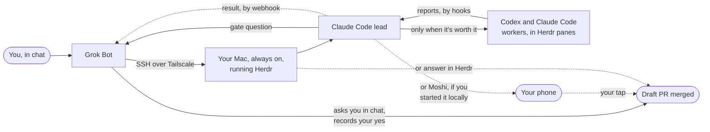
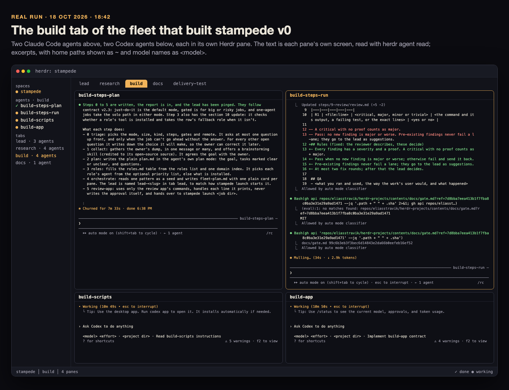

# The stampede guide

What stampede is at length, how a job flows, and one job walked through command by command. Install: [SETUP.md](SETUP.md). The short version: the [README](../README.md).

**You text a task to your Grok Bot. It reaches your Mac over Tailscale, where a Claude Code lead does the job in [Herdr](https://herdr.dev) and adds Codex or Cursor panes only when parallel work helps. Nothing is merged, pushed, sent or spent until you say yes.**

Grok Bot is the setup we recommend, but you don't need it: stampede also runs when you start it straight from Claude, Codex or any agent ([Without a bot](#without-a-bot)). Either way you can watch every agent in Herdr, and every question comes back to you.

**Let a Grok Bot set it up.** [Stompy](https://x.ai/bot/_mNMq-0M5aA02AQMNOHTy) is a Grok Bot that sets up stampede between your Grok Bot and your Mac, end to end, and keeps it healthy.

New releases: on [GitHub](https://github.com/vib-z/stampede), **Watch**, then **Custom**, then **Releases**. The site: [vib-z.github.io/stampede](https://vib-z.github.io/stampede/).

## Contents

- [How it flows](#how-it-flows), [Without a bot](#without-a-bot), [Quick start](#quick-start)
- [What is stampede?](#what-is-stampede), [Works with](#works-with), [Works well with](#works-well-with), [See it](#see-it)
- [How it works](#how-it-works), with [the job folder](#the-job-folder)
- [Use: one job, start to finish](#use-one-job-start-to-finish), [Share the plan first](#share-the-plan-first), [A front door outside Herdr](#a-front-door-outside-herdr-the-claude-desktop-app)
- [Front doors](#front-doors)

## How it flows

Started from Grok Bot, the setup we recommend:



## Without a bot

stampede works fully on its own with Herdr, Claude Code and this repo: start a job straight from Claude, Codex, Cursor or any agent, or from a Claude pane in Herdr ([Front doors](#front-doors)). Gate questions then reach your phone through Moshi, if you use it, or you answer in Herdr.

Either way:
- **One ask, one lead.** A Claude Code lead plans the job and does it.
- **Workers only when it's worth it.** The lead opens a Codex or Claude Code worker in its own Herdr pane for parallel work, another model or a reviewer, and works alone otherwise.
- **Hooks, not polling.** Workers report to the lead through hooks, and you can watch every pane in Herdr.
- **Your yes on every merge, push, send, spend or close.** The gate question goes back to whoever started the job ([Safety](SAFETY.md)), and the lead keeps working while it waits.

## Quick start

**An agent told to run a job with stampede:** start at [USING.md](../USING.md), one short page.

Install it as the [README](../README.md#install) shows.

**Your first ask.** Once per Mac, run the [unattended setup](../skills/herdr-fleet/references/unattended-setup.md), so the lead can start workers with no visit to their panes. Run `herdr-trust ~/code/my-app` once for your repo, open it in Herdr, start Claude in a pane, and type:

> With stampede: add a /health endpoint with a test, have a reviewer on another model check it, then open a draft PR.

**Then from your phone (recommended).** Set up Grok Bot's SSH, Tailscale and webhook once ([remote/grokbot/](../remote/grokbot/README.md)), and send the same ask in chat.

**On Herdr Core instead of the Herdr TUI.** With [Herdr Core](https://herdr.dev/core/) (`hc` 0.1.13 or later) installed and running, run `herdr-doctor`, then ask *"With stampede, on Herdr Core: ..."*. The front door runs `stampede new --core`: a job runs on Herdr Core only when you ask for it ([Herdr Core](CORE.md)).

**Limits.**
- macOS and Linux. On macOS you load the event relay's two launchd jobs yourself; on Linux `install.sh` starts the same timers. What ran live on Linux, and what has not yet: [docs/LINUX.md](LINUX.md).
- The lead is Claude by default, or Codex with `stampede new --lead codex`. Workers can be Claude, Codex or Cursor; on Herdr Core any program runs as a helper.
- Early: commands and files may still change.
- For big jobs. A small job runs as one agent session in a single tagged Herdr pane ([FAQ](TROUBLESHOOT.md)).

The full install, with every prerequisite: [Install](SETUP.md#install). A whole job, command by command: [the walkthrough](#use-one-job-start-to-finish).

## What is stampede?

stampede is multi-agent orchestration for Claude Code and Codex in Herdr: four skills and one command, installed by script or as a Herdr plugin. You ask once, in plain words: in a Claude pane in Herdr, from Claude or Codex desktop or Cursor, or, as we recommend, from your phone through Grok Bot.

stampede starts **one lead agent** for the job. The lead writes a short plan and starts working at once. It brings in Codex workers, or Claude Code or Cursor ones, each in its own Herdr pane, only when that agent earns its place: work that runs in parallel, a different model, one reviewer, or the same task many times over. Workers report through hooks, so nobody polls. Gate questions come back to wherever you asked, and nothing that matters happens without your own yes.

**Why.** Running many agents by hand means stops between steps, too many small agents, rounds that wait on each other, and a lead that spends its day writing briefs. Real jobs showed all four ([docs/RUNS.md](RUNS.md)). stampede is the lean answer: plan and go, work alone by default, wake on hooks, and ask you only what is yours to decide.

**Who it is for.** Anyone who runs Claude Code, Codex or Cursor and wants a whole job done from one ask, watched in Herdr and answered from a phone.

**What it is.** Four skills and one command:

| part | what it does |
|---|---|
| [`stampede`](../skills/stampede/SKILL.md) (skill) | the front door: say "use stampede" in any project chat and it writes the ask, opens a Herdr workspace for the project and starts the lead |
| [`herdr-fleet`](../skills/herdr-fleet/SKILL.md) | the playbook the lead follows: plan, panes, hooks, review, gates, report, reopen |
| [`grokbot-herdr`](../skills/grokbot-herdr/SKILL.md) | the front door for a bot that reaches your machine over SSH |
| [`share-plan`](../skills/share-plan/SKILL.md) | shows you the plan before any agent starts, only when you ask |
| [`stampede`](../scripts/stampede) (command) | the command: `new`, `start`, `tell`, `ask`, `cancel`, `approve` |

## Works with

**Agents.** The lead runs on Claude Code, or on Codex when you pick it (`stampede new --lead codex`, on the Herdr TUI or on Herdr Core). Workers run on Claude Code, Codex or Cursor, each started by `stampede start --kind claude|codex|cursor` with its own hooks and auto mode. A [Herdr Core](CORE.md) job runs any other CLI as a program, and the earlier `--core --relay` path hands Hermes and Kimi workers to Herdr TUI panes.

<table>
  <tr>
    <td align="center" width="150">
      <br>
      <b>Claude Code</b><br><sub>the lead, and workers</sub>
    </td>
    <td align="center" width="150">
      <picture>
        <source media="(prefers-color-scheme: dark)" srcset="images/logos/codex-dark.svg">
        
      </picture><br>
      <b>Codex</b><br><sub>the lead if you pick it, workers and reviewers</sub>
    </td>
    <td align="center" width="150">
      <picture>
        <source media="(prefers-color-scheme: dark)" srcset="images/logos/cursor-dark.svg">
        
      </picture><br>
      <b>Cursor</b><br><sub>workers</sub>
    </td>
  </tr>
</table>

**Tools.**

<table>
  <tr>
    <td align="center" width="150">
      <picture>
        <source media="(prefers-color-scheme: dark)" srcset="images/logos/herdr-dark.svg">
        
      </picture><br>
      <b>Herdr</b><br><sub>the panes you watch</sub>
    </td>
    <td align="center" width="150">
      <br>
      <b>Moshi</b><br><sub>questions on your phone</sub>
    </td>
    <td align="center" width="150">
      <picture>
        <source media="(prefers-color-scheme: dark)" srcset="images/logos/grokbot-dark.svg">
        
      </picture><br>
      <b>Grok Bot</b><br><sub>the preferred bot</sub>
    </td>
    <td align="center" width="150">
      <picture>
        <source media="(prefers-color-scheme: dark)" srcset="images/logos/tailscale-dark.svg">
        
      </picture><br>
      <b>Tailscale</b><br><sub>a bot's private link</sub>
    </td>
  </tr>
</table>

**Herdr Core** (`hc` 0.1.13 or later), Herdr's terminal runtime, can run a whole job in place of the Herdr TUI: [Herdr Core](CORE.md).

Herdr itself detects many more agent CLIs (its `herdr agent start --help` lists 24, from Gemini and Kimi to OpenCode and Copilot). That is Herdr's support, not stampede's yet: `stampede start` refuses any other kind (a Core job runs any CLI as a plain program), and starting workers on them is [planned](STATUS.md). The marks belong to their owners and imply no endorsement ([sources](images/logos/SOURCES.md)).

## Works well with

**[pstack](https://github.com/michael-denyer/pstack-claude), optional.** For coding jobs, the lead picks up pstack if you have it: data shape first, a contract commit, proof on the real surface. The lead is a normal Claude Code session, so an installed pstack loads on its own, and stampede's rules keep pstack's fan-out as Herdr panes you can watch. Not required: without it nothing changes. The rules: [references/pstack.md](../skills/herdr-fleet/references/pstack.md).

## See it



<sub>Real, drawn: the <code>build</code> tab of the fleet that built stampede's first version, drawn from each pane's own screen text (<code>herdr agent read</code>), personal paths replaced with <code>~</code>, 18 Oct 2026. A lean job opens fewer panes; each looks the same.</sub>

## How it works

The flow is the [diagram in How it flows](#how-it-flows), step by step, for any front door:

1. **You ask once**, in plain words, in a [front door](#front-doors). It writes the ask to a file, runs `stampede new --file <ask.md>`, tells you the lead's name, and steps back.
2. **One lead plans and goes.** `lead-<slug>` starts on Claude (Opus 5.5 at `xhigh` effort by default), or on Codex (GPT-6 Astra at `ultra`) with `--lead codex`, in auto mode, in a `lead` tab. It writes `plan.md` (the tasks, who does each, questions with a safe default, and the gates) and starts work.
3. **A pane only when it's worth it:** parallel pieces of about 30 minutes or more (at most 4), another model or tool, one reviewer on another model, or the same task many times (6 at once). Each worker gets its own Herdr pane.
4. **Hooks, not polling.** A worker's report, turn end, question or exit lands as a line in `<job>/inbox.log` (`REPORT`, `TURN`, `QUESTION`, `GONE`, and `UNDELIVERED` for a question, gate or post its bot has not heard), and Claude's file hook wakes the lead. A Codex lead has no file hook: stampede types each new line into its pane, marked `[fleet-job inbox for <lead>, not typed by the owner]`, once it is idle and unfocused.
5. **Review only what ships**, on another model, at most two rounds.
6. **Questions and gates go back to whoever started the job**: a bot gets a `question` or `gate` event, asks you in chat and passes your answer back (a gate's yes recorded with `approve-gate`); a job you started locally asks on your phone through Moshi. Which yes counts where: [Safety](SAFETY.md). The lead keeps working while it waits, and an agent's own say-so never counts.
7. **The lead reports back once.** When the job is done or stopped for good it runs `stampede finish <job> "<summary>"`, the one done event a bot outside Herdr gets for the job. While the job is open, plain turn ends stay on the machine; blocked, permission prompts, StopFailure, a stale or dead pane, questions, gates and the lead's posts (`stampede post`) still go out. Then the lead asks whether to close.
8. **Workers exit when their work is merged** or accepted. Nothing closes without your yes, and `reopen.sh` brings a closed job back.

**Stateful lead, stateless workers.** The lead holds your ask, the plan, the decisions and the judgement. A worker gets one brief and nothing else, so that brief carries the state: Goal, Why, Inputs, Constraints, Done when, Report back and If blocked, on the [hand-off template](../skills/herdr-fleet/references/brief.md). A thin brief is the usual cause of weak worker output. `stampede start` refuses a worker brief with a missing or empty section before starting anything. Pick a strong planner for the lead and a fast, capable executor for workers; both are [settings](CONFIGURE.md), not code.

**What lives where.** Your Mac, always on, runs Herdr, the lead and the workers. A bot such as Grok Bot runs on its own computer and reaches the Mac over SSH and Tailscale. Or the whole thing runs on one remote computer. Either way, the lead and its workers share one machine; workers on a second machine are [planned](STATUS.md).

**On Herdr Core** the flow keeps its steps, but Core holds the tree: the lead is a root terminal, each helper its Core child (any depth, at most 12 working at once), and the lead is woken by Core's notes about its children and by messages sent with `hc send`, never by hooks or inbox files. Questions, gates, posts and finish reach the owner as above; a blocked, failed, dead or stalled lead reaches the owner from the machine's watchdog within about 5 minutes ([Herdr Core](CORE.md)).

### The job folder

`stampede new` makes `~/code/herdr-jobs/jobs/<date>-<bot or local>-<slug>/` on every backend (the setting `jobs_root` moves the root), never inside your repo, so nothing lands in git. A job an older stampede made in `<repo>/.herdr-<slug>` keeps working. The repo stays the agents' working folder, and every agent gets `--add-dir <job>` to write there:

```text
ask.md        your ask, word for word
settings.json the settings stampede new resolved (not the user-only ones), and the layer that set each; every later
              command of the job reads it (stampede config show --job <job>)
workdir       the repo the agents work in
lead          the lead's name
plan.md       the lead's plan
briefs/       the generated lead brief, then worker briefs on the hand-off template
hooks/        each agent's hook settings and wake state; deliver.log for a Codex lead (not on Core)
inbox.log     REPORT, TURN, QUESTION, GONE and UNDELIVERED lines that wake the lead (not on Core)
inbox/        messages to each agent, one file per agent (not on Core)
questions/    a worker's questions, as files for the lead
asks/         questions out to your phone, while they wait; on Core, a phone answer the lead could not take
owner         the bot that started the job, when one did: its gates go back to it
workspace     the Herdr workspace id, or a Herdr Core job's key hc-<12 hex>; while the job is open,
              ~/.config/herdr-events/jobs/<id> names this job
backend       native for a Herdr Core job, core for one on --relay (no file: the Herdr TUI)
endpoint      the Herdr Core a Core job was made on (HC_SESSION, HC_SOCKET);
              every later command uses it
space         a Core job's space name (the lead's stampede.space label)
max-helpers   a Core job's cap, only when the owner set one
closed        a Core job closed whole by stampede close; stampede reopen removes it
tree.json     a Core job's reopen record: every node, its parent, kind, session, brief,
              and how to start it again
queue/        a Core job's helper starts waiting under the cap; dropped/ those whose parent ended
core.json, locks/, relay-state.json, start-failed, reopen-pending
              the --relay path's record (core-relay.md)
finished      the one-line summary written by stampede finish
gates/        each gate asked (action, PR, commit) and your recorded yes
gates.log     one line per gate switched off for the job, and each merge or push made without one
merges.log    one line per stampede merge: PR, reviewed commit, merge commit, review report, gate
agents.tsv    who was started, and how: the reopen record (not on Core)
approved      the plan's fingerprint, for a --review job
front-door    present when a chat outside Herdr relays for you (new --front-door)
outbox/       what the lead posts for that chat to relay: NNN.md and NNN/ files
outbox.log    one line per post, read by stampede wait
REOPEN.md, reopen.sh   written by herdr-reopen-snapshot before a close (a Core job: at every start
              and by stampede snapshot)
```

## Use: one job, start to finish

In a Herdr pane in your repo, ask your Claude chat: *"With stampede: make hello.txt with hi, then have a reviewer on another model confirm it."* The chat (a front door) writes the ask and starts the lead:

```console
$ printf 'Make hello.txt with hi.\nThen have a reviewer on another model confirm it.\n' > ask.md
$ stampede new --file ask.md
recorded lead-make-hello-txt-with-hi (claude) in ~/code/herdr-jobs/jobs/2026-10-29-local-make-hello-txt-with-hi/agents.tsv
DELIVERED lead-make-hello-txt-with-hi (inbox file)
lead-make-hello-txt-with-hi ~/code/herdr-jobs/jobs/2026-10-29-local-make-hello-txt-with-hi
```

Inside Herdr, `--workspace` defaults to the current workspace and the lead gets a new `lead` tab; `--pane <id>` puts it in an empty pane instead, and `--name <slug>` names the job. A front door outside Herdr has no current workspace: for the Herdr TUI it passes `--workspace` or `--pane`, and for Herdr Core `--core`; with none of them `new` refuses and makes nothing ([skills/stampede](../skills/stampede/SKILL.md)). The chat tells you `lead-make-hello-txt-with-hi` and stops.

**Plan in chat, then fork it into the lead.** A Claude chat where you and Claude already worked out the plan adds `--fork "$CLAUDE_CODE_SESSION_ID"`: the lead starts as a fork of that chat (`claude --resume <id> --fork-session`), keeps the whole conversation and writes the agreed plan into `plan.md`. Your chat stays as it was. Put the agreed plan in the ask file too: it stays the source of truth. Guide: [remote/claude-code.md](../remote/claude-code.md#plan-here-then-fork-the-lead).

**Pick the lead.** The lead is Claude unless you ask for Codex: then the front door adds `--lead codex` (`FLEET_LEAD_KIND=codex` makes it your standing choice). A Codex lead runs GPT-6 Astra at `ultra` with its hooks and `--approve-for-me`; its brief pointer is typed into its pane at once:

```console
$ stampede new --file ask.md --lead codex
recorded lead-make-hello-txt-with-hi (codex) in ~/code/herdr-jobs/jobs/2026-11-03-local-make-hello-txt-with-hi/agents.tsv
SUBMITTED lead-make-hello-txt-with-hi
lead-make-hello-txt-with-hi ~/code/herdr-jobs/jobs/2026-11-03-local-make-hello-txt-with-hi
$ stampede new --file ask.md --lead codex --fork "$CLAUDE_CODE_SESSION_ID"
stampede new: --fork forks a Claude chat, so it takes a Claude lead: drop --lead codex, or start without --fork
```

A Codex lead has no file hook: a short-lived deliverer types its new inbox lines into its pane once it is idle, unfocused and has nothing typed in its prompt (on Herdr Core, Core delivers them). Because text is typed there, it acts on a gate only after `stampede gate-ok` prints `APPROVED`.

The lead reads `ask.md`, writes `plan.md` and goes on at once. Here it writes `briefs/review-hello.md` on the [hand-off template](../skills/herdr-fleet/references/brief.md), then starts one reviewer on another model:

```console
$ J=~/code/herdr-jobs/jobs/2026-10-29-local-make-hello-txt-with-hi
$ stampede start $J review-hello --kind claude --pane <pane id> \
    --brief $J/briefs/review-hello.md \
    --model <another model> --effort max --report reports/review-hello.md
recorded review-hello (claude) in ~/code/herdr-jobs/jobs/2026-10-29-local-make-hello-txt-with-hi/agents.tsv
DELIVERED review-hello (inbox file)
```

When the reviewer writes `reports/review-hello.md` with `Status: PASS` in its first 10 lines and ends its turn, its hook adds `REPORT reports/review-hello.md` to `inbox.log`, which wakes the lead. A question for you, with the lead still working:

```console
$ stampede ask $J "Keep the file in the repo root?" \
    --option Yes --option No
ASKED 1fecfa0be4dc (the answer goes to the lead inbox; cancel with: stampede cancel <job> 1fecfa0be4dc)
```

Your tap comes back as `ANSWER ...` in the lead's inbox. A gate (say, merging the draft PR) goes back to whoever started the job ([Safety](SAFETY.md)); you started this one in Herdr, so it goes to your phone. The lead merges only with `stampede merge`, which checks the review report and the PR head first and names the gate it needs:

```console
$ sha=$(gh pr view 12 --json headRefOid -q .headRefOid)
$ stampede merge $J 12 --sha $sha --review $J/reports/review-hello.md
stampede merge: the merge gate is on: ask the owner with the next line, then run this again with --gate <id>
stampede ask <job> --gate --kind merge --sha 4e1b0c2f9a7d3e5b6c8a0f1e2d3c4b5a69788766 --pr 12 'merge PR 12'
$ stampede ask $J --gate --kind merge --sha $sha --pr 12 "merge PR 12"
GATE 3288fa0757e0 on the phone; act after stampede gate-ok <job> 3288fa0757e0 --sha <the commit you act on> prints APPROVED
$ stampede merge $J 12 --sha $sha --review $J/reports/review-hello.md --gate 3288fa0757e0     # after your tap
MERGED 12 9c2d7e1f0a4b6c8d3e5f7a9b1c2d4e6f8a0b1c3d
```

It marked the draft ready, merged with `--match-head-commit $sha`, and wrote `<job>/merges.log`: a `MERGING` line before it touched GitHub, then `MERGED`. Only the recorded yes opens a merge gate ([Safety](SAFETY.md)). Then the lead writes a short report and asks whether to close the workspace; `<job>/reopen.sh` brings it back later.

### Share the plan first

Say "share the plan first" and the front door adds `--review`. The lead then writes `plan.md` and ends its turn, and no pane can open until you approve that exact plan:

```console
$ stampede new --file ask.md --name hello-review --review
recorded lead-hello-review (claude) in ~/code/herdr-jobs/jobs/2026-10-29-local-hello-review/agents.tsv
DELIVERED lead-hello-review (inbox file)
lead-hello-review ~/code/herdr-jobs/jobs/2026-10-29-local-hello-review
$ J=~/code/herdr-jobs/jobs/2026-10-29-local-hello-review
$ stampede start $J review-hello --kind codex \
    --pane <pane id> --brief <brief>
stampede start: the owner asked to see this plan: run fleet-job approve after their yes, and again after any change to the plan
$ stampede approve $J --by "owner in chat"
DELIVERED lead-hello-review (inbox file)
$ cat $J/approved
Approved: 2026-10-21 21:35 by owner in chat, plan 6ef5e2effdb06d6adf70e17da8726c05dd2d057a4a7ba23c4fbe3836eed14ffa
```

The `start` refusal exits 2. The approval holds a fingerprint of `plan.md`; any later change locks `start` again until a new approve. A change you ask for goes to the lead with `stampede tell <job> lead "<your words>"`. The steps: [share-plan](../skills/share-plan/SKILL.md).

### A front door outside Herdr (the Claude desktop app)

When you talk to a chat outside Herdr, nobody watches the lead's pane. The front door then starts the job with `--front-door`: the lead posts everything that is for you (the plan, questions, gates, files, its report) to `<job>/outbox/`, a hook turns its own question cards and SendUserFile into posts, and the front door waits on the outbox in the background and relays each item. Here a review job:

```console
$ stampede new --file ask.md --pane <pane id> --name seller-copy --front-door --review
lead-seller-copy ~/code/herdr-jobs/jobs/2026-10-29-local-seller-copy
$ J=~/code/herdr-jobs/jobs/2026-10-29-local-seller-copy
$ stampede approve $J --by "owner in desktop chat: 'ok - lets go'"
stampede approve: the owner has not been shown this plan.md: the lead posts it (fleet-job post <job> "PLAN READY" --file plan.md), the front door sends it to the owner, and only their yes to it is approved
$ stampede post $J "PLAN READY: one Sonnet build, one review" --file $J/plan.md      # the lead
POSTED 001 for the front door to relay (~/code/herdr-jobs/jobs/2026-10-29-local-seller-copy/outbox/001.md)
$ stampede wait $J                                                                   # the front door, in the background
# 001 post

PLAN READY: one Sonnet build, one review

Files:
- ~/code/herdr-jobs/jobs/2026-10-29-local-seller-copy/outbox/001/plan.md
$ stampede approve $J --by "owner in desktop chat: 'approve as written'"
DELIVERED lead-seller-copy (inbox file)
$ stampede ask $J --gate --sha <commit> --pr 12 "mark PR #12 ready for review"        # the lead
GATE 83307febaa1a posted to the front door as outbox 002; act after stampede gate-ok ... prints APPROVED, or on the owner's yes typed in your pane
$ stampede approve-gate $J 83307febaa1a --sha <commit> --by "owner in desktop chat: 'mark it ready'"
APPROVED 83307febaa1a at <commit>
```

The front door shows you the plan file itself, and a yes to its own summary is never an approval. A gate's item carries the exact `approve-gate` line, which the front door runs with your words quoted. If the lead is held at a card anyway, `stampede wait` and `stampede tell` say `BLOCKED_ON_CARD`. The lead's `finish` posts a `done` item, and `stampede wait` says `LEAD_GONE` when Herdr no longer has the lead. The front door's loop: [skills/stampede](../skills/stampede/SKILL.md#steps); the lead's side: [front-door.md](../skills/herdr-fleet/references/front-door.md).

**On Herdr Core** the same loop runs with `stampede new --core --front-door` from a chat outside Herdr. One run against the test suite's fake `hc`, every command from outside Herdr:

```console
$ stampede new --core --file ask.md --name login --front-door --review
on Herdr Core (--core), repo <repo>
hook pre-push installed in <repo>/.git/hooks/pre-push: a job's agent cannot push to the default branch without the gate
STARTED lead-login (t1)
lead-login ~/code/herdr-jobs/jobs/2026-11-14-local-login
$ J=~/code/herdr-jobs/jobs/2026-11-14-local-login
$ stampede post $J "PLAN READY: two helpers" --file $J/plan.md                     # the lead
POSTED 001 for the front door to relay (~/code/herdr-jobs/jobs/2026-11-14-local-login/outbox/001.md)
$ stampede wait $J                                                                # the chat, in the background
# 001 post
...
$ stampede approve $J --by "owner in desktop chat: 'go'"
SUBMITTED lead-login (t1)
$ stampede ask $J --gate --kind merge --sha <commit> --pr 12 "merge PR #12"       # the lead
GATE daf2e0132e56 posted to the front door as outbox 002; act after stampede gate-ok ~/code/herdr-jobs/jobs/2026-11-14-local-login daf2e0132e56 --sha <the commit you act on> prints APPROVED
$ stampede wait $J                                                                # the chat
# 002 gate

Gate daf2e0132e56 (merge): merge PR #12 (PR #12) at <commit, 12 hex>?
One exact action, yes or no. Show the owner this action as written.

Answer with: fleet-job approve-gate ~/code/herdr-jobs/jobs/2026-11-14-local-login daf2e0132e56 --sha <commit> --digest 999675042abdf0d7 --by "owner in <chat>: <their exact words>"   (a no: fleet-job tell ~/code/herdr-jobs/jobs/2026-11-14-local-login lead 'GATE daf2e0132e56 NO: <their words>')

$ stampede approve-gate $J daf2e0132e56 --sha <commit> --digest 999675042abdf0d7 --by "owner in desktop chat: 'merge it'"   # on the owner's yes
SUBMITTED lead-login (t1)
APPROVED daf2e0132e56 at <commit>
$ stampede wait $J                                                                # the lead waits at a permission dialog
BLOCKED lead-login: permission. Core says it waits at a dialog in its terminal t1 (hc read t1). Its screen:
Allow this command?
...
```

`SUBMITTED` means Core typed the line into the lead's terminal: there is no inbox file. The lead has no hooks there, so its brief tells it never to use a question card or a file-send tool. [Front door](CORE-NATIVE.md#front-door) has the whole contract.

## Front doors

Every front door writes the ask and runs `stampede new`; none plans or runs the job itself.

| front door | how you ask | where answers arrive | guide |
|---|---|---|---|
| a chat in Herdr | type the ask in a Claude pane | the lead's pane, plus a Moshi card | [walkthrough](#use-one-job-start-to-finish) |
| Claude desktop or the Claude app | Remote Control into a session on the machine | the lead's row in the Claude app, plus Moshi | [remote/claude-code.md](../remote/claude-code.md) |
| Codex desktop or the ChatGPT app | Codex on the connected machine | Moshi | [remote/codex.md](../remote/codex.md) |
| Cursor | a Cursor chat on the machine runs the same two commands | Moshi | [remote/other.md](../remote/other.md) |
| **Grok Bot** (preferred bot) | the bot reaches your Mac over SSH and Tailscale | the Grok chat, woken by a webhook | [remote/grokbot/](../remote/grokbot/README.md), [grokbot-herdr](../skills/grokbot-herdr/SKILL.md) |
| any other bot | the same as Grok Bot | its webhook | [remote/other.md](../remote/other.md) |
| a whole remote computer | Herdr, the CLIs and stampede on one box | any of the above | [remote/any-machine/](../remote/any-machine/README.md) |

Any of them can run the job on Herdr Core instead, when asked: it passes `--core --cwd <repo>` ([Herdr Core](CORE.md)). It then hears a question, a gate, a post and done from the lead's own commands, and blocked, error, dead or stale for the lead from the machine's watchdog within about 5 minutes.

Moshi, the phone side of every front door: [remote/moshi.md](../remote/moshi.md).
