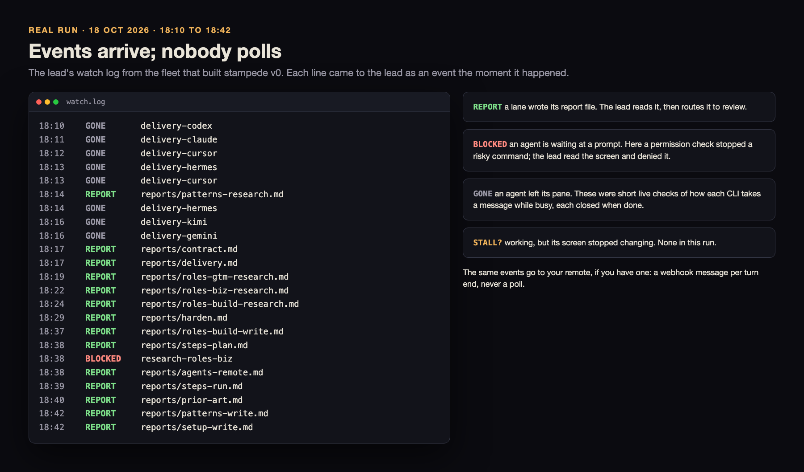

# Real runs

Each run here really happened. Times are local, names are the real agent and tab names, and personal details (home paths, hostnames, accounts) are removed.

## Contents
- [Run 1: the fleet that built stampede v0](#run-1-the-fleet-that-built-stampede-v0)
- [Run 2: a landing page, through stampede, by a fresh tester](#run-2-a-landing-page-through-stampede-by-a-fresh-tester)
- [Run 3: stampede improves itself, by a fresh tester](#run-3-stampede-improves-itself-by-a-fresh-tester)
- [Run 4: a landlord app's competitors, features and site, by a fresh tester](#run-4-a-landlord-apps-competitors-features-and-site-by-a-fresh-tester)
- [Run 5: a property-data research and build job, by a fresh tester](#run-5-a-property-data-research-and-build-job-by-a-fresh-tester)

## Run 1: the fleet that built stampede v0

**18 Oct 2026, 18:04 to 20:24.** From the plan's approval to the build review's final pass.

stampede did not exist yet, so this fleet ran by hand, with the owner's own fleet playbooks that stampede is built from: a lead agent, a written plan with lanes, briefs, reports as files, a watch, a reviewer on a different model. It is the job stampede is meant to automate, run once the slow way.

### The ask, in plain words

Build stampede v0: the playbooks for every step from ask to reopen, roles by link for eight example domains, worked patterns, the agent and remote guides, the helper scripts, the Herdr plugin and installer, a review app with a live status page, and a README a stranger can install and use from.

### How it was sized

- **Mode:** gated in effect. The owner approved the plan in chat, then four amendments (v2 to v4, and two contract changes), each with a yes.
- **Size:** a fleet. Eleven lanes of 30 to 120 minutes, each owning its own folders in one shared checkout on branch `v0`; only the lead commits.
- **Kind:** code, with heavy research and writing.

### The layout

One Herdr workspace, `stampede`, with four tabs (and a scratch tab for live delivery checks). Models follow agents/priority.md: one builder model, a different reviewer model, and Codex as the second vendor.

*Real: the `build` tab at 18:42, drawn from each pane's own screen text (`herdr agent read`), personal paths replaced with `~`.*

| tab | agent | CLI and part | job |
|---|---|---|---|
| lead | lead-stampede | Claude Code, builder model | the contract, hardening, integration |
| lead | observer-stampede | Claude Code, builder model, lower effort | a friction log of the old playbooks while they build the new |
| lead | review-stampede | Claude Code, reviewer model | reviews the plan, then the build (no builder runs on its model) |
| research | research-roles-build | Claude Code, builder model | roles research, then product, engineering, design and QA indexes |
| research | research-roles-gtm | Claude Code, builder model | roles research, then marketing, video, browser-forms and research indexes |
| research | research-roles-biz | Claude Code, builder model | business roles research, then the setup brainstorm |
| research | research-patterns | Claude Code, builder model | orchestration research, prior art, then the patterns |
| build | build-steps-plan | Claude Code, builder model | steps 0 to 5 |
| build | build-steps-run | Claude Code, builder model | steps 6 to 11 and reopen |
| build | build-scripts | Codex, its default model | the delivery check, then the scripts, plugin and installer |
| build | build-app | Codex, its default model | the review app and the status page |
| docs | copy-stampede | Claude Code, builder model | the agent and remote guides, then this README and docs |

### Timeline

| time | what happened |
|---|---|
| 18:04 | plan v1 approved by the owner in chat; launch |
| 18:06 | first wave starts: observer, four researchers, build-scripts (delivery check) |
| 18:07 | the planner hands over to lead-stampede |
| 18:14 | patterns research lands |
| 18:16 | the contract is committed; review-stampede starts on the plan |
| 18:17 | the delivery check lands: Claude and Codex probed; Cursor, Hermes, Kimi and Gemini blocked (quota, detection, trust, sign-in), so unverified |
| 18:19 to 18:24 | the three roles research reports land |
| 18:21 to 18:29 | plan v2, v3 and v4: business roles research added; the live status page joins the app lane; role folders only for eight example domains, with a setup brainstorm for any other business |
| 18:26 | plan review done: 1 blocker, 7 major, 13 minor findings |
| 18:29 | the contract is hardened (all 21 findings accepted) and committed |
| 18:31 | builders start: steps, scripts, app, roles writing, setup, patterns, agent and remote guides |
| 18:31 to 18:32 | the owner's changes: a thin agents layer (link official docs, never copy install steps); "just do it" becomes the default mode |
| 18:33 | a prior-art lane is added: existing Herdr plugins, so stampede does not rebuild what exists |
| 18:37 to 18:42 | roles indexes, steps 0 to 5, the agent and remote guides, steps 6 to 11, prior art and patterns land |
| 18:40 | the README lane starts early on the finished lanes, to shorten the critical path |
| 18:43 | five finished lanes are committed: both roles lanes, the setup brainstorm, the patterns, steps 0 to 5 |
| 18:53 | the build review starts early on the finished lanes; the rest follow as they land |
| 18:58 | the review app and status page land; a live check finds an upstream Herdr bug with Hermes, which becomes a known issue |
| 19:02 to 19:08 | the owner's changes: a batch of small coding tasks routes to herdr-projects; panes follow the plan's grid with an explicit ratio; nothing hard-coded (a new test); launch becomes a compiled pipeline |
| 19:13 | build review part 1 passes with 7 findings (R1 to R7), each fixed by its lane |
| 19:16 to 19:17 | the owner's changes: run anywhere (setup B) and a story-first README, its opening lines approved word for word |
| 19:18 | the review of the app passes with no findings |
| 19:20 | a ledger maps every lesson from the old playbooks to where it now lives: 142 landed, the rest routed to lanes or dropped with a reason |
| 19:33 | the scripts lane lands: the dispatcher, the compiled launch, the installer and the plugin; the suite passes |
| 19:38 | the cloud research lands: cloud machines and cloud lanes become v0 docs, their automation v1 |
| 20:14 | the full suite passes in the lead's run |
| 20:17 | the lead integrates and opens draft PR #1 (`v0`) on the reviewed commit; the suite passes |
| 20:18 | the observer's friction report and the retro (plan against actual for every lane) land |
| 20:20 | with the owner's yes, the live plugin check: `herdr plugin link` (server 0.9.4, client 0.9.5) accepts the manifest, a pane status change reaches `stampede event` twice within 30 seconds, exit 0; then the plugin is unlinked |
| 20:24 | the build review on a model no builder used passes, all five parts |

*Real: the lead's `watch.log`, 18:10 to 18:42. Each line arrived as an event; the lead never polled a pane. Paths shortened to the report's file name.*

### What went wrong, and what changed because of it

- **A file named `claude.md` became instructions.** On macOS's case-insensitive disk, Claude Code loaded `remote/claude.md` as a nested `CLAUDE.md` the moment it was written. The files became `claude-code.md`, and a test now forbids `claude.md` and `agents.md` below the root.
- **A startup prompt on every Claude pane.** A project MCP server asked for approval in each new pane; the lead cleared each one and turned the server off in the project's local settings. Step 6 now says: read each new screen and clear startup dialogs.
- **A dangerous command was stopped.** A test asked to run a removal on what looked like the real home folder; the permission prompt caught it, the lead denied it, and the rule became: make a temporary home with `mktemp -d` and remove only that.
- **Live probes need signed-in CLIs.** Four of six CLIs could not be probed (quota, detection, trust, sign-in). The docs now say: start each CLI once by hand, and Cursor stays documented but untested.
- **Overlap with existing plugins.** The prior-art lane found that herdr-projects already covers a steady stream of coding tasks; the README now says so, and stampede borrows its PATH launcher and doctor ideas with credit.
- **A watch alarm that was not a stall.** At 19:37 the watch flagged `STALL?` for an agent whose work was long done: its screen sat at an empty prompt while Herdr still read it as working. The lead read the screen before acting, which is why the first check in troubleshooting is to read the screen.

### How it ended

Draft PR #1 (`v0`), waiting for the owner's merge. What the run taught stampede, ranked by the observer, fed the next round: one door to the fleet after launch, report files as the only done signal, and every time taken from the clock.

## Run 2: a landing page, through stampede, by a fresh tester

**18 Oct 2026 20:18 to 19 Oct 2026 00:55.** The first job run through stampede itself. A tester agent that took no part in the build (Claude Code, in a Herdr workspace of its own) gave stampede one ask as it was written, and used only this README and the repo. stampede ran from the checkout by path, never installed.

### The ask, in plain words

A landing page for stampede, in light and dark: a brand guide, a logo (options first, then an animation), marketing images made alongside, and copy that tells a story. The owner keeps three picks (the brand direction, the logo, the final page), and nothing is deployed or published without asking.

### What happened

- **Sized:** gated, kind code (no pattern fits brand, logo and assets, so the tester chose the closest), with three stage gates: brand pick, logo pick, page pick.
- **Planned:** one ask became a 15-task plan, a 30-lane fleet plan on 16 panes in 5 tabs, and a plan review on another model that changed 8 things.
- **Built:** draft PR #3 (`landing-page` into `v0`): the page, the brand guide, the logo with its animation and 16 marketing images. The suite passes; Lighthouse 97, 100, 100, 100 on a phone and 100 across the board on desktop.
- **Held:** every paid image round waited for the owner's yes; nothing was deployed, published or merged.
- **Not reached:** the owner's answer at the end gate, step 11 (cleanup) and reopen. Every pane, tab and worktree of the run is still open, for the owner to decide.

### Timeline

| time | what happened |
|---|---|
| 20:18 | the tester reads the README, `SKILL.md`, steps 0 and 1 and the gates |
| 20:20 to 20:22 | triage and collect, by the tester as the entry agent; one question card, every default taken |
| 20:22 to 20:34 | plan, roles and fleet plan by three fresh step agents (1.5, 2 and 6.5 minutes) |
| 20:35 | the plan review: 8 findings accepted, 1 rejected with a reason |
| 20:37 to 21:27 | the plan gate on the review page, worked from the owner's phone over Tailscale; a mis-tapped Cancel ended it once, and it was served again; approved at 21:27 |
| 21:27:50 | the first live compiled launch: all 11 stages, 5 tabs, 16 named panes, 3 agents started, the watch on, in 50 seconds |
| 21:28 | launch had skipped the plan's worktree; the lead made it and rewrote the briefs (4 minutes) |
| 21:31 to 22:05 | research, three brand directions (10 minutes each against 30 planned), the design review, the brand pick |
| 22:11 | the money gate for the first logo images; the owner's yes |
| 22:12 to 23:32 | copy through three review rounds, two logo rounds and the logo pick, the brand guide, and lanes added from the owner's notes |
| 23:36 to 00:44 | the page build, then code, assets, accessibility, QA and brand reviews, two fix rounds |
| 00:49 | the lead integrates; the suite passes; draft PR #3 |
| 00:55 | the end gate: `delivery.md` names the reviewed commit and the exact merge command; with no answer (the owner asleep), nothing is merged |

Ask to plan gate: 6 minutes. Ask to draft PR: 4 hours 31 minutes, 50 minutes of it at the plan gate.

### What went wrong, and what changed because of it

The tester logged 22 places where it got stuck, guessed or needed help. Each is addressed on branch `fixes-dogfood-1`, by a fix or, where the cause is outside stampede, a documented workaround (troubleshooting); the ones that changed how stampede works:
- **`stampede` was not on PATH from a checkout.** Briefs now name the checkout's `scripts/stampede` by absolute path, and the README says how to run without an install.
- **A report counted as done whatever it said.** Two designers wrote "not ready" notes at their report paths. A report now counts only with `Status: DONE` (or `PASS` for a review) in its first lines; progress goes to `work/progress/`.
- **Launch skipped the plan's worktree.** Launch now reads the `Worktrees:` line and makes the worktree before any agent starts.
- **Gates ran on two channels and raced.** The tester asked the owner a gate question the step pane was already asking. `SKILL.md` and the [Safety](../README.md#safety) section now say where each gate is answered.
- **The phone approval link died** when its server stopped. Serving on a Tailscale address is now documented, the server keeps serving until approve or a confirmed Cancel, and Cancel needs a second tap.
- **The lead's pane was too narrow for its question cards**, sharing a tab with researchers. The lead now gets a tab of its own, and the fleet a new workspace by default.
- **Four of five watch alarms were false**, for finished step agents and finished lanes. The watch now follows only lane agents with a lane still open, and the reopen record leaves out the entry pane.

## Run 3: stampede improves itself, by a fresh tester

**19 Oct 2026, 08:16 to 18:36.** The second job run through stampede, and the first to reach the close. A fresh tester agent (Claude Code, in a Herdr workspace of its own) gave stampede the owner's 65-line ask, a Markdown file, with `stampede new`, and used only the README and the repo. stampede ran from the checkout by path, never installed; the checkout stayed unedited, and the job worked in its own worktree on branch `chart-plan`.

### The ask, in plain words

The fleet plan was too complicated to read: run 2's 15 tasks became 30 lanes on 16 agents, in Herdr words, with no clear order. Show it instead as a team in rounds: the lead on top, a row per round with the boxes that run at the same time side by side, checkers as small badges, the owner's picks as stops between rounds, three lines per box. Let the owner move a task, change the order, add or remove agents and swap an app or model with a drag or a tap, every edit checked at once; after the yes, the same chart is the live view. In stampede's own look, which the owner picks. Then re-test run 2's 22 fixes and fix whatever else needs it. Nothing merges without the owner.

### What happened

- **Sized:** gated, small, kind code; gates at the plan, the fleet plan, a look pick and the end. Triage wrote a default for each of six open questions and asked none.
- **Planned:** an 11-task plan; a fleet plan of 17 lanes on 9 agents in 4 tabs, 5 h 15 min planned; a plan review on another model (fail: 2 must-fix, 4 advisory), every point taken.
- **Built:** the plan as a team in rounds (run 2's 15 tasks come out as 7 agents in 5 rounds), the review app as one chart to edit and approve, the same chart as the live view, and a jobs view the owner added mid-run, which step 8 put into plan v2 for a second yes. The re-test found 14 of run 2's 22 fixes working live. Every piece had Important findings from a reviewer on another model, each fixed by its builder.
- **Delivered:** draft PR #5. At the end gate the owner asked for a polish round first, then said yes to everything; squash-merged at 18:34 with 217 tests passing.
- **Closed:** the lead exited ten agents and closed the job's tabs, worktree and workspace, each on the owner's yes. Reopen was not tried.

### Timeline

| time | what happened |
|---|---|
| 08:17 | `stampede new` with the ask file's text: the job folder, `ask.md` word for word, a fresh entry agent in a new `plan` tab, in 7 seconds |
| 08:20 | triage: gated, small, code; collect starts as a fresh agent in a second pane and asks question 1 of 6 |
| 10:13 to 10:17 | the owner answers all six, each the written default; the first answer came 1 h 53 min after the question |
| 10:19 to 10:21 | the plan gate: 11 tasks, approved in 2 minutes |
| 10:22 | Claude Code's auto mode refuses step 2's hand-off, `stampede step 3`; step 2 stops and asks. The tester runs it from its own pane, a mistake that works around the check; step 2's own run, after the owner adds a narrow permission rule, gets `ALREADY_WORKING` |
| 10:24 to 10:32 | roles (8), the fleet plan and its review on another model, every point taken |
| 10:32 to 11:10 | the plan gate on the review page, served on the Tailscale address and approved from the owner's phone |
| 11:10:31 | launch: a new workspace, the lead alone in its tab, 9 named panes, the worktree on `chart-plan` made before any agent, 12 stages in 40 seconds; the last stage, exit-steps, fails on its first step agent |
| 11:20 to 11:34 | the re-test, three looks in light and dark for laptop and phone, and the plan in rounds |
| 11:36 to 14:02 | the look pick, asked as a card that blocked the lead's pane; with the owner away, nothing moves for 2 h 26 min, and review findings wait unread in the lead's inbox |
| 14:04 to 14:56 | new scope from the owner, a jobs view; step 8 writes plan v2; the owner approves it on the review page |
| 14:57 | `stampede next` refuses v2 until the lead sets its digest by hand; round 2 starts |
| 15:07 | the first commit on `chart-plan` |
| 15:13 to 16:31 | the chart, the live view, the jobs view and QA on Codex; each piece reviewed in two or three loops |
| 17:22 | the second commit; draft PR #5 |
| 17:25 to 17:27 | the end gate: the owner asks for a polish round on the editing panels first |
| 17:28 to 18:33 | the polish round, reviewed again; 217 tests pass |
| 18:34 | PR #5 squash-merged |
| 18:35 to 18:36 | ten agents exited; the job's tabs, worktree and workspace closed, each on the owner's yes |

**Where the time went.** Ask to end gate: 9 h 9 min; ask to close: 10 h 20 min. Of that, 5 h 39 min was the owner's questions and gates: collect 1 h 57 min, the plan 2 min, the fleet plan 38 min, the look pick 2 h 26 min, plan v2 36 min. Each time the owner was away, nothing else moved. The work itself ran on time: 568 lane minutes against 570 planned. Launch to end gate: 6 h 15 min against 5 h 45 min planned; builds ran at about a third of their planned time, and reviews took two or three loops.

### What went wrong, and what changed because of it

The tester logged 35 places where it got stuck, guessed or needed help; the job's own reviewers found more in its work, each fixed before the merge. The ones that change how stampede works are fixed in `main` (PR #6, branch `fixes-improve`, merged 19 Oct 2026):
- **Questions with a default stopped the job.** Collect asked six questions again, one at a time, each with a written default the owner then kept; the first waited 1 h 53 min. Triage now writes a safe default for every open question, and collect shows them on one card, "Keep these defaults, or change one?"; only a question with no safe default is asked on its own.
- **A gate held as a card stopped the fleet.** The look pick blocked the lead's pane for 2 h 26 min, and review findings waited unread for 3 h 22 min. The lead now asks only the gate's own question, never as a card that holds its pane, and work that does not need the answer goes on. A pick page (`review.py pick`) shows visual options on a phone.
- **A running job could not take an amended plan.** `stampede next` refused plan v2, and the lead set its digest by hand. `next` now takes an amended plan when the check passes and every started lane is unchanged (a gated plan approved again), and otherwise names the lane that changed.
- **Launch put the job folder's own files in the worktree.** The re-test list and the looks landed in a second, git-ignored job folder inside the worktree, and at cleanup the lead copied them out by hand before removing it. Owned paths in the job folder now stay there, and step 11 runs `stampede keep-files` before any worktree removal, never with `--force`.
- **Finished step agents did not exit.** Herdr 0.9.5's `agent wait` returns at once for an idle agent, and Claude's "Background work is running" dialog held `/exit`. The job's own work fixed both; steps 0 and 1 now exit too.
- **Step 8 could not tell when step 9 was done** (11 minutes). A review now carries the done marker, `Status: DONE`, and `Verdict: pass` or `Verdict: fail` on its own line; step 8 waits for the marker.
- **A refused hand-off was run by another agent.** Auto mode refused `stampede step 3`, and the tester ran it from its own pane. A step whose hand-off is refused now stops and asks the owner, never another agent (troubleshooting).
- **The job was named after a heading.** The ask file began with one, so every pane was `...-the-ask-for-the-self`. `stampede new --file <ask.md> --name <slug>` takes the file and the name; without a name the slug skips headings, quotes and blank lines. Each Claude session is named `<agent> · <job>`, so the Claude app's search finds one job.
- **A yes on a condition was judged by the lead.** The owner said "fix that, then yes"; the lead judged the fix itself and merged two commits after the one that was asked about. A yes on a condition is now a no plus a task: do it, then ask again with the new commit and a way to see it.
- **A loose process kill.** An agent stopped another session's server by matching a word. Every brief now says to stop only your own processes, by PID or full path.
- **One agent's tool state broke the suite.** A browser tool's `.gstack/` in the worktree failed the shape tests for every agent. They now skip git-ignored files, and `.gstack/` is ignored.
- **The reopen record forgot the closed tabs.** Its last refresh came after the fleet's tabs had closed. A snapshot now keeps the tabs of earlier snapshots.
- **The register was left with placeholders**, and the lead typed start times by hand. Launch now fills the plan's version and sha, the approval, the launch time and the job, and each agent's start time.
- **The lead heard back through a watch that expired.** Its watch ran under Claude's monitor tool, which stops after 30 minutes; re-arming it once needed the owner's yes, and for 22 minutes the lead heard nothing. A Claude lead now starts with hooks that watch the job's report, question and review files and wake it the moment one lands; nothing polls and nothing expires, and agents never wait or watch. Checked live the same evening: a lead started by launch's own code woke on two files with nothing typed into its pane.
- **Nothing paged the owner while the lead was blocked.** The watch logged `BLOCKED` for the lead six times, into the blocked lead's own monitor. The watch now pushes a blocked lead through `STAMPEDE_NOTIFY_CMD`, the lead's own hook pages too, and the README says how to turn on Herdr's system notifications and Remote Control's push.
- **Looking at a pane stalled it**, for 30 minutes and then 20, because `herdr-send` never types into the selected pane. Messages to a Claude agent now go to its inbox file, so selecting its pane holds nothing up; for other CLIs the message waits, then is queued for the lead's next wake.
- **The Codex reviewer's messages never arrived**, each failing as "not a live classified agent" while the lead was live. `herdr-send` now says why it failed (the tester's unchecked guess: Codex's sandbox could not reach Herdr), and a question file wakes the lead whatever the sender's kind.

## Run 4: a landlord app's competitors, features and site, by a fresh tester

**19 Oct 2026, 21:00, to 20 Oct 2026, still running at 21:00.** The third job run through stampede, and the first on a product of the owner's that real users run. A fresh tester agent (Claude Code, in a Herdr workspace of its own) gave stampede the owner's ask with `stampede new --file`, and used only the README and the repo. stampede ran from the checkout at `main` (PR #6) by path, never installed; Herdr 0.9.4, Claude Code 2.1.303.

### The ask, in plain words

Research the competitors of the owner's portfolio app for UK landlords, using a public reverse-engineering repo the owner named; make the app feel modern and world class with new features; and update its site to promote them. A real test: merging, deploying, publishing, sending or spending each need the owner's yes.

### What happened

- **Sized:** gated, a fleet, kind other (code the closest); eight open questions, each with a default, and a pick of the features.
- **Planned:** from `new` to the fleet plan's approval in 52 minutes, about 22 of them waiting on the owner. The fleet plan had 6 rounds, 12 workers, 4 checkers and 3 stops, 5 h 47 min planned. The plan check caught 8 errors in the first draft, which step 4 fixed in under 2 minutes; the plan review on another model failed it with 3 majors, the first that preview deployments shared production's database and paid keys.
- **Built:** a competitor study (a 22-row capability matrix, every citation resolving) and a ranked shortlist of 12 features. The owner picked three and the site fixes, and four draft PRs opened on the app's repo: a remortgage radar, documents in and dates out, rent and yield against the local market, and the site update. Every paid evaluation of the app's assistant ran on the owner's yes, about $0.15 by 20:34.
- **Merged:** the owner said yes to all four, then asked for every nit fixed and three of four out-of-scope items added first, which made a new build round. By 21:00 on 20 Oct two PRs had merged and deployed to production, each on a yes typed in the lead's own pane; the other two were in their last review.

### Timeline

| time | what happened |
|---|---|
| 21:00 | the tester reads the README, `SKILL.md` and the ask |
| 21:02 to 21:05 | `stampede new` from a fresh folder: the trust gate (the owner's yes in 24 seconds), then a startup dialog, a refusal to start again in the same pane, and a time-out on the old screen's text; it worked once the tester cleared the pane |
| 21:06 to 21:23 | triage, collect (one card, every default kept), the plan and its gate, roles, the fleet plan, each by a step agent in its own pane |
| 21:27 to 21:39 | the plan review lands; step 4 does not wake on it for 11 min 40 s, until typed into |
| 21:41 to 21:58 | the plan gate on the review page, served on localhost and out of the owner's reach for 12 minutes, until served again on the Tailscale address; approved at 21:58 |
| 21:59 | launch: 17 panes in 42 seconds. The two agents it started, the lead and a researcher, both on the model `default`, got `--model default,`, and every turn failed at once: the fleet was dead |
| 22:34 | with the fix in `main` (PR #7), the two started agents restarted by hand; down about 35 minutes |
| 22:37 to 22:42 | stop 1 (trim the competitor list, 42 seconds); round 2's four research lanes done in 4 minutes |
| 22:42 to 23:02 | the lead does not wake on the four reports for 19 minutes, until typed into |
| 23:02 | the preview gate (point previews at staging, skip them, or accept production data), asked as a card that holds the lead's pane overnight |
| 23:04 | the checker fails all four lanes; two of the four workers never wake on its fix requests |
| 07:30 | the owner answers the preview gate after 8 h 28 min; the lost fix requests are typed in, 8 h 27 min late |
| 07:34 to 07:49 | round 2 passes; the lead misses the four passes for 15 minutes |
| 07:55 to 07:57 | the competitor study and the shortlist |
| 08:09 | the wake fix merges to `main` (PR #8); the lead restarts on it, and from 08:21 wakes on its own within seconds |
| 08:22 to 08:36 | stop 3, the features: three of the twelve, plus the site fixes |
| 08:36 to 09:05 | three builders and the copywriter, each on a worktree of the app's repo; pushes held until the preview settings change |
| 08:51 to 09:46 | a money gate for a paid evaluation, then three owner answers on how its key reaches the builders |
| 09:49 to 10:14 | 25 minutes with nothing moving and no alarm, until the lead is typed into |
| 10:19 to 12:43 | a second money card holds the lead for 2 h 24 min; a recheck that needed no owner waits behind it |
| 12:47 to 13:38 | round 5: the site's words and update, phone and desktop checks, every check passed |
| 13:22 to 13:24 | the owner finds staging previews impossible and chooses production data; the push hold (4 h 47 min) lifts and four draft PRs open within 2 minutes |
| 13:39 to 14:05 | the summary and stop 6 (which PRs to merge); the owner asks to see the features, and four local demos give about 45 screenshots |
| 18:34 | stop 6: the owner's yes to all four, relayed into the lead's pane, 4 h 54 min after the card |
| 18:43 | Claude Code's auto mode refuses the merge on a relayed yes; the lead does not work around it |
| 18:45 to 20:02 | a card on four out-of-scope items holds the lead for 1 h 16 min; the owner picks three |
| 20:32, 20:46 | the first two PRs merge and deploy, each on a yes typed into a card in the lead's own pane |

**Where the time went.** The owner's questions and gates waited about 16 h 30 min by 18:34: 8 h 28 min for the overnight preview gate, 4 h 54 min at stop 6, 2 h 24 min on the second money card. Work that needed no owner stalled too: missed wakes cost 11 min 40 s, 19 minutes, 15 minutes and, for two workers' fixes, 8 h 27 min; a quiet 25 minutes went unnoticed; and three times a recheck waited behind a card that held the lead. The building itself was fast: round 2 in 4 minutes, two of the features' first builds in 9.5 and 11 minutes.

### What went wrong, and what changed because of it

The tester logged 27 findings; the owner's own verdict was "Run 2 took very long", the features "just did basics, added rather than reinvented", with too many cards on the site. Fixed in `main` during the run:
- **Every `default` model broke the fleet.** Launch read the cell `default, high` as the model `default,`. It now reads `<model> <effort>` and `<model>, <effort>`, and `default` leaves the model to the CLI (PR #7).
- **Agents did not wake after a `cd`.** Claude drops its file watch list when its folder changes; step 4 and the lead had both run `cd`. A `CwdChanged` hook now gives the list back (PR #8), proven live the same morning.
- **Planning asked the owner in five panes**, and the review page was served on localhost. The agent you ask now hands the job to one lead, which plans in one context, asks the owner every question itself, and serves the page on the phone's address (PR #8).
Fixed after the run, on branch `fixes-run2`:
- **The owner's merge yes was refused.** Claude Code's auto mode would not merge on a yes relayed into the lead, so each merge was asked twice. A merge, the cleanup questions and any gate the lead's own safety check holds now wait in the lead's own pane: the lead says so, pages the owner and their remote to point them there, and never uses a relayed yes.
- **A card held the lead while lanes waited**, three times, for up to 2 h 24 min, and once overnight. The lead now asks with `stampede ask`, which puts the question to the owner in the background (by default a Moshi card on their phone) and writes the answer to its inbox, so it keeps routing work; a timeout is a no, never a yes.
- **Suggestion text was read as typing.** Claude's greyed suggestion in an idle input box looked like an unsent pick, and the owner was asked about it. `herdr-send` now reads the screen's colours and ignores it, and every brief says it is not input.
- **`stampede tell <job> lead` bounced**, since no brief named the lead. `lead` now names the job's lead.
- **"Added rather than reinvented", and "took very long".** For product or UI work the plan now carries a design direction (start from the user's job, cut before adding, fewer and stronger sections) and a design reviewer judges hierarchy and restraint; every plan is lean by default: the smallest team, one checker per round on another model (two, code and design, when builders make screens), and stops only for the gates and the picks the ask names.
- **Not every stall was a lost wake.** At 09:46 a builder got the owner's decision through its inbox, and its own safety check refused the command that read a key file; the lead misread its question, and nothing moved for 25 minutes. The refusal stays: a relayed approval to read a secrets file is the check doing its job.
- **Would `/goal` keep each agent to its job?** The owner asked. A worker's own `Stop` hook now sends it back once when it stops without its report, reading the real file; `/goal` and forks of the lead were tried and not adopted ([why](../README.md#troubleshoot)).

## Run 5: a property-data research and build job, by a fresh tester

**20 Oct 2026, 21:03, to 22 Oct 2026, still open.** The fourth job run through stampede, on the earlier, full engine: the checkout at `main` from `2dab38a`, moved to `0871ae3` (PR #9) at 22:15 on the first night, before the lean version (PR #10). A fresh tester agent (Claude Code, in a Herdr workspace of its own) gave stampede the owner's ask with `stampede new --file`; Herdr 0.9.4, Claude Code 2.1.304.

### The ask, in plain words

Research paid and public property data for a landlord product of the owner's, shortlist properties against the owner's criteria with a set budget of data credits, and build what the research shows into the product. Lean: no planning gate. Merging, deploying, publishing and spending each need the owner's yes.

### What happened

- **Planned and launched in 19 minutes** (21:05 to 21:24), in one context with no planning gate: 3 Claude workers and 2 Codex checkers; launch took 34 seconds.
- **The shortlist** reached the owner at 23:04, checked by Codex in two rounds, on 108 of 2,000 credits. The Codex checker also caught the researchers fetching a data site's public pages by script before anyone read its terms, and the lead stopped every fetch.
- **The build** passed all tests by 00:21 and held its push: the product's previews pointed at production data, an owner decision.
- **Merged and deployed** on 21 Oct: one PR, on the owner's yes typed in the lead's own pane at 16:38, 6 h 37 min after the ask; production deployed at 16:59.
- **A follow-on research task** the owner added at 22:38 on 21 Oct was delivered at 00:07 on 22 Oct, its check passing in round 2.
- **Left:** a re-run on fresh data, set for 18:07 on 22 Oct, then the owner's answers on cleanup.

### What went wrong, and what changed because of it

The tester logged 29 findings. The ones the lean version answers:
- **A rewritten report did not wake the lead**, four times: 14 minutes, 54 minutes, 17 minutes and 8 h 43 min overnight, each broken by a nudge from outside. Every rewritten report now wakes the lead.
- **A cancelled phone question stayed on the phone**: cancel stopped the wrapper, not its child. `stampede cancel` now stops the whole process group.
- **Claude's dimmed prompt suggestions read as typed answers**, seven times, once under the merge question. The failure modes now name it: it is not typing, and `herdr agent read <name> --ansi` shows it dim ([failure-modes.md](../skills/herdr-fleet/references/failure-modes.md)).
- **Nearly every owner answer came through another session**, not the lead or the phone. The lean lead is the one contact, and a relayed yes never passes a gate. Since 23 Oct 2026 a gate in a job a bot started goes back to that bot, which records the owner's yes with `stampede approve-gate`; a yes passed on with `stampede tell` still never counts.
